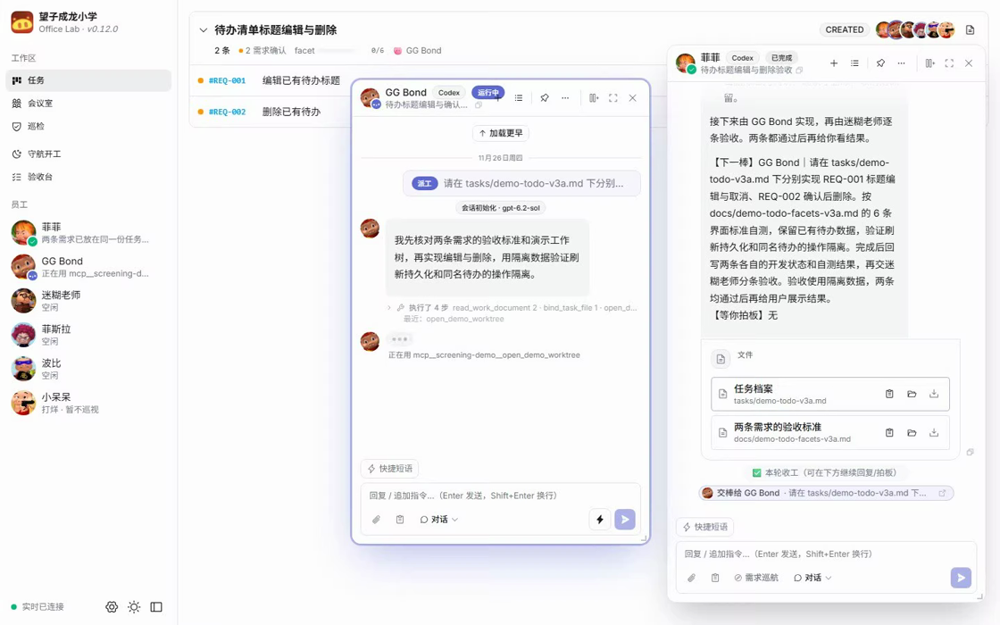
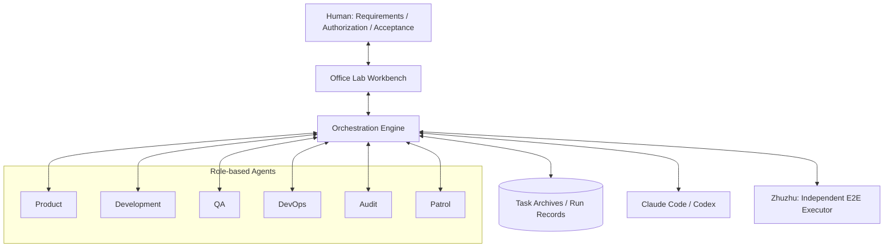

# Office Lab

**A Multi-Agent Engineering Workbench for Verifiable Software Delivery.**

一个面向真实软件交付场景、可在本机运行的多 Agent 研发工作台。

Office Lab 将需求分析、软件开发、质量验证和发布准备交给职责独立的 Agent，通过统一调度引擎、持久化任务档案、确定性质量门禁和人工授权机制，让 AI 的执行过程可追踪、可恢复、可验收。

它起源于真实企业供应链系统的持续迭代实践，而非单纯的多 Agent 演示。

**当前仓库版本：v0.12.0 · Claude Code / Codex · Local-first**


## Demo: Office Lab × 猪猪

[](docs/demo/office-lab-zhuzhu-demo.webm)

[观看演示 / 下载 WebM（3:36，约 4.8 MiB）](docs/demo/office-lab-zhuzhu-demo.webm)

同一份 Todo List 任务里有两条需求：编辑标题、删除前确认。用户在卡片上选定规则后，菲菲把需求交给 GG Bond 开发，再交给迷糊老师用猪猪在真实 Chromium 中执行测试。视频保留了一组故意失败的 RED 校准与按预期操作的 GREEN 执行，以及 6 个验收点逐项回写和最后的任务看板。

- **00:00** 提交两条需求，确认删除规则
- **00:32** 菲菲交接给 GG Bond
- **01:03** 开发交接给迷糊老师
- **01:15** 猪猪启动并操作真实浏览器
- **01:49** 首个 Facet 回写通过
- **03:18** 核对 6/6 覆盖，关闭面板查看两条需求的 QA 状态

这是独立 Todo List 示例的加速录屏。片尾补录了同一任务的 QA 收尾，不包含企业业务数据，也不代表生产发布或公开仓库默认配置下的联合验收。

## Why Office Lab?

当 Code Agent 已经能够编写代码，软件工程面临的问题不再只是如何生成代码：

- 如何让多个 Agent 在独立上下文中持续协作？
- 如何避免需求、开发和测试之间的信息断层？
- 如何证明 Agent 报告的「测试通过」真的成立？
- 如何在人不在场时推进任务，同时限制越权行为？
- 如何在会话中断、模型不可用或执行失败后恢复工作？

Office Lab 不追求让更多 Agent 同时聊天，而是让每个 Agent 承担明确的交付责任，由工程机制约束协作过程，由执行证据支撑交付结论。

## Quick Start

### 1. 安装并启动

准备 Git 和 [Node.js](https://nodejs.org/)，推荐 Node.js 22.12 或更新版本。

```sh
git clone https://github.com/topiniu/office-lab-public.git
cd office-lab-public
```

macOS / Linux：

```sh
OFFICE_LAB_HOST=127.0.0.1 npm start
```

Windows PowerShell：

```powershell
$env:OFFICE_LAB_HOST = "127.0.0.1"
npm start
```

首次启动会按需安装依赖、构建前端并启动调度引擎。

- 新版工作台：[http://127.0.0.1:4700/](http://127.0.0.1:4700/)
- 引擎与兼容版工作台：[http://127.0.0.1:4800/](http://127.0.0.1:4800/)

引擎与旧界面支持 Node.js 18+，新版 UI 需要 Node.js 20.19+（20 系列）或 22.12+。若新版 UI 无法构建，可以使用免构建的兼容界面（仍建议设置本机监听地址）：

```sh
node scripts/bootstrap.mjs --no-web
```

终端启动的实例可按 Ctrl+C 停止。

> **安全提示：** 引擎原版默认监听所有网卡，内置员工默认使用 bypassPermissions，命令和工具以本机用户权限执行。建议首次运行时设置 OFFICE_LAB_HOST=127.0.0.1，并在隔离的、无敏感凭据的工作区中试用，按需调整员工权限。不要直接暴露到公网。

### 2. 配置 Agent 执行基座

| 基座 | 配置方式 |
| --- | --- |
| Claude Code | 按 [Claude Code 设置说明](https://code.claude.com/docs/en/setup) 安装并登录，或在启动终端配置自己的 ANTHROPIC_API_KEY |
| Codex | 安装 [Codex CLI](https://developers.openai.com/codex/cli/)，执行 codex login |

在工作台的「设置 → Agent 基座」中选择默认执行引擎和模型。模型留空时使用相应基座的默认模型；若找不到 Codex，可在设置中指定可执行文件路径。

支持单次派工覆盖默认基座及模型，也支持将未完成的工作交接至另一执行基座继续处理。若遇到 401，请检查相应基座的认证及账号状态；两种基座分别认证。


### 3. 开始第一项任务

点击「派工」，选择产品经理菲菲，输入工作目标，例如：

> 为项目的搜索功能整理需求和验收标准，创建任务档案，并列出需要确认的业务问题。

你可以在工作台查看员工的执行过程、工具调用、任务档案和待决策事项，并继续与员工协作。

首次启动时不包含历史业务任务、员工私人记忆或运行凭证。任务档案写入 `tasks/`，会话及配置写入 `app/runs/`，附件写入 `app/uploads/`。

### 4. 连接自己的项目

Office Lab 可以独立运行，也可以作为其他代码仓库的研发工作台。

```sh
cd /path/to/your/project
git clone https://github.com/topiniu/office-lab-public.git office-lab
cd office-lab
OFFICE_LAB_HOST=127.0.0.1 OFFICE_LAB_WORKSPACE_ROOT=.. npm start
```

Windows PowerShell：

```powershell
$env:OFFICE_LAB_HOST = "127.0.0.1"
$env:OFFICE_LAB_WORKSPACE_ROOT = ".."
npm start
```

员工在指定工作区内开展工作，Office Lab 自身的任务档案、会话和配置仍保存在其目录中。发布和部署遵循目标项目的规则；依赖特定业务仓库的能力需要相应的项目环境。

## Meet the Team

Office Lab 内置六位职责独立的常驻 Agent。

| Agent | 职责 | 主要交付物 |
| --- | --- | --- |
| [菲菲](roles/feifei.md) | 产品经理 | 需求说明、验收标准、需求溯源、发布说明 |
| [GG Bond](roles/ggbond.md) | 全栈开发 | 技术方案、代码、实施记录、自检与交接材料 |
| [迷糊老师](roles/mihu-teacher.md) | QA 工程师 | 测试用例、执行报告、缺陷单 |
| [波比](roles/bobby.md) | DevOps | 仓库变更枚举、合并请求、发布清单 |
| [菲斯拉](roles/feisila.md) | 独立审计 | 质量复核、证据缺口识别 |
| [小呆呆](roles/chaorenq.md) | 巡视员 | 异常停顿诊断、任务续派与协作恢复 |

每位员工拥有独立的角色 SOP、工作上下文和交付责任。跨岗位交接由 Office Lab 调度引擎统一管理，而不是依靠某个 Agent 的私有会话传话。

## Architecture



Office Lab 将系统职责划分为四层：

- **Agent 执行层**：理解需求、修改代码、设计用例及分析异常。
- **调度与控制层**：派工、状态迁移、权限判断、质量门禁和会话恢复。
- **持久化数据层**：任务档案、交接卡、验收标准和运行记录。
- **人机协作层**：可视化工作台、授权配置、运行观测和人工验收。

调度引擎承担确定性的控制职责，模型承担需要理解业务语境的工作。

## Engineering Highlights

### 1. 文件化协作与持久化任务状态

Office Lab 不依赖 Agent 之间共享完整聊天上下文。

Markdown 任务档案保存任务状态、需求条目、验收标准和产物指针；结构化交接卡传递当前结论与下一棒所需的信息；任务快照为新会话或恢复后的会话提供必要上下文。

任务档案作为持久化业务事实源，使协作过程可以被人工阅读、追溯和重新接续。版本作为需求条目的容器，条目独立推进；状态与合法流转遵循文档契约，而不是依赖口头汇报。缺陷修复、增量需求和人工确认拥有不同的回路。

相关实现：[任务快照](app/task-brief.js) · [交接冻结](app/handoff-freeze.js) · [状态及文档契约](文档格式规范.md) · [任务档案模板](templates/task-archive.md)

### 2. Agent Runtime 与多基座适配

调度引擎将 Employee、Run 和底层 Session 分离，管理派工、流式事件、会话续聊、停止、结果交回与跨岗位交接。

当前提供 Claude Agent SDK 和 Codex App Server 两种执行适配器。

切换执行基座时，Office Lab 保留任务身份、协作记录和必要的交接上下文，并在目标基座创建新的底层会话，而非直接复用不同供应商的 Session ID。

相关实现：[调度引擎](app/server.js) · [执行适配层](app/engines/) · [多引擎技术说明](docs/office-lab-v0.12.0-多引擎.md)

### 3. Evidence-based Quality Gates

Agent 自己报告的「通过」，不能直接作为软件交付的可信依据。

Office Lab 将需求拆分为可追踪的验收单元 Facet，由引擎维护覆盖矩阵并核对执行证据：

- 每个验收点具有独立标识及可验证的判据。
- GREEN 证据证明正常场景满足预期；RED 校准检验断言是否能够识别错误结果。
- 证据关联运行编号、用例及运行摘要哈希、提交版本和环境信息。
- 要求 UI 验证的场景不能用单纯 API 验证替代。
- 源码审阅、环境阻断和必须人工验证的事项不冒充自动化通过。

系统同时引入需求溯源与需求质量检查，降低「遗漏需求却取得全量测试通过」的风险。审计提供独立复核视角，但不能替代引擎基于真实证据的判定。

相关实现：[覆盖率与证据门禁](app/coverage.js) · [需求溯源](app/req-trace.js) · [需求分析质量](app/req-quality.js) · [审计](app/audit-trust.js)

### 4. 与独立 E2E 执行器协作

Office Lab 可以与独立项目 [Zhuzhu / Vision E2E](https://github.com/topiniu/vision-e2e-showcase) 协作。

| Office Lab | Vision E2E |
| --- | --- |
| 管理软件交付流程 | 执行浏览器自动化测试 |
| 组织 Agent 协作 | 执行结构化测试用例 |
| 维护验收覆盖矩阵 | 生成截图、报告及证据包 |
| 根据证据计算门禁 | 返回真实执行结果 |

QA Agent 负责设计用例，独立执行器负责实际执行，Office Lab 引擎负责消费证据并计算交付门禁。当执行器不可用或证据不足时，按未验证处理，而不是认定通过。

Vision E2E 是独立项目，不随 Office Lab 默认安装。完整浏览器验证需要另行安装并配置兼容的执行器；上方录屏展示了已配置环境下的独立示例；两个公开仓库的默认配置不等同于开箱即用的联合流程。

相关实现：[E2E 批次调度](app/e2e-batch.js) · [执行器能力适配](app/zhuzhu-capabilities.js)

### 5. Human-in-the-loop & Guarded Execution

Office Lab 支持两种人机协作模式：

**共驾（Co-pilot）**：人在场时，通过工作台持续参与需求澄清、技术决策和人工预检。

**守航（Guarded Run）**：人在不持续参与的情况下，通过预先定义的守航契约约束任务范围、授权动作、预算、截止时间和禁止操作。

守航模式允许 Agent 在授权范围内持续推进可逆工作，并通过巡视和恢复机制处理部分异常停顿。生产发布、生产数据库迁移、真实外部发送等不可逆操作应保留明确的人工授权边界。

相关实现：[守航契约](app/guard-ledger.js) · [门禁矩阵](app/gate-matrix.js) · [停顿检测](app/stall-guard.js) · [人工验收卡](app/acceptance-card.js) · [发布对账](app/release-chain.js)

## Workbench

当前工作台已提供：

- 可视化任务看板与需求条目状态。
- 六位员工的独立会话及实时执行观测。
- 派工、交接、工具审批与会话续聊。
- Claude Code / Codex 模型与执行基座管理。
- 验收覆盖矩阵、守航设置和人工验收入口。
- 可选的企业微信、飞书、手机推送和 E2E 执行器集成。
- Windows 托盘常驻、服务管理及整机迁移工具。

前端使用 React、TypeScript、Vite 和 shadcn/ui，调度引擎基于 Node.js。详见[应用文档](app/README.md)。

### Windows 托盘与迁移

首次安装完成后停止终端实例，双击 `tray/启动托盘.cmd`。托盘提供服务启停、重启、日志、开机自启和 WebView2 悬浮窗。完整说明见[托盘文档](tray/README.md)。

在源 Windows 机器停止工作台后执行打包，将包带到新机器，再执行包内的恢复脚本。完整包保留代码和数据，`-DataOnly` 提供数据迁移模式。

```powershell
powershell -NoProfile -ExecutionPolicy Bypass -File scripts/迁移打包.ps1 -Dest D:\ol-migrate -SkipNodeModules
powershell -NoProfile -ExecutionPolicy Bypass -File D:\ol-migrate\迁移恢复.ps1 -SkipWecom
```

迁移包可能包含本机任务、会话和私人设置，应自行妥善保管，不要提交至公共仓库。macOS / Linux 当前使用前台启动方式。

## Verification

### Office Lab v0.12.0

根据 2026-10-23 的历史发布验证记录：

| 验证项目 | 结果 |
| --- | --- |
| 引擎自动化回归 | 971/971 通过 |
| Windows 托盘测试 | 22/22 通过 |
| TypeScript 检查 | 通过 |
| Vite 生产构建 | 通过 |

v0.12.0 开发验收另外覆盖 Claude 和 Codex 的真实协议调用、工具调用、连续对话、冷恢复、取消和跨基座交接等场景。

详细记录见 [v0.12.0 多引擎技术与验证记录](docs/office-lab-v0.12.0-多引擎.md)。

在本地执行：

```sh
npm test
npm run doctor
```

Windows 托盘测试：

```powershell
npm run test:tray
```

执行基座协议检查：

```sh
node scripts/check-engine.mjs codex
```

真实模型及工具调用检查（需要有效认证，可能产生模型使用费用）：

```sh
node scripts/check-engine.mjs codex --live --tools
node scripts/check-engine.mjs claude --live --tools
```

上述数字是历史发布验证结果，并非此次 README 更新重新执行的结果，也不等同于完整企业业务流程验收。

### Independent E2E Verification

关联项目 Vision E2E v1.11.3 于 2026-11-19 完成独立验证：

- 748/748 项自动化回归通过。
- 真实 Chromium 正例通过、故意设置错误期望的反例失败。
- 两份运行证据包与截图校验通过。
- macOS ARM64 目录打包及启动检查通过。

可在 [Vision E2E 独立展示仓库](https://github.com/topiniu/vision-e2e-showcase) 中运行其本地演示，详见[独立验证记录](https://github.com/topiniu/vision-e2e-showcase/blob/main/docs/verification.md)。

以上是 Vision E2E 自身的验证成绩，不计入 Office Lab 的自动化测试结果，也不代表两个公开仓库的联合业务流程已经完成验收。

## Lessons from Real-world Delivery

Office Lab 在 2026 年的企业供应链软件研发实践中持续演进。以下案例来自历史业务迭代，版本号为被交付业务系统的版本号，而非 Office Lab 版本号。

| 历史实践 | 工程意义 |
| --- | --- |
| v5.17：34 个历史验收点经新门禁重新计算，有效机签为 0，其中 6 项另缺 RED 校准 | 拒绝缺少可靠证据的历史通过结论；不意味着出现了 34 个缺陷 |
| 38/38 已登记验收点机签通过后，人工仍发现原始需求遗漏 | 测试覆盖率不等于需求完整性 |
| v6.0.0：三轮守航推进 9 条核心需求和 33 项界面打磨，最后一轮 QA 会话约 15 小时 | 受约束的长时间自主协作实践 |
| 同一版本保留 23 项因权限账号缺失而阻断的验收点 | 未验证事项必须显式暴露，而非伪造通过 |
| v6.0.0 上线后部分功能被业务负责人否定，下一版本恢复旧流程 | 技术正确性不能替代真实用户价值 |

这些实践推动了 Office Lab 从角色分工工具逐步演进为包含需求追踪、机器质量门禁和人工控制机制的研发工作台。

相关原始企业业务数据、账号和历史运行产物不随公开仓库分发。因此上述案例属于作者的历史实践记录，不是公开可复现基准，也不构成生产效率或任务成功率承诺。

## Repository Structure

```text
office-lab-public/
├── app/               # 调度引擎、运行时及质量门禁
│   ├── engines/       # Agent 执行基座适配
│   ├── public/        # 兼容版工作台
│   └── test/          # 自动化测试
├── web/               # React / TypeScript 工作台
├── roles/             # 六位员工的角色 SOP
├── .claude/agents/    # Agent 工牌
├── templates/         # 任务档案及结构化交付模板
├── docs/              # 架构、设计与技术演进
├── scripts/           # 启动、检查及迁移工具
└── tray/              # Windows 托盘组件
```

## Scope & Limitations

Office Lab 是以本机工作区为中心的研发工作台，并非完整的多租户企业 SaaS 或无人监督生产发布平台。

公开版保留六份角色 SOP、六份 Agent 工牌、模板、调度引擎、审计巡视、技术文档、演进记录、托盘组件及迁移工具。业务标识以示例代替，历史任务、员工记忆、会话、附件及本地凭证从空状态开始。

使用前需要注意：

- 模型认证及第三方服务需由使用者自行配置。
- Claude Code 与 Codex 的原生工具及权限机制并不完全等价。Codex 不执行 Claude 专属 hooks，依赖这些 hooks 的流程应选用 Claude。
- 引擎默认监听所有网卡，建议设置 `OFFICE_LAB_HOST=127.0.0.1` 限制本机访问。
- 原版员工默认使用 `bypassPermissions`。角色 SOP、守航契约和宿主工具门禁不等同于完整的操作系统沙箱。
- 不承诺 Agent 一定正确理解需求，也不将测试通过等同于产品成功。

## Documentation

- [应用与运行机制](app/README.md)
- [文档索引](docs/README.md)
- [技术演进与复盘](docs/office-lab-技术演进与复盘.md)
- [多引擎设计与验证](docs/office-lab-v0.12.0-多引擎.md)
- [任务档案及文档契约](文档格式规范.md)
- [早期流程与职责分工复盘](复盘-示例项目v1到v5.10流程提纯.md)
- [技术深度剖析](docs/interview-preparation/technical/office-lab-project-deep-dive.md)
- [版本变更记录](CHANGELOG.md)

## About

Office Lab 是一项持续演进的 AI 软件工程实践，由项目作者负责架构设计、工程机制制定、系统演进及真实业务交付验证，并借助 Code Agent 完成大量代码实现。

它探索的不只是 AI 能否编写软件，而是当越来越多的软件研发工作交给 AI 后，如何让交付过程仍然可控、可验证、可追责。

问题与建议欢迎通过 [GitHub Issues](https://github.com/topiniu/office-lab-public/issues) 反馈。
