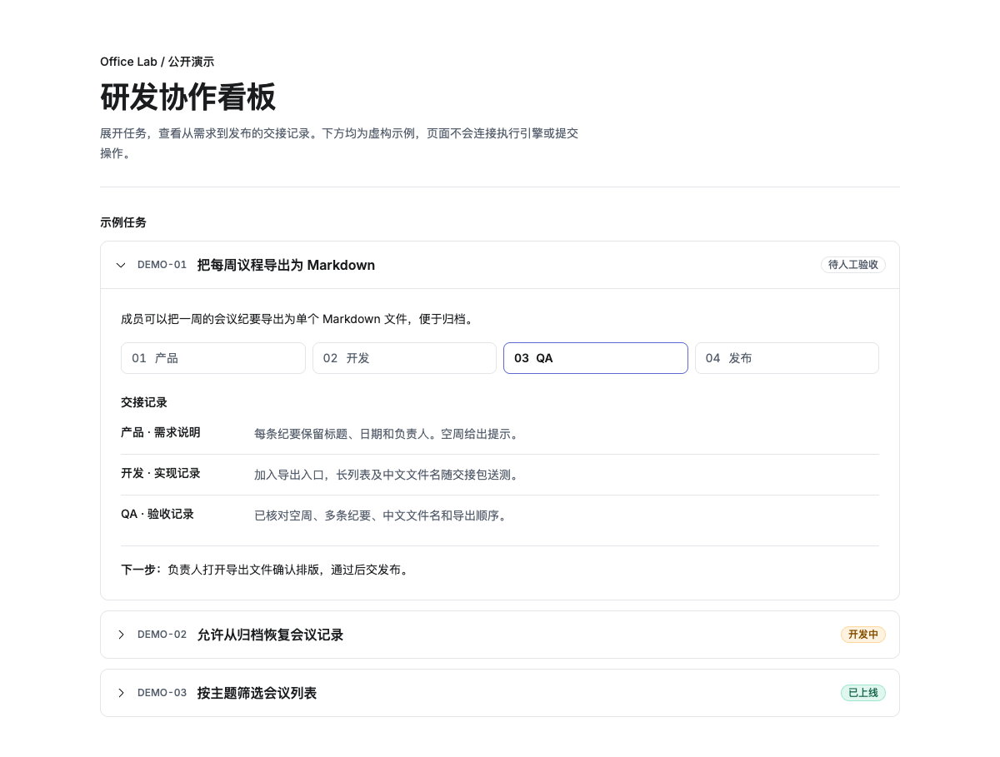

# Office Lab

Office Lab 是一个按职责组织 AI Agent 的研发协作工作台。产品整理需求和验收标准，开发提交实现记录，QA 留下验证结果，发布角色准备上线清单。一份任务档案记录当前阶段、已交付的产物和下一步，方便团队接手，也方便负责人判断是否可以继续。

**[打开在线演示](https://topiniu.github.io/office-lab-public/)** · [本地运行](#本地运行) · [查看引擎源码](#引擎模块)



公开版包含**可直接浏览的静态看板**和**可独立测试的引擎模块**。完整工作台另提供真实派工、任务状态更新和人工审批入口。

## 打开演示后做什么

演示无需登录，使用三条虚构任务。展开卡片即可查看任务目标、当前阶段、交接记录和下一步。

1. 打开 **DEMO-01 · 把每周议程导出为 Markdown**。QA 已记录验证结果，接下来由负责人打开导出文件确认排版。
2. 对比 **DEMO-02 · 允许从归档恢复会议记录**。任务仍在开发中，卡片列出了交给 QA 之前要说明的权限与重复点击场景。
3. 打开 **DEMO-03 · 按主题筛选会议列表**。已上线的任务保留了从需求说明到上线检查的完整交接记录。

## 适合解决什么问题

如果你已经让 Claude Code 或 Codex 参与研发，并且需要在不同会话之间交接需求、实现和测试，可以用 Office Lab 的工作方式给每个阶段定义输入、交付物和验收标准。

| 阶段 | 交给下一位的内容 |
| --- | --- |
| 产品 | 需求范围、验收标准和待决事项 |
| 开发 | 代码改动、实施记录和送测说明 |
| QA | 测试结果、验证证据和未通过项 |
| 发布 | 上线检查清单和发布记录 |

完整工作台把任务档案保存在 Markdown 文件里。每一棒从档案和上一阶段的产物接手，交接时把结果写回档案。流程根据验收标准和执行证据判断任务能否继续，负责人确定需求并做最终验收。

想在自己的项目里先试一次，可以为下一个需求建一份 Markdown 档案，记录**验收标准、当前负责人、产物路径、验证结果和下一步**。让接手的人从这份档案开始，每次交接更新同一份文件。

## 本地运行

需要 Git、Node.js 22.12 或更新版本和 pnpm 10。在终端执行以下命令。

```bash
git clone https://github.com/topiniu/office-lab-public.git
cd office-lab-public
pnpm --dir web install --frozen-lockfile
pnpm --dir web build
pnpm --dir web exec vite preview --config vite.demo.config.ts --host 127.0.0.1 --port 4173 --strictPort
```

浏览器打开 [http://127.0.0.1:4173/](http://127.0.0.1:4173/)。本地演示使用内置数据，首次运行无需配置模型账号。要换成自己的示例任务，可以编辑 [`web/demo/fixtures.ts`](web/demo/fixtures.ts) 后重新构建。

## 引擎模块

| 源码 | 用途 |
| --- | --- |
| [`app/engines/index.js`](app/engines/index.js) | 注册 Claude 和 Codex 执行适配器，统一运行事件格式 |
| [`app/engines/handover.js`](app/engines/handover.js) | 切换执行引擎时保留任务标识，把已有上下文交给新会话 |
| [`app/run-subs.js`](app/run-subs.js) | 通过同一 SSE 连接订阅不同会话的事件 |
| [`app/user-input.js`](app/user-input.js) | 让执行过程等待用户选择或补充信息，并接收回复 |

测试使用本地夹具，可以直接运行。实际调用模型时，由宿主安装并配置 Claude Agent SDK 或 Codex CLI。

```bash
npm ci --prefix app
npm test --prefix app
```

## 托管与反馈

演示构建产物位于 `web/dist-demo/`，可部署到静态站点。使用 GitHub Pages 时，在仓库 **Settings → Pages** 中选择 **GitHub Actions**，由 [Pages 工作流](.github/workflows/pages.yml) 测试、构建并发布。

体验过程中遇到问题，欢迎在 [GitHub Issues](https://github.com/topiniu/office-lab-public/issues) 记录操作步骤、预期结果和实际结果。
