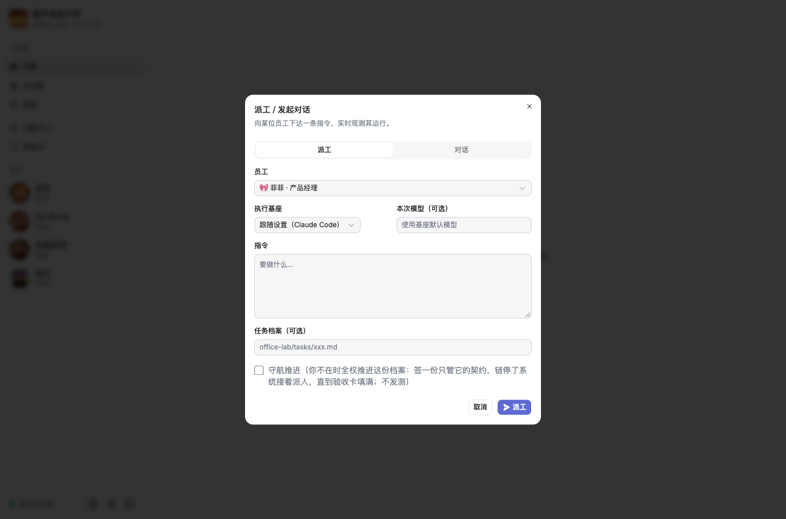

# Office Lab

Office Lab 是一个可在自己电脑上运行的多 Agent 研发工作台。产品、开发、QA、发布、审计和巡视六位员工各有职责和完整 SOP。看板显示每项工作的进度、验证结果和待你决定的事项。你可以打开员工会话、派工、跟进交接并做最终验收。


## 安装并启动

准备 Git，建议使用 [Node.js](https://nodejs.org/) 22.12 或更新版本。引擎和旧界面沿用原版 Node.js 18+ 支持，新界面需要 Node.js 20.19+（20 系列）或 22.12+。`node scripts/bootstrap.mjs --no-web` 可使用原版旧界面。在终端执行以下命令。

```sh
git clone https://github.com/topiniu/office-lab-public.git
cd office-lab-public
npm start
```

首次启动会安装依赖并构建前端。新界面打开 [http://127.0.0.1:4700/](http://127.0.0.1:4700/)，引擎与旧界面位于 [http://127.0.0.1:4800/](http://127.0.0.1:4800/)；停止时在终端按 Ctrl+C。

## 配置模型，开始第一项工作

1. 任选一个执行引擎并在运行 Office Lab 的电脑上完成认证。
   - **Claude Code**：按 [Claude Code 设置说明](https://code.claude.com/docs/en/setup) 安装并登录，或在启动 Office Lab 的终端设置自己的 `ANTHROPIC_API_KEY`。
   - **Codex**：安装 [Codex CLI](https://developers.openai.com/codex/cli/)，执行 `codex login`。
2. 打开 **设置 → Agent 基座**，选择默认引擎及模型。模型留空时使用该引擎的默认模型。Codex 找不到时，在设置中填写可执行文件路径。
3. 点击 **派工**，选择员工并说明目标。例如，给菲菲发一条「为项目的搜索功能整理需求和验收标准，建一份任务档案」。可在会话中查看结果、继续补充要求或拍板。

如果会话提示模型服务返回 401，请检查所选引擎的登录状态和账号可用性，再重新派工。两个引擎分别认证。



首次启动时，任务和会话为空。内置员工包括菲菲（产品）、GG Bond（开发）、迷糊老师（QA）、波比（发布）、菲斯拉（教导主任／审计）和小呆呆（巡视）。任务档案写入 `tasks/`，会话及配置写入 `app/runs/`，附件写入 `app/uploads/`。

## 连接自己的项目

直接启动时，员工在 Office Lab 仓库中工作。要让员工访问其他项目，可把 Office Lab 克隆到项目目录下，并在启动时显式将该目录设为工作区根。

```sh
cd /path/to/your/project
git clone https://github.com/topiniu/office-lab-public.git office-lab
cd office-lab
OFFICE_LAB_WORKSPACE_ROOT=.. npm start
```

Windows PowerShell 中用 `$env:OFFICE_LAB_WORKSPACE_ROOT = '..'`，再执行 `npm start`。任务档案和配置仍保存在 Office Lab 目录内。发布和部署按目标项目的规则执行。

## 工作台功能

- **任务看板**显示 Markdown 任务档案、需求条目、负责人、覆盖情况及下一步。
- **员工会话**提供实时输出、继续对话、工具审批和跨引擎会话交接。
- **守航与验收台**用于安排一轮工作，查看验收证据及待人工决策事项。
- **可选集成**可在自己的环境配置企微、飞书、手机推送和兼容的 E2E 执行器。私人连接配置为空，功能开关沿用原版，在设置中填写自己的连接信息。

工作台沿用原版网络监听与员工权限配置。引擎默认监听所有网卡，设 `OFFICE_LAB_HOST=127.0.0.1` 可仅允许本机连接。默认员工权限为 `bypassPermissions`，命令和工具以本机用户权限执行，可在员工设置中调整。

## Windows 托盘与迁移

Windows 首次安装完成后，停止终端实例，双击 `tray/启动托盘.cmd`。托盘提供服务启停、重启、日志、开机自启和 WebView2 悬浮窗。完整说明见 [托盘文档](tray/README.md)。macOS/Linux 使用 `npm start`。

在源 Windows 机器停止工作台后执行打包，把包带到新机器，再执行包内的恢复脚本。完整包保留代码和数据，`-DataOnly` 提供数据迁移模式。

```powershell
powershell -NoProfile -ExecutionPolicy Bypass -File scripts/迁移打包.ps1 -Dest D:\ol-migrate -SkipNodeModules
powershell -NoProfile -ExecutionPolicy Bypass -File D:\ol-migrate\迁移恢复.ps1 -SkipWecom
```

迁移包包含本机任务、会话和私人设置，应由使用者自行保管。迁移脚本包含全部原版参数和恢复能力。

## 公开范围

保留原版六份角色 SOP、六份 Agent 工牌、全部模板、调度引擎、审计巡视、技术文档、演进记录、托盘组件及迁移工具。业务名称、内网地址、账号标识和私人资源标识替换为示例。历史任务、员工记忆、会话、附件及本地凭证从空状态开始，第三方服务由用户自行配置。Windows 与跨平台启动使用同一套应用和任务协议。

```sh
npm test
node scripts/bootstrap.mjs --doctor
```

问题可在 [GitHub Issues](https://github.com/topiniu/office-lab-public/issues) 反馈。

---

# Office Lab —— 职责 Agent 工作规范原型

> 蓝本：`docs/示例项目需求/` v1 → v5.10 的完整迭代史（逆向复盘见 [`复盘-示例项目v1到v5.10流程提纯.md`](复盘-示例项目v1到v5.10流程提纯.md)）。
> 目标：把开发 / QA / DevOps 三个职责提纯为独立 agent，先以「三个 Claude Code 会话 + 文件化交接」运转，后续演进为 office lab 统一编排。

## 三个角色

| 角色 | 岗位 | 核心产物 | SOP |
|------|------|---------|-----|
| **菲菲** | 产品经理 | 需求说明与验收标准、版本发布说明、CHANGELOG、权限变更记录 | [`roles/feifei.md`](roles/feifei.md) |
| **GG Bond** | 全栈开发 | 需求确认文档（技术确认）、实施记录、代码、RELEASE_CHECKLIST 开发段、对抗性自查、人工预检单（引导） | [`roles/ggbond.md`](roles/ggbond.md) |
| **迷糊老师** | 专业 QA | 测试用例(上线前必过)、猪猪 E2E 用例、QA 结果报告、缺陷单 | [`roles/mihu-teacher.md`](roles/mihu-teacher.md) |
| **波比** | DevOps / 发布 | 仓库枚举与部署清单、MR、SQL 交付执行、上线后收尾 | [`roles/bobby.md`](roles/bobby.md) |

## 目录结构

```
office-lab/
├── README.md                  # 本文件（流程与状态机）
├── 文档格式规范.md              # ★ 唯一格式事实源：文档体系导览 + 命名 + 机器可解析契约
├── 复盘-示例项目v1到v5.10流程提纯.md   # 逆向复盘：产物链演进、职责切分依据
├── roles/                     # 角色 SOP（红线 + 阶段门禁 + 交付物 + 规范指针）
├── templates/                 # 任务档案、交接卡、各文档骨架模板
│   ├── task-archive.md        # 任务档案（frontmatter 状态机）
│   ├── handoff-pm-to-dev.md   # 菲菲 → GG Bond 需求卡
│   ├── handoff-dev-to-qa.md   # GG Bond → 迷糊老师 交接卡
│   ├── handoff-qa-to-devops.md# 迷糊老师 → 波比 交接卡
│   ├── pm-*.md / dev-*.md / qa-*.md / devops-*.md   # 各类版本文档骨架
├── memories/                  # 角色专属教训库（按角色拆分，持续追加）
└── tasks/                     # 任务档案实例（一任务一文件）
```

## 任务生命周期状态机

> **版本是条目的容器**：每个需求/插单/bugfix 是一个条目，各自独立走"菲菲→GG Bond→迷糊老师"的小循环（条目状态记在任务档案「需求条目登记表」）；版本状态 = 最落后条目的聚合态。下图是单条目视角的主流程。
>
> **条目状态是严格状态机、登记表即唯一事实源**：每条目的「状态」列只能取 `文档格式规范.md` §3.4 的枚举，其**语义/合法流转/一致性规则**（尤其 **`人工Pass`（免 QA 终态）≠ `待测`（预检通过、仍要进 QA）**，以及「哪些条目可进 QA」= `状态∈{待测,待QA,已开发}`）均以 §3.4「状态机语义与流转」为准。**推进条目看登记表状态、不看口头**——一句「预检通过」在多条并行待检时指代不清（v5.15 REQ-0241 被误标 `人工Pass` 搁浅、迷糊只测一个需求点，即此坑）。

```
CREATED
  └─ 菲菲 ────────────────────────────────────────────────
     PM_INTAKE           原始需求结构化 →《需求说明与验收标准》草稿（含 facet 表）
       └─ ①.5 业务澄清（老板第一次介入）：与老板聊清业务待澄清 → 口径定稿 + 冻结需求快照
       └─ ①-plus 三方会审（新功能版硬门禁）：技术/测试与菲菲详细聊「设计与实现」，多轮到对齐
                          （在业务澄清冻结之后、会审结果拍板之前；templates/三方会审-开工前体检.md）
     PM_WAITING_CONFIRM  会审结果呈老板拍板（老板第二次介入），结论回写（只拍会审新暴露的设计/实现/可测性口径）
     HANDOFF_TO_DEV      任务卡推进就绪态 + 产出需求卡（templates/handoff-pm-to-dev.md）→ 交棒 GG Bond
  └─ GG Bond ──────────────────────────────────────────────
     DEV_UNDERSTANDING   技术确认：业务口径引用菲菲文档，补 DDL/权限/性能/基线核查
     DEV_WAITING_CONFIRM 待用户拍板「待确认事项」
     DEV_IMPLEMENTING    编码 + 实施记录滚动更新
     DEV_SELF_CHECK      性能/权限/testid/数据流 四项自检 + 回填 RELEASE_CHECKLIST
     DEV_ADVERSARIAL_SWEEP 对抗性 bug 自查（红队视角打自己代码：边界/异常/并发/越权/状态机/回归）
     HANDOFF             产出交接卡 + 人工预检单（引导半张）；收工 gate【等你拍板】人工预检
  └─ 老板（人工预检门）────────────────────────────────────
     HUMAN_PRECHECK      老板亲眼过 UI/UX + 明显 bug（跑起来看，据人工预检单引导）；只记现象、不分类
                         ├─ 通过（无发现）─→ GG Bond 才【下一棒】迷糊（交 QA）
                         └─ 有发现 ────────→【下一棒】菲菲单口分诊（判缺陷/变更、按需更新 facet）
                                             → 合并需求卡增量 → GG Bond 处理 → 重走预检
  └─ 迷糊老师 ─────────────────────────────────────────────
     QA_CASE_DESIGN      测试用例文档（读源码，不臆造）
     QA_AUTOMATION       猪猪 JSON：validate → headless 迭代 → RED 校准 → App-run 终验
     QA_ANALYZING        结果报告 + 缺陷单（只报事实）
     QA_FAILED ──→ 回 GG Bond（带缺陷单，修复后回 QA_AUTOMATION 验证 RED→GREEN）
     QA_PASSED / HANDOFF_TO_DEVOPS   产出交接卡（templates/handoff-qa-to-devops.md）
  └─ 波比 ────────────────────────────────────────────────
     DEVOPS_ENUM         逐仓库枚举改动，产出部署服务清单
     DEVOPS_TEST_RELEASE 发测试：DDL → MR(→master, 显式 target) → 部署
     DEVOPS_PROD_RELEASE 发线上：确认 master 已含提交 → MR(→release)
     POST_RELEASE        权限配置确认、验证 SQL、分支清理建议 → 通知菲菲
  └─ 菲菲 ────────────────────────────────────────────────
     PM_RELEASE_NOTES    版本发布说明 + CHANGELOG + 权限变更记录 + 微信发版通知文案
  └─ 波比 ────────────────────────────────────────────────
     DOCS_PUBLISH        本版全部文档变更 commit + push master（docs(sampling): v<版本> 发布——…）
DONE
```

**插单回边**：版本进行中冒出的小需求/bugfix → 菲菲插单 intake（登记条目 + 归属判定，用户拍板）→ 并入则版本回 DEV_IMPLEMENTING 条目级推进（已 PASSED 条目不清零，按 GG Bond 影响面声明做增量回归）；波比封板（`frozen: true`）后默认排下一版本。QA 测出的 bug 走缺陷单闭环，不算插单。

状态与门禁记录在任务档案的 YAML frontmatter 里（见 `templates/task-archive.md`），未来 office lab UI 直接 parse frontmatter 渲染看板。

## 员工交流流程图与交接依赖物

### 主流水线（消息载体全部落文件，不靠口头/聊天记录）

```
              (1)派活：建任务档案 + 原始需求位置
  你（老板）────────────────┐
                           ▼
  原始需求 ──▶ ┌──────┐  需求卡   ┌─────────┐  交接卡   ┌──────────┐  交接卡   ┌──────┐  上线通知  ┌──────┐
  (PRD/Excel) │ 菲菲  │ ───────▶ │ GG Bond │ ────────▶ │ 迷糊老师  │ ────────▶ │ 波比  │ ────────▶ │ 菲菲  │ ─▶ DONE
              └──────┘ handoff-  └─────────┘ handoff-  └──────────┘ handoff-  └──────┘           └──────┘
               需求说明  pm-to-dev  需求确认+   dev-to-qa   用例+JSON+  qa-to-     枚举+MR+          发布三件套
               +验收标准            实施记录+              结果报告+   devops     部署+收尾          (发布说明/
               (facet表)           代码+SQL               缺陷单                                   CHANGELOG/
                                                                                                  权限变更记录)

  ▲ GG Bond → 迷糊老师 之间有一道【人工预检】门（老板亲眼过 UI/UX + 明显 bug）：
    GG Bond 开发+自检+对抗性自查完 → 出交接卡+人工预检单 →【等你拍板】人工预检 → 老板亲验：
      · 通过（无发现）→ GG Bond 才【下一棒】迷糊（别用最贵的猪猪自动化去发现一眼可见的问题）
      · 有发现 →【下一棒】菲菲单口分诊：她判缺陷/变更、按需更新 facet、合并成需求卡增量给 GG Bond → 重走预检
    老板只记现象不分类——缺陷 vs 变更由 facet 主人菲菲判（业内 UAT→PM 分诊→开发的标准分工）；GG Bond 不接散单、不自行吸收变更。

  ══════════════════ 任务档案 tasks/<任务>.md = 唯一状态总线 ══════════════════
  （每个员工开工先读、收工必写：frontmatter 状态/门禁、需求条目登记表、产物指针、时间线）
```

### 三条回路（触发条件明确，不是自由往返）

```
① 缺陷回路（流水线内置，不过菲菲、不占条目编号）
   迷糊老师 ──缺陷单(只报可观测事实)──▶ GG Bond ──修复段回填──▶ 迷糊老师 ──RED→GREEN──▶ 关单

② 复核回路（软检查，只提意见不卡流程）
   迷糊老师 ──测试用例文档──▶ 菲菲(对照facet表轻复核) ──意见──▶ 任务档案时间线

③ 插单回路（迭代中途冒出的小需求/新要求）
   任何来源（含【人工预检】暴露的需求/重大UX变更）──▶ 菲菲 intake(登记条目+facet) ──归属三选一──▶ 你拍板
                 ├─ 并入本版 ──需求卡增量──▶ GG Bond(同分支追加,带影响面声明) ──▶ 迷糊老师(增量回归)
                 ├─ 排队下一版本
                 └─ 线上急修 ──▶ 独立 hotfix 版本走完整小流水线
   （波比封板 frozen:true 后，并入需你特批；提 release MR 后一律不并入）
```

### 你（老板）的固定介入点（6 个，其余环节自动流转）

| # | 介入点 | 谁找你 | 你要做什么 |
|---|--------|--------|-----------|
| 1 | 派活 | 你发起 | 建任务档案，指原始需求位置给菲菲 |
| 2 | 业务拍板 | 菲菲 | 回答需求说明的待确认事项、插单归属三选一 |
| 3 | 技术拍板 | GG Bond | 回答技术类待确认事项（业务类他会退回菲菲） |
| 4 | 人工预检 | GG Bond | 据人工预检单跑起来/看图，一眼过 UI/UX + 明显 bug；只记现象不分类——通过则放行交迷糊，有发现则【下一棒】菲菲分诊 |
| 5 | 发布确认 | 波比 | merge / 生产部署 / 分支清理——他只准备不执行 |
| 6 | 验收 | 菲菲 | 读版本发布说明，确认任务 DONE |

### 交接依赖物明细表

| 交接 | 消息载体 | 接收方另需读取的依赖物 | 接收方产出 |
|------|---------|----------------------|-----------|
| 你 → 菲菲 | 任务档案（新建） | 原始需求（PRD/Excel/截图） | 需求说明与验收标准（facet 表） |
| 菲菲 → GG Bond | `handoff-pm-to-dev` 需求卡 | 需求说明与验收标准 | 需求确认文档（技术段）、代码、实施记录、release SQL、CHECKLIST 开发段回填、**人工预检单（引导半张）** |
| GG Bond → 老板（人工预检门） | `人工预检单`（引导半张）+【等你拍板】人工预检 | 跑起来的改动 / 关键页面 | 预检结论：通过→放行 GG Bond 交迷糊；有发现→【下一棒】菲菲分诊（填人工预检单发现清单） |
| 老板 → 菲菲（有发现时） | `【下一棒】菲菲` + 人工预检单发现清单 | facet 表、需求确认文档 | 分诊（缺陷/变更）、按需更新 facet、合并需求卡增量 → GG Bond |
| GG Bond → 迷糊老师（**经人工预检通过后**） | `handoff-dev-to-qa` 交接卡（含门禁自检声明+影响面声明+人工预检已通过） | facet 表、需求确认文档、实施记录、testid 注册表、人工预检单、**最新源码** | 测试用例文档、猪猪 JSON、QA 结果报告、缺陷单、CHECKLIST 缺陷/冒烟段回填 |
| 迷糊老师 → 波比 | `handoff-qa-to-devops` 交接卡（QA 判定+前置技术债） | QA 结果报告、缺陷单目录、RELEASE_CHECKLIST（审计回填完整性） | 仓库枚举、部署服务清单、MR、DDL 交付执行、上线收尾 |
| 波比 → 迷糊老师 | 测试部署完成通知 | 部署清单 | 上线冒烟结果（回填 CHECKLIST） |
| 波比 → 菲菲 | 上线完成通知 | **需求条目登记表**（防漏底账）+ 三来源（原始需求/需求确认/实施记录） | 版本发布说明、CHANGELOG 条目、权限变更记录条目 |

> **格式一律以 [`文档格式规范.md`](文档格式规范.md) 为准。** 各文档/交接卡的 frontmatter、命名、章节结构，以及「页面中间的任务档案卡由 `tasks/*.md` frontmatter + 三个承重章节实时渲染」等机器可解析契约，都在那份规范里；本文件只讲流程与状态机。

## 设计原则（三条，不许破）

1. **指针，不复制。** 角色文件只写职责边界、门禁、模板和红线一句话；规范正文永远指向唯一事实源（`agents.md`、`CLAUDE.md`、`docs/e2e-test-case-generation-rules.md`、testid 注册表等）。复制 = 制造会腐烂的副本。
2. **交接卡传文件指针 + 摘要，不传正文。** 下游自己去读权威文档；卡上只承载改动摘要、风险点、门禁自检声明。
3. **任务档案是唯一状态源。** 每个角色开工前先读任务档案，收工时回写状态、产物链接和时间线。

## Office Lab 应用（推荐入口）

```bash
node scripts/bootstrap.mjs      # 一条命令：装依赖 → 构建新 UI → 起引擎 → 开浏览器（Windows / macOS / Linux 通用）
```

首次跑会装依赖（引擎需 `@anthropic-ai/claude-agent-sdk` 与 `zod`，Node 18+）。装好后想直起引擎：`node app/server.js` → http://127.0.0.1:4800 （引擎 API + 旧 UI；新 shadcn UI 在 4700）。只体检不启动：`node scripts/bootstrap.mjs --doctor`。

**两种部署形态**（引擎自动探测，启动日志第二行会打出来）：嵌在 monorepo 下 → 员工工作树 = monorepo 顶层，兄弟仓能力（后端构建/发布枚举/UI 契约）可用；单独 clone 本仓 → 工作树 = 本仓根，兄弟仓能力自动跳过、其余照常。需要手工指定时用 `OFFICE_LAB_WORKSPACE_ROOT`。

任务看板（frontmatter 渲染 + 等拍板待办）· 员工派工（headless 拉起，流式观测）· 收工后直接回复/拍板（同会话续聊）。产物仍在仓库文件里，应用只做调度与观测，详见 [`app/README.md`](app/README.md)。

## 备用方式（终端多会话）

1. 从 `templates/task-archive.md` 复制一份到 `tasks/<日期>-<任务名>.md`，填基本信息。
2. 开一个会话给菲菲，开场喂三样：`roles/feifei.md` + 任务档案路径 + 原始需求位置；她产出需求说明与验收标准并组织你拍板。
3. 菲菲的需求卡 + `roles/ggbond.md` 喂给开发会话；GG Bond 走完产出交接卡后，卡 + `roles/mihu-teacher.md` 喂给 QA 会话；QA→波比同理。
4. 波比上线收尾后通知菲菲回来写发布三件套（版本发布说明/CHANGELOG/权限变更记录），任务才 DONE。
5. 每次角色收工，由该角色回写任务档案的 frontmatter 状态与时间线。

> **前台（外层会话）调度纪律**：在 supervisor 建成之前，外层会话充当前台调度器——员工（subagent）之间无法直接通信是 Claude Code 的架构事实，衔接由前台完成，这是设计内的。但前台有"三不"：
> 1. **不转述产物内容**——只传任务档案/交接卡的**路径**和"该谁接棒"，下游员工一律读文件原件（二手转述会引入失真，且绕过了交接卡的门禁声明）；
> 2. **不代员工干活**——探索代码、写实现、写用例都由对应员工在自己的会话里做，前台替开发跑 Explore 再喂结论 = 员工吃了不带出处的二手事实；
> 3. **不代用户拍板**——员工的"等拍板事项"原样呈给用户。

## 下一步

- [ ] 用下一个真实小版本（v5.10.x 或 v5.11）按本流程完整跑一遍，暴露交接卡缺的字段和卡壳的门禁。
- [ ] 跑通后再定 office lab 的数据结构与 UI。
