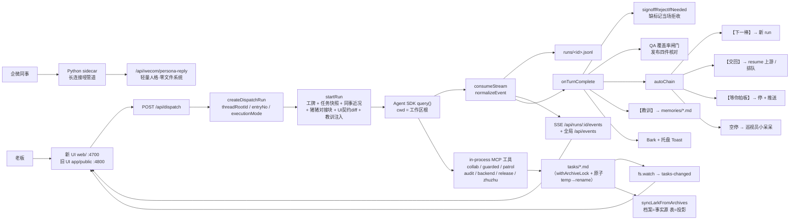
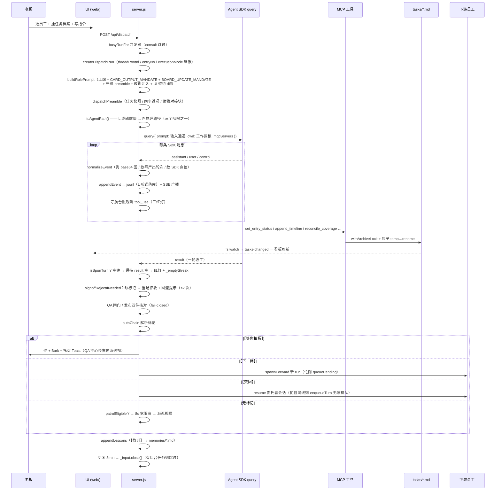

# office-lab 深度项目剖析

> **文档基线**：`app/package.json` **0.10.0**（git tag 最新 `v0.9.0`，0.10.0 内容仍在 CHANGELOG `[Unreleased]`）；全量单测 **449/449**；最后核对日期 **2026-08-31**。
> **口径**：本文所有「已实现」都指向具体文件；所有「不足」都写明**残留面**而非只写方向。机制取舍的权威记录在 [`../../tech/**`](../../tech/)，本文是它的**结构化提炼 + 讲解版**，不复制正文。

---

## 1. 项目一句话介绍

office-lab（对外名「望子成龙小学」）是一个**面向真实企业代码库的 AI 数字员工编排工作台**：六个有明确职责与红线的角色 agent（产品经理 / 全栈开发 / 专业 QA / 教导主任 / DevOps / 巡视员），以**仓库里的 Markdown 任务档案**为唯一状态总线、以**收工汇报里的机器标记**为交接协议，由一个 Node 引擎负责会话生命周期、自动接棒、健壮性自愈、权限门禁、质量硬闸与外部渠道（企微 / 飞书 / 手机推送 / 系统托盘）。

它不是「多开几个 Claude Code 窗口」的皮，核心复杂度在三处：
- **让一支无状态 agent 团队在共享工作树上不打架**（交接协议 / 并发闸 / 待处理队列 / 共享总线写收归引擎）；
- **让「它说干完了」这件事变得可验证**（QA 覆盖率硬闸 + 机器证据血缘 + 有效性 linter + fail-closed 第三态）；
- **让「它停下来了」这件事不会静默**（watchdog / 空转熔断 / 巡视员 / 收工即校验 / 交接受阻升级）。

## 2. 项目背景与业务痛点

起点**不是**「我想做一个 AI 办公室」，而是一次逆向复盘。

背景是一个真实业务系统（示例项目工作台）从 v1 迭代到 v5.10 的完整历史。复盘（`复盘-示例项目v1到v5.10流程提纯.md`）把散落在开发/DevOps 身上的职责**提纯**成独立角色，切出开发（GG Bond）、QA（迷糊老师）、DevOps（波比），后补产品经理（菲菲）。**先跑出一个「办公室格式」的标准闭环样本，再谈系统**——`tasks/2026-07-08-cost-report-style.md` 是 0 号原型，那时还没有 `app/` 一行代码。

真实痛点按出现顺序：

| # | 痛点 | 表现 | 落到什么机制上 |
|---|---|---|---|
| 1 | **职责混在一个人身上，产物链断裂** | 开发顺手写测试、DevOps 顺手改需求，发布说明的「三来源交叉比对」没人做 | 四角色 + 交接卡 + `templates/**` 十六份骨架 |
| 2 | **口头交接指代不清** | 老板一句「预检通过」，在多条需求并行待检时 GG Bond 只关了当时活跃的那一张，其余四条搁浅（§3.41） | 需求条目登记表升为**严格状态机**，「哪些可进 QA」= 一次结构化查询 |
| 3 | **agent 停下来没人知道** | 空停 / 漏写标记 / 退化成「【等你拍板】无」/ 工具报错后不恢复——每种在引擎里打补丁是打地鼠 | 第 5 个角色**巡视员小呆呆**（检测用引擎、判断用 LLM）+ 后来的收工即校验 |
| 4 | **QA 会「合理地」欠测** | v5.17 九条需求实测只 1 条真机验，其余写成「待人工 / 源码坐实 / 环境不可用」，还漏掉 P0 白屏 | QA 覆盖率闸门 → 有效性 linter → 硬闸 v2（判定移出 LLM） |
| 5 | **交付物漏项，且软门禁「漏得越狠越不报警」** | 菲菲发布沟通四件交付物只交了一件，而软门禁要求「先做完三件」才检查第四件（§3.103） | 门禁触发条件改按**阶段 + 落盘事实**，一份 checklist 喂三处闸口 |
| 6 | **无人值守的夜里不可信** | 「跑一半冻死了、报告没出来、我不敢重启」；82% 的提交只拿到一句 `operation timed out` | 守航态（guarded_run）+ 契约 + 三红灯台账 + 晨检验收单 |
| 7 | **流程只有一档，小任务被齐平仪式碾压** | 裸 CC「直说改 bug → 直接发测」，到 lab 每次都先付冷启动税 | 效率复盘 round 1~10（**诊断已完成、快车道分级仍是提案**） |

## 3. 用户角色与使用场景

| 用户 | 使用方式 | 代码依据 | 边界 |
|---|---|---|---|
| **老板（唯一真人）** | 看板派工、六个固定介入点（派活/业务拍板/技术拍板/人工预检/发布确认/验收）、聊天窗续聊与拍板、守航开工、晨检验收 | `web/src/views/KanbanView.tsx`、`/api/dispatch`、`/api/runs/:id/reply`、`/api/guarded/launch` | 单人工具，无多用户/权限体系 |
| **六个 agent 员工** | 被 `startRun` 拉起，读工牌 + 任务快照 + 同事近况 + 教训注入，用 MCP 工具回写档案，收工写标记 | `app/employees.json`、`buildRolePrompt`、`makeCollabTools` | 无状态；每回合从磁盘重建认知 |
| **企微里的同事** | 跟菲菲的**轻量人格**对话（问业务、登记需求、发截图），**不能开工** | `personaReply`、`app/wecom_sidecar/**` | 渠道 = 纯 I/O，正式派工只在看板 |
| **外部平台猪猪（vision-e2e）** | 被迷糊通过 MCP 工具调用跑 E2E、取 repair-context、验证据 | `app/e2e-batch.js`、`app/zhuzhu-capabilities.js` | 双向依赖：它的接口没上线时 lab 侧 fail-closed 降级 |
| **技术评审 / 面试官** | 关注编排骨架、健壮性、门禁范式、事故复盘密度 | `app/server.js`、`docs/tech/**` | 需区分已实现 / 降级 / 提案 |

## 4. 核心功能清单

| 功能 | 说明 | 代码位置 | 状态 | 技术难点 | 可讲价值 |
|---|---|---|---|---|---|
| 常驻流式会话 | 每 run 持长活 `query` + async generator 输入通道 + AbortController；多轮热推享 prompt 缓存，空闲 3min 优雅收束 | `server.js` `startRun`/`consumeStream`/`sendToRun` | 已实现 | 3min 空闲窗**刻意对齐** <5min 缓存 TTL；close = 杀子进程 = 杀后台任务 | 「常驻 vs 冷起」的成本-延迟取舍有明确数字依据 |
| 四标记交接协议 | `【下一棒】/【交回】/【等你拍板】/【教训】`，门优先 | `autoChain`、`parseNextHop`、`parsePendingGate` | 已实现 | **解析铁律**：独占一行 / 全文取最后一条 / 支持多行（两轮踩坑定型） | 「协议设计的三条铁律各自对应一次事故」 |
| 服务端强制守卫 | 深度天花板、自环→自续、回发 self/busy/unknown 拦截、扇出 ≤2、线程并存 ≤4 | `autoChain`、`CC_MAX_*` | 已实现 | 深度**只计 call 不计 return**（中枢型员工不虚增） | 「不信 agent 守规矩」的落地形态 |
| 抄送 `cc_colleague` | 第三种交接原语，回合**内**工具、fire-and-continue | `makeCollabTools` | 已实现 | 标记只在 `result` 解析、给不了「继续」；共享总线写必须同步收归引擎 | 承重决策：为什么是工具不是标记 |
| 健壮性自愈 | watchdog judged-dead（宽限 = 基础 + 思考预算×系数）→ abort → `shouldAutoRetry` → resume | `sweepStalled`/`handleStreamEnd` | 已实现 | 「真卡死是零字节」；`thinking_tokens` 心跳作存活信号 | 事故驱动（4.5min 流式中断 → 僵尸 run） |
| 空转熔断（双判据） | SDK「no visible output」自催次数 **或** 零产出顶层轮次 ≥2，任一即判空转、不许兜底假绿 | `isSpunTurn`/`barrenTurns` | 已实现 | 必须按 `message.id` 归并、只数顶层、阈值 >1 | **判据从「文本信号」换成「事实」**的教科书案例 |
| 后台任务可观测 | 消费 SDK `background_tasks_changed`/`task_*` 控制消息；level 信号为唯一权威源 | `handleControlMsg`/`syncBgTasks` | 已实现 | 非空时**跳过** `scheduleIdleClose`；settle 唤起前查 `supersededBy` 防诈尸 | 「turn 内可视化」vs「turn 外还在跑」的区分 |
| 跨线程待处理队列 | 同线并入、跨线入队、收工排空，落 `runs/pending.json` | `queuePending`/`drainPending` | 已实现 | 判据是**任务线**不是员工（否则误伤多线程并行） | 守卫粒度选错的反面教材 |
| 只读咨询窗 | 员工正忙时并发开的零写能力窗口，不过并发闸、不进流水线 | `isConsult`/`CONSULT_ALLOW`/`consultDeny` | 已实现 | 一个 MCP 都不挂（比逐个 deny 可靠）；7 处守卫全在函数入口 | 「另起旁路 vs 复用骨架」的判据升级 |
| 会议室 | 一次性隔离 `query()` 编排，**不进** `runs`/`liveRuns` 注册表 | `runMeeting`/`speakOnce` | 已实现 | 零污染：autoChain/watchdog/巡视根本看不到它 | 正交场景宁可另起轻量旁路 |
| 权限三名单 | `PERM_ALLOW`/`PERM_ASK`/`PERM_DENY` 内置引擎 + `DANGER_DENY` 恒生效 + 非编码角色 code-lock | `server.js` 常量区 | 已实现 | bypass 下 SDK 在咨询 `canUseTool` 前放行 → 只有 deny 有效 | 三次演进（静态白名单 → 分类器 → 三名单） |
| QA 覆盖率硬闸 | facet 升为一等单元；五态语义；`COVERED_GREEN` 只能机读签发，证据绑 runId/testHash/summaryHash/commit/env | `app/coverage.js` + `computeCoverageForRun` | 已实现 | 通过语义收紧为唯一公式；`lintAck` 不再豁免；全路径 fail-closed | **判定移出 LLM** 的范式转移 |
| 有效性 linter | `DB_FISHING` / `NO_ACTION` / `PRESENCE_ONLY`，挡在置 GREEN 那一刻 | `coverage.js` `lintTestFile` | 已实现 | content/presence 分类；宁漏报边界用 `lintAck` 兜误判 | 「测得算不算数」也机器化 |
| facet_doc 生命周期门禁 | 进 QA 的三处转换点 fail-closed；守航态豁免硬挡、改 detective 巡检 | `validateArchive`/`sweepFacetDrift` | 已实现 | 关键项硬、其余软；altitude 分层（进 QA 才挡） | 门禁强度与高度的双重分层 |
| 收工即校验 | `onTurnComplete` 里缺标记**当场拒收**并回灌具体提示 | `signoffRejectIfNeeded` | 已实现 | 每会话最多拒 2 次；chat 轮不管；巡视员/菲斯拉豁免（无棒可交） | 上线前**离线跑过 604 条历史收工**分组看命中率 |
| 守航三红灯 | `guard.violation.forbidden_action` / `over_budget` / `fake_green`，含 `unverified` 第三态 | `app/guard-ledger.js` | 已实现 | 观测点选 `tool_use` 流而非 `canUseTool`（后者在 bypass 下是死代码） | fail-closed：「问不到 ≠ 通过」 |
| 门禁矩阵 | `classifyRisk` 从机器信号自动升级风险等级，人填的**只作下限** | `app/gate-matrix.js` | 已实现 | DDL/权限/主数据/回填>1000 行/净改>800 行任一顶 high | 「门禁的输入不能是被门禁对象的自述」 |
| 发布链对账 | 七环：facet绿→commit→push→MR opened→merged→deployed→**目标分支 content 坐实** | `app/release-chain.js` | 已实现 | content 是最硬一环（半发布只在这暴露）；探测不到按「未探测」记 | `released_prod` 由对账器写、不由人写 |
| 版本级晨检验收单 | 以**需求条目登记表**为行集，覆盖矩阵/台账/门禁只补列；一版一份、每天覆盖写 | `app/version-report.js` | 已实现 | 单位从「一夜」改回「一个版本」；park 分「真歧义 vs 引擎顺延」 | 「聚合单位选错」这一类 bug |
| `run_e2e_batch` | 并发提交 E2E 批次 + 引擎唤起 + 自动附 repair-context 摘要 | `app/e2e-batch.js` | 已实现 | 「信封 ok:true + status:failed」假绿陷阱；轮 `terminal` 而非阻塞 | 把机械纪律做成工具契约 |
| UI 状态契约抽取 | 从前端源码抽「按钮可见需要什么状态」，引擎在 GG Bond 收工时刷新并把 diff 注入 QA | `app/ui-contract.js` + 前端仓 `extract-ui-contract.js` | 已实现 | 指纹**不含行号**；首次不把全部当新增；fail-soft 三层 | 「CI 是对着错误的人喊」 |
| 企微人格 | Python sidecar 长连接 → 主人格端点；防抖攒批 / 读图 / zip 批量 / KB 按人限额 | `app/wecom_sidecar/**` + `personaReply` | 已实现 | 渠道 = 纯 I/O 不是开工信号；硬限制放工具代码不放 prompt | 一次关键的架构转向（被用户当场否掉初版） |
| 飞书需求表 | 引擎内直连客户端（弃用 npx lark-mcp）+ 自动翻页 + **双向对账**（档案=事实源，表=投影）+ 降级熔断 | `larkListRecords`/`syncLarkFromArchives` | 已实现 | 幂等要「归一化再比」（epoch ms vs 日期串）；单轮降级 >3 条整批不写 | 跨系统一致性靠对账不靠记性 |
| 企微智能表格镜像 | Webhook「接收外部数据」单向只读镜像，自适应二分批量写 | `syncWecomMirror` | 已实现 | 四修才通（限流→批量→二分→键名→**整套方言**） | 第三方集成「方言」的经典案例 |
| 路径三层语义 | L 逻辑协议前缀 / P 物理路径 / R 解析器；双部署形态自动探测 | `app/paths.js` | 已实现 | `office-lab/` 前缀是**线上协议常量**（旧 UI 正则 + 406 条存量数据依赖） | 「判断一个东西是不是契约，看有没有别人按它的形状写了代码/存了数据」 |
| 跨平台首启 | `scripts/bootstrap.mjs` 零依赖，含**仓库完整性自检**（解析 server.js 的本地 import 逐个查存在） | `scripts/bootstrap.mjs` | 已实现 | Windows `.cmd` 垫片必须 `shell:true`；凭据预检改「不能确认就说不能确认」 | 「交付形态的验收要在交付形态上跑」——真 clone 才照出 33 个漏 add 的文件 |
| Windows 托盘 | 常驻、看门狗、原生 Toast、WebView2 全局置顶悬浮窗、引擎与 web 双端口托管 | `tray/office-lab-tray.ps1`（1066 行） | 已实现 | 端口真伪判定走 TCP 监听表；`Test-IsDescendant` 沿父链上溯 | 「跳过是个危险的默认」 |
| macOS 常驻 | launchd + 菜单栏 | — | **未实现** | 已有清单（`KeepAlive` 天然替代 health 轮询） | 别说成跨平台已完备 |
| 跨机调度 / 多用户 | — | — | **未实现** | — | 不要当成已实现讲 |

## 5. 项目整体技术架构

### 5.1 进程与技术栈

```
┌─────────────────────────────────────────────────────────────────────┐
│ Windows 托盘 (PowerShell + WinForms, 1066 行)                        │
│  · 引擎托管(4800) + web 托管(4700) 双监控模式  · 原生 Toast          │
│  · WebView2 全局置顶悬浮窗   · 端口真伪走 TCP 监听表                  │
└───────────────┬─────────────────────────────────┬───────────────────┘
                │ spawn                            │ spawn
┌───────────────▼─────────────────┐  ┌─────────────▼──────────────────┐
│ 引擎 app/server.js (8770 行)     │  │ 新 UI web/ (Vite preview:4700)  │
│ Node 18+ 原生 http，零第三方 HTTP │  │ React 19 + Tailwind4 + Radix    │
│ npm 依赖只有 2 个：              │  │ shadcn + GSAP，14159 行 TS/TSX   │
│  @anthropic-ai/claude-agent-sdk  │  └─────────────┬──────────────────┘
│  zod                             │                │ /api/* 代理
│ + 16 个纯函数模块 (4012 行)      │◄───────────────┘
│   coverage / guard-ledger /      │
│   morning-report / version-report│  ┌──────────────────────────────┐
│   release-chain / gate-matrix /  │  │ 旧 UI app/public (7381 行)    │
│   stall-guard / requirement-pool │◄─┤ 纯静态无构建，已入库、免构建  │
│   handoff-freeze / qa-report-card│  │ = 「总能跑起来」的兜底主路径  │
│   audit-trust / zhuzhu-capab. /  │  └──────────────────────────────┘
│   e2e-batch / ui-contract /      │
│   paths / entry-status           │  ┌──────────────────────────────┐
└──┬────────┬─────────┬────────────┘  │ Python sidecar               │
   │        │         │  spawn+看护   │ app/wecom_sidecar (748 行)   │
   │        │         └──────────────►│ 企微长连接哑管道 + 自带 venv  │
   │        │                          └──────────────────────────────┘
   │        │ Agent SDK query()
   │        ▼
   │   ┌────────────────────────────────────────┐
   │   │ 6 个员工 agent 子进程（claude_code 预设）│
   │   │ cwd = 工作区根；工牌全文 append 到       │
   │   │ systemPrompt；按角色挂 in-process MCP    │
   │   └────────────────────────────────────────┘
   │ fs
   ▼
┌──────────────────────────────────────────────────────────────────────┐
│ 产物层（全部是仓库里的普通文件，删掉 app/ 不丢任何数据）              │
│  tasks/*.md (76 份，唯一状态总线)  roles/*.md  memories/*.md          │
│  templates/*.md (16 份)  docs/**  + app/runs/** (gitignore 的运行态)  │
└──────────────────────────────────────────────────────────────────────┘
```

**核心信条（写在复盘第一页）**：**产物永远在仓库文件里，Lab 只做调度与观测——删掉整个 `app/` 不丢任何数据。** 任务档案 / 交接卡 / 教训库都是纯 Markdown，人和 agent 都能直接读写。这条信条决定了后面几乎所有取舍（为什么不上数据库、为什么状态总线是 md、为什么看板是派生视图）。

### 5.2 后端架构（本地形态，无传统业务后端）

引擎 `app/server.js` 是**单文件单体**，用 Node 原生 `http`，**零第三方 HTTP 框架**。它承担六件事：

1. **会话运行时**：`liveRuns` Map 持有每个活跃 run 的 `_q`（长活 query）、`_input`（promise 队列 async generator）、`_abort`（AbortController）。
2. **编排**：`autoChain` 解析收工标记，派生下一棒 / 回发上游 / 停在门前；`makeCollabTools` 提供抄送与档案写工具。
3. **门禁**：覆盖率闸门、facet_doc 校验、发布交付物核对、收工即校验、守航契约台账。
4. **持久化**：`runs/index.json`（run 注册表，`stripPrivate` 剥掉 `_` 前缀句柄）、`<runId>.jsonl`（事件流，SSE 断点续传按绝对行号做 id）、`conversations.jsonl`、以及一批 `*-config.json`。
5. **渠道**：企微 sidecar 看护、飞书直连客户端、企微 webhook 镜像、Bark 推送、托盘通知增量流。
6. **静态服务**：旧 UI 直发（br/gzip + 内存缓存 + `?v=` 版本化 immutable + 304 协商）。

**~50 个 HTTP 端点**，分五组：看板/资料、运行控制、配置/能力、渠道、守航。**SSE 有两条**：全局 `/api/events`（30+ 种事件类型：`run-status`/`run-activity`/`run-bg`/`handoff`/`tasks-changed`/`patrol-*`/`guard-violation`/`pending-changed`/`facet-drift`/`lark-sync`/`morning-report`…）和单 run 的 `/api/runs/:id/events`（带 `Last-Event-ID` 断点续传）。

### 5.3 前端架构（两套并存，刻意的）

| | 旧 UI `app/public` | 新 UI `web/` |
|---|---|---|
| 栈 | 纯静态 vanilla，无构建 | React 19 + Vite 8 + Tailwind 4 + Radix/shadcn + GSAP |
| 规模 | 7381 行（app.js 3827 / style.css 2327 / cards.js 646） | 14159 行 TS/TSX，91 个文件 |
| 端口 | 引擎直发 4800 | `vite preview` 4700（dev 让到 4701） |
| 定位 | **已入库、免构建、「总能跑起来」的兜底主路径**；覆盖 5 个配置面板中的 5 个 | 主力界面 |
| 依赖 | 只有 vendored `marked.min.js` | 完整 npm 依赖树，需 pnpm |

**为什么保留两套**：新 UI 需要 Node ≥20.19 + pnpm + 构建，任一环节失败就没界面；旧 UI 已入库、零构建，`bootstrap.mjs` 的降级链末端就是它。而且 `office-lab/` 前缀这个**线上协议常量**正是被旧 UI 的正则依赖着（`REPO_MD_SRC` 只认 `office-lab/(tasks|templates|roles|docs|memories)/…`）——这是它为什么不能被"顺手统一"的直接原因。

### 5.4 数据流（一句话 + 图）

用户在 UI 派工 → server `createDispatchRun` 建 run 并 `startRun` 拉起 query → SDK 消息流经 `normalizeEvent` 落 `runs/<id>.jsonl` 并经 SSE 推前端 → 员工按 SOP 用 MCP 工具回写仓库里的任务档案 `.md` → `fs.watch` 广播 `tasks-changed` 刷看板 → 收工汇报里的标记驱动 `autoChain`（接棒/回发/停门）、`appendLessons`（沉淀教训）、`maybePushRunStopped`（手机推送）、`signoffRejectIfNeeded`（缺标记当场拒收）。



### 5.5 三条正交的「监督」通道

这是这个项目最容易被忽略、但技术含量最高的一层结构：

| 通道 | 管什么 | 触发 | 模型 | 关键判据 |
|---|---|---|---|---|
| **watchdog `sweepStalled`** | 进程层：query 冻死 / 连接中断 / 零字节 | 30s 定时 | — | 宽限 = 基础 + 思考预算×系数；`thinking_tokens` 心跳作存活信号 |
| **空转熔断 `isSpunTurn`** | 模型层：这一轮到底有没有真产出 | 每轮 `result` | — | SDK 自催次数 **或** 零产出顶层轮次 ≥2 |
| **巡视员小呆呆** | 协作层：该停没停 / 不该停却要干 | 事件驱动（8s 宽限窗可撤销）+ 6min 定时兜底 | Sonnet（light） | 按**被巡员工的职责与红线**注入判据（两轴判断） |

再加两条**结论层**的：
- **菲斯拉（教导主任）**：对已过机器门禁的 QA 结论做对抗审查——**只产出发现，不掌握放行或打回权**（v2 起明确取消 LLM 最终 go/no-go）。
- **收工即校验 `signoffRejectIfNeeded`**：把「收尾有没有标记」这个纯字符串判定从事后巡视挪到 `onTurnComplete` 那一刻，砍掉 79 次巡视里的 97% 浪费。

## 6. 核心执行链路

### 6.1 一次派工的完整时序



### 6.2 环节表

| 环节 | 当前实现 | 代码依据 | 备注 / 残留面 |
|---|---|---|---|
| 并发闸 | 按**员工**挡第二条可写会话；consult 跳过；跨员工天然并发 | `busyRunFor`/`liveConsultFor` | 冲突源是「写」不是「聊」，粒度选错曾误挡问话 |
| 血缘 | `callerRunId`（回发目标）、`threadRootId`（会话看板归组）、`chainDepth`、`selfChainDepth`、`entryNo`、`executionMode`、`guardContract` | `createDispatchRun` | 自续 run 的 `callerRunId` 继承**原委托者**而非上一自续轮 |
| 提示装配 | 工牌全文 + 五条 mandate + 任务快照（1–3K）+ 同事近况 + 猪猪块 + UI 契约 diff + 相关教训（≤14 条/5000 字符） | `buildRolePrompt`/`dispatchPreamble` | 任务档案曾达 227KB，全量读占派工负担 ~85% → 改注入快照 |
| 路径改写 | 三个 L→P 咽喉：`makeInputChannel().push` / `startRun` 的 `roleText` / 会议 `speakOnce` 的 prompt | `app/paths.js` `toAgentPath` | `appendEvent` 在 push **之前**落库 → 落库与前端永远是 L 形式 |
| 事件归一 | 透传 + 剥 `tool_result` 内嵌 base64 图 + 按 `message.id` 归并产出记账 | `normalizeEvent`/`stripToolResultImages` | 剥图的安全论证：jsonl 是**纯 display 日志**，全仓无任何路径回喂模型 |
| 档案回写 | 结构化 MCP 工具（枚举校验 + per-file 锁 + 原子写），不给员工手 `Edit` | `makeCollabTools`/`engineSetEntryRow` | 关键根因：全员 bypass 下 `canUseTool` 不挂 → 「加 advisory 锁」这条路对现有员工全失效 |
| 收工判定 | 空转双判据 → 兜底取本轮实说文本 → 否则空 result 红灯 | `isSpunTurn`/`_turnText` | 空 `result` **≠ 这一轮没干活**（可能结束在思考块/工具块） |
| 接棒 | 门优先 → 自环=自续（独立 `selfChainMax` 预算）→ call/return | `autoChain` | 「深度只计 call 不计 return」 |
| 停顿处置 | 巡视 8s 宽限窗（老板回话即撤销）+ 6min 定时兜底 + 持久 `patrolClearedSig` 防重复 | `scheduleGracePatrol`/`patrolCandidate` | 签名跨重启有效（非 `_` 前缀，避开 `stripPrivate`） |

## 7. 模块级技术剖析

### 7.1 引擎主体 `app/server.js`（8770 行）

- **职责**：上面五节的全部。
- **实现方式**：单文件、ESM、顶层即 `listen`。函数级组织，没有分层框架。
- **潜在问题（诚实）**：
  - **8770 行单文件**是本项目最大的结构债。路由是 if 链、顺序是隐式契约；`autoChain` 一个函数里塞了背书延迟转发、QA 闸门、发布核对、四种标记分支、巡视分流。
  - `import` 即 `listen` 导致**纯函数无法被直接 import 单测**——现有回归测试只能「按名从源码抠出定义再 eval」（抠不到即抛错，重构改名会立刻红）。这是可用但脆弱的妥协。
  - 新能力已经在往外抽（16 个纯函数模块 + 依赖注入），但主体没有回头拆。
- **可优化方向**：显式路由表替代 if 链；把 `autoChain` 拆成「标记解析 → 门禁链 → 派生动作」三段；把 `listen` 挪进 `main()` 让模块可 import。
- **面试讲法**：「新机制普遍用『可注入依赖 + 框架无关纯逻辑』的写法，因此能在不启动 server 的前提下被 449 条单测覆盖——**这是这些复杂机制敢改的前提**；但主体那 8770 行是历史债，我知道它在哪、也知道拆的代价。」

### 7.2 覆盖率与门禁 `app/coverage.js`（470 行）

- **职责**：facet 全集解析、覆盖矩阵读写、机器证据校验、三个反模式 linter、`validateArchive`、REQ 级派生汇总。
- **关键设计**：
  - **段定位不锚在标题字面上**（标题可被散文合法复述），改为「按 facet 表头行认真段」（`findMatrixSection`）——这是踩了三个会话才根治的（§3.72 治标 → §3.73 治本）。
  - **展示与门禁物理分家**：`buildCoveragePayload`（看板用，缺件降级、绝不 fail-closed）与 `computeCoverageForRun`（门禁用，缺 `facet_doc` 即抛）刻意两条路——「展示逻辑一旦能把门禁判死，就会诱人为了卡片好看去松门禁」。
- **残留面**：硬闸只覆盖「进了覆盖矩阵/facet_doc 的 facet」——**facet_doc 本身漏了一条验收点，闸门无从知道它该测**；`SOURCE_ATTESTED` 的「同 REQ 有真绿→点名」是启发式，混合 REQ 仍可能漏点。

### 7.3 守航能力包（10 个模块，v0.10.0 新增）

`guard-ledger` / `morning-report` / `version-report` / `release-chain` / `gate-matrix` / `stall-guard` / `requirement-pool` / `handoff-freeze` / `qa-report-card` / `audit-trust`，加上 `zhuzhu-capabilities` 与 `entry-status`。

- **共同写法**：纯函数 + 依赖注入，`node --test` 可单测、不启 server。测试从 109 条涨到 391 条（现 449）。
- **共同口径**（比代码更重要的三条）：
  1. **新指标不许自带虚假健康值**——外部能力缺位引入第三态 `unverified`，不计红灯也不计可信绿，且在每份产物里显式印出来。`preflightGates` 返回 `ok: null` 而不是布尔，就是为了让调用方**没法**把它当 `false` 或 `true` 用。
  2. **门禁的输入分「机器事实」与「人填字段」，人填的只作下限**——`classifyRisk` 从 DDL/权限/主数据/回填行数/改动规模自动顶 high，并显式印「机器定级 X 高于人填的 Y」。
  3. **判据能挪到事件发生那一刻的就别留给事后巡视**——79 次巡视只 2 次真停，97% 的浪费来自「事后才发现收工没写标记」。
- **残留面**：`gate-matrix` 的降级只影响那一条（其余不连坐）是对的，但「哪种 risk_class 保留哪道门」目前仍靠这张表，没有跑过足够轮次验证误判率。

### 7.4 前端（新 UI `web/`）

- **组件规模**：91 个 TS/TSX、14159 行；`run-detail.tsx`、`KanbanView.tsx` 是两个大文件。
- **状态管理**：React state + 少量 Provider（`sse-provider` / `employee-status-provider` / `run-detail-provider` / `theme-provider`），无 Redux/Zustand。
- **几处值得讲的实现**：
  - **`use-poll` 共享轮询**：module 级 registry 按 path 合流（`/api/runs` 从 4 路 10s+15s×3 合成 1 路）、在途去重、`document.hidden` 暂停 + 转可见补拉。**刻意保持导出签名不变**，17 处调用点一行不改——轮询策略是横切关注点，让它渗进每个视图才是真正的债。
  - **聊天窗停靠为第三栏**：不能换 portal 容器（换容器会重挂子树丢状态），改「始终 portal 到 body + CSS 变量 `--ol-dock-w` 预留空间」。
  - **浮动卡拖动手柄经 React portal 抢走 Radix 菜单项的 `pointerup`**：加 `contains` 守卫。
  - **GSAP 作全站动效底座**：用 `fromTo` 而非 `from`（后者在 StrictMode 双挂载下会记错初值）；随时间变的量交 `gsap.ticker` 而非自走 tween。
- **潜在问题**：`run-detail.tsx` 承担流式 transcript、附件、OLCards、历史翻页、置顶/删除、会话切换、SSE 断点续传，职责偏重；两套 UI 的能力对齐靠人工清单维护（有过一轮「派子代理逐文件比对新旧 UI 按清单修 bug」的批修）。

### 7.5 旧 UI `app/public`（7381 行 vanilla）

- **为什么不迁 React**（明确否决过两次）：Base UI / shadcn `Message` 都是 React 库，采用任一 = 引入 React + 构建管线 + 依赖树，直接推翻「除 SDK 外零依赖」与「纯静态无构建」两条立身之本，并要重写 2000+ 行流式渲染管线。**关键澄清：headless 库不改「好不好看」**——它们零视觉，样式仍要自己写；老板真实诉求是「UX 不够美观」，那是设计打磨活、不是迁移活。
- **正解是「借解剖学、不搬代码」**：shadcn 的聊天五件套（MessageScroller / Message / Bubble / Attachment / Marker）与 vanilla 实现一一对应，于是把它当**设计参照**，用纯 CSS 精修既有件。
- **后来还是做了新 UI**——但那是**另立一个 `web/` 工程**、零改后端，而不是把旧 UI 迁过去。两条路各自成立，且旧 UI 保留为兜底。

### 7.6 渠道层

- **企微**：Node 引擎 `spawn` 并看护一个 **Python sidecar**（官方 `wecom-aibot-python-sdk` 长连接）。为什么不用 Node 重写：官方 SDK 是 Python 的，长连接协议（鉴权/心跳/重连/流式 `reply_stream`）由它封装，重写等于把已验证的协议实现再造一遍。**进程边界即语言边界**，二者只通过 HTTP 解耦。缺 SDK/凭证时 sidecar 退出、引擎退避重试且**不崩**。
- **飞书**：早期挂官方 `npx @larksuiteoapi/lark-mcp`，本机 npx 拉不起来 → 菲菲根本没飞书工具。**教训沉淀为「能力工具优先 in-process」**，改引擎内直连客户端。
- **企微智能表格**：唯一一次**破例引入外部二进制**（`wecom-cli`，一次 `npm i -g` 装好的本地二进制，调用零网络前置，风险性质与 npx 完全不同）。最终因「搜索与获取文档内容」能力授权未批而降级，把「启用」与「当主表」拆成两个开关——**让「能力就绪但不可用」这个中间态可以被如实表达**。

### 7.7 部署与运维

- **`scripts/bootstrap.mjs`**：纯 Node 内置模块、零依赖、`.mjs`。分级降级：**只有「引擎起不来」才硬失败**（Node<18 / 引擎依赖装不上 / SDK 平台二进制缺失 / server.js 本地 import 缺失）；Node<20.19、凭据查不到、新 UI 装不上/构建失败、浏览器打不开都只告警。新 UI 包管理器三级择一（`pnpm` → `corepack pnpm` → `npm exec pnpm@10`），全找不到就回落旧 UI。
- **仓库完整性自检**：解析 `server.js` 的本地 `import` 并逐个查存在，缺就硬失败且措辞直说「这是仓库本身不完整，不是你的环境问题」并给出该执行的 `git add`。**这条是真 clone 一次才发现需要的**——源机器上完全不可见的 33 个漏 add 文件。
- **托盘**：引擎与 web 双端口托管，端口真伪判定统一走 TCP 监听表（`Get-PortOwnerPid`）而非 HTTP 探测；心跳连续 3 次失败才判死；判死也不丢把手（端口仍有主 → 判「卡顿而非退出」、`monitorPid` 校准为端口主 PID）。

## 8. 技术选型分析

| 技术 | 为什么适合 | 替代方案 | 优势 | 限制 | 讲解要点 |
|---|---|---|---|---|---|
| **Claude Agent SDK** | 要的是「有工具、能读写真实仓库、能 resume」的 agent，不是 chat completion | 自研 tool loop、LangGraph、CrewAI | 常驻流式 query、原生 subagent、`canUseTool`、resume、后台任务控制消息 | 版本升级会改行为（`page.evaluate` 式的隐式契约）；bypass 下 `canUseTool` 不生效 | v0.2.0 从 `spawn('claude -p')` + 手撸 stream-json 迁过来，**前后端契约一字未改** |
| **Node 原生 http（零框架）** | 单人本地工具，端点有限；「除 SDK 外零依赖」是立身之本 | Express / Fastify | 依赖少、启动快、可控 | 路由是 if 链、顺序是隐式契约、无中间件生态 | 压缩/缓存/ETag 全部自己在 `json()`/`serveStaticFile` 一处收口——**这反而逼出了「横切策略落在唯一出口」的正确做法** |
| **Markdown 做状态总线** | 人和 agent 都能直接读写；产物进 git；删掉 app/ 不丢数据 | SQLite / JSON / 数据库 | 可审计、可 diff、零迁移、agent 原生擅长 | 自研 YAML 子集解析脆弱；长表格的 `Edit` 锚点易失配；并发写要引擎串行化 | **这是整个项目的第一性取舍**，后面所有机制都从它长出来 |
| **in-process MCP 工具** | 给 agent 加能力又不放开文件系统/网络权限 | 让 agent 直接 Bash/Edit | handler 是引擎侧 Node 代码，权限收在引擎；zod schema 即文档 | 工具面要按角色裁剪，否则膨胀 | 企微人格「碰不到文件系统」但能查版本进度，靠的就是这个模式 |
| **纯函数 + 依赖注入的能力模块** | 复杂机制要敢改，就必须能不启 server 单测 | 全写进 server.js | 449 条单测、跑完 631ms | 需要显式把 IO 提到调用方 | 「这是这些复杂机制敢改的前提」 |
| **React 19 + Vite + Tailwind4 + Radix（新 UI）** | 主力界面要做移动端、动效、复杂交互 | 继续 vanilla / Vue | 生态成熟、shadcn 可复制、Radix 行为可靠 | 需 Node≥20.19 + pnpm + 构建，是首启失败面 | 与旧 UI **并存**而非替换，降级链末端仍是旧 UI |
| **vanilla 静态（旧 UI）** | 免构建、已入库、总能跑起来 | — | 零依赖、`?v=` mtime 缓存、AI 员工可直接编辑 | 3827 行 app.js 的渲染管线 delicate | 分页复用它的解法值得讲：**「别复制 delicate 的渲染器，沙箱它」** |
| **Python sidecar（企微）** | 官方长连接 SDK 只有 Python | Node 重写协议 | 复用已验证实现、跟得上官方 | 多一个 Python 运行时依赖（自带 venv 兜底） | 「进程边界即语言边界」 |
| **PowerShell + WinForms 托盘** | Windows 常驻、原生 Toast、WebView2 置顶窗，零额外运行时 | Electron / 服务化 | 系统自带、1 个文件、可读可改 | 仅 Windows；PS 不 hoist 函数；无 BOM 被按 ANSI 解码 | macOS 明确未实现，已列清单 |
| **Bark 手机推送** | 收工/异常/审批挂起要能离开电脑也知道 | 企微/邮件 | 简单、可带图标、可点开审批页 | 依赖第三方服务 | 通知文案用独立 Sonnet 精炼，`cwd` 用临时目录避免加载本仓 CLAUDE.md 把要约从 8k 撑到 41k |
| **JavaScript（无 TypeScript）** 引擎侧 | 迭代快、Node 原生跑 | TS | 无构建步骤、agent 可直接改 | 协议类型安全不足 | 新 UI 是 TS，引擎是 JS——**边界划在「有没有构建步骤」上** |
| **`node --test`** | Node 原生、零依赖 | Jest / Vitest | 与「零依赖」一致、启动快 | 前端组件测试能力弱（新 UI 靠 `tsc -b`） | 449 条 631ms |

## 9. 数据结构与协议设计

| 结构 | 关键字段 | 代码依据 | 说明 |
|---|---|---|---|
| **run 形状** | `id`、`employee`、`kind`(dispatch/chat/consult/patrol/audit)、`status`、`taskFile`、`entryNo`、`callerRunId`、`threadRootId`、`chainDepth`、`selfChainDepth`、`executionMode`、`guardContract`、`sessionId`、`result`、`activity`、`bgTasks`、`patrolClearedSig`、`patrolGraceUntil`、`handoffBlockedSig`、`qaHollowStopSig`、`auditClearedSig`、`lastSnapshot` | `createDispatchRun`、`runs/index.json` | **`_` 前缀字段经 `stripPrivate` 不落库**——这条设计曾误杀裁决状态（§3.40），教训是「裁决/去重/节流/计数类状态命名上就别用 `_`」 |
| **交接标记协议** | `【下一棒】<员工>｜<指令>` / `【交回】[@runId]｜<报告>` / `【等你拍板】<事项>` / `【教训】<一句话>` | `parseNextHop`/`parseReturnHop`/`parsePendingGate` | **三条铁律**：独占一行、全文取最后一条（不 slice）、支持多行 |
| **任务档案** | frontmatter（`task`/`status`/`gates`/`frozen`/`facet_doc`/`updated`）+ 四个承重章节（需求条目登记表 / 覆盖矩阵 / 待确认事项 / 时间线） | `templates/task-archive.md`、`文档格式规范.md` §3 | 「唯一状态总线」；条目状态列是**严格状态机**（19 个枚举 + 语义 + 合法流转），三处同步（server 校验 / 前端渲染 / 规范文档） |
| **覆盖矩阵行** | facetId、状态（`COVERED_GREEN`/`SOURCE_ATTESTED`/`BLOCKED_WITH_PROOF`/`HUMAN_INHERENT`/`UNCOVERED`）、机器证据串（`runId=`/`case=`/`testFile=`/`testHash=`/`summaryHash=`/`commit=`/`env=`/`redBasis=`） | `app/coverage.js` | **只有 `COVERED_GREEN` 且证据完整才算通过**；另三种风险态一律令 `qa_passed=false` |
| **qaTrace（数据血缘）** | `arrange`/`act`/`assert` 三段携带同一 `entityRef`，各自声明 `provenance`/`operationId`/`oracle` | `coverage.js` | 从启发式 AAA 升级为显式血缘；create macro 只从 fixture/arrange 结构识别，**标题/注释/lintAck 里的单词不算造数** |
| **守航契约** | `mode`/`run_name`/`deadline`/`selection`/`authorization`/`limits`/`forbidden`/`failure_policy`/`exit` | `templates/守航任务契约.md`、`issueGuardedContract` | **诚实边界写进契约正文**：yaml 不被机器拦截（Stage 4 拦截层已撤），它是 prompt 级授权 + 次日审计基线 |
| **三红灯台账** | `forbidden[]`/`overBudget[]`/`fakeGreen{ counted, unverified[] }`、`itemResults`、`usage`、`settledAt` | `app/guard-ledger.js` | 按契约 `run_name` 聚合（一轮守航是整条交接链），不按 `run.id` |
| **OLCards** | ` ```olcard ` 围栏 JSON；展示卡 7 种（link/code/checklist/table/stepper/fields/gallery）+ 动作卡 6 种（approval/decision/multiselect/defect/toggle/gate） | `消息卡片协议.md`、`app/public/cards.js`、`web/src/components/olcard.tsx` | 动作卡按钮复用 `/api/runs/:id/reply` 回发续跑，**零新增服务端接口** |
| **SSE 事件** | 30+ 种；单 run 流按**绝对行号**做 id（`Last-Event-ID` 断点续传） | `broadcast`/`appendEvent` | 冷开按「有意义消息」配额（12 条）而非事件数——噪声搭车不占额 |
| **UI 状态契约产物** | `actions[]`（testid → 看板 mode / 子 tab / 状态字段 / 权限码 / 条件表达式）+ `predicates`（谓词定义脚注）+ `testidsByPage` | `frontend/.../extract-ui-contract.js` 产物 JSON | **指纹不含行号**（按钮上下移动不产生 diff 噪声）；实测覆盖 87% |

## 10. 错误处理与稳定性设计

| 失败场景 | 当前处理 | 代码位置 | 残留面（诚实） |
|---|---|---|---|
| 流式连接中断 / 进程冻死 | watchdog 30s 巡检 → `abort()` → `shouldAutoRetry` → resume；上限 `MAX_AUTO_RETRIES`=10 | `sweepStalled`/`handleStreamEnd` | 宽限阈值是经验值；`thinking_tokens` 稳定流出后才敢收紧 |
| 模型层空收工（`result` 空） | **不自动续跑**：置 error 终态、红灯、推手机、run 回到可交互态 | `onTurnComplete` | 第一版做过「自动热推续跑」，当天回退——**锁 running + `/reply` 409 = 把「静默停」放大成「彻底不工作」** |
| 结尾停在思考块的真收工 | 兜底取本轮实说文本（`_turnText`），绿灯并注明 | `consumeStream` | 这个兜底本身又制造了「假绿」（§3.61/§3.101），现由空转双判据闸住 |
| SDK 静默重发（无 nudge 文本） | 数**零产出顶层轮次**（按 `message.id` 归并、只数顶层、阈值 2） | `barrenTurns` | 阈值 >1 是为了不误伤「说了真话只是结尾停在思考块」 |
| agent 空停（没写任何标记） | 8s 宽限窗（老板回话即撤销）→ 派巡视员；6min 定时兜底；持久 `patrolClearedSig` 防重复 | `scheduleGracePatrol`/`patrolCandidate` | 巡视判断准头依赖 LLM；已加「按被巡员工职责注入判据」的两轴 SOP |
| 写了标记但从没执行 | `escalateBlockedHandoff` 打持久 `handoffBlockedSig` + 立即推「⛔ 交接受阻·待接管」；巡视破除标记豁免 | `autoChain` | 起因是 QA 闸门 fail-closed 把**合法**回发也吞了（无 `taskFile` 的 chat 线漂入） |
| QA 覆盖不达标却写待拍板 | `markQaHollowStop`：pending 门仍停流水线，但先把覆盖率算出来落档，未达标盖 `qaHollowStopSig` → 巡视不再豁免 | `autoChain` | 只管「迷糊 + 带任务档案」这一条有覆盖率可算的路径 |
| 后台任务完成唤起旧会话 | `supersededBy()`：同员工 + 同 `threadRootId` + 更晚 + 在跑 → 判已被顶替，跳过唤起、只落 lab 说明、**不跨会话注入内容** | `scheduleBgResume` | 按线程判而非按员工判（后者会误伤多线程并行） |
| 跨线程消息污染当前会话 | 同线并入、跨线 `queuePending`、收工 `drainPending` FIFO 排空、落盘 `pending.json` | `queuePending`/`drainPending` | 仍是**串行**：同员工不并发，真并行要 worktree（未做） |
| 危险命令 | `DANGER_DENY` 全员硬拦（任何模式恒生效）+ 三名单 + 非编码角色 code-lock | 常量区 | glob 匹配规则是**实测踩出来的**（`./x/**` 或 `//abs/**`，无前缀/单斜杠不匹配）——SDK 升级可能变 |
| 守航越权 | 观测 `tool_use` 流记三红灯，**只计数不拦截** | `app/guard-ledger.js` | 拦截层 2026-08-15 因误杀只读 MCP 已撤；拦不拦交给门禁矩阵与 `DANGER_DENY` |
| 外部能力探不通 | `{available:false, why}` → 上层写「未验证」，`preflightGates` 返回 `ok: null` | `app/zhuzhu-capabilities.js` | **不 fail-open**：fail-open 会让 `guard.fake_green` 永远是 0，比不建更坏 |
| zhuzhu base 漂移 | `refreshZhuzhuHealth` 顺带试同 host 的 32147/32148/32146，`diagnoseBaseUnreachable` 区分 `base-drift` 与 `app-down` | `zhuzhu-capabilities.js` | 只堵「base 漂移」这一种；根治要平台侧写固定服务发现文件 |
| 端口被占 / 僵尸进程 | `server.on('error')` 命中 EADDRINUSE 即 `process.exit(1)` | `server.js` 启动区 | 起因是 `uncaughtException` 兜底把启动期致命错误吞了 → 5 个僵尸进程 |
| 托盘误判引擎已死 | 端口真伪走 TCP 监听表；连续 3 次心跳失败才判死；判死也保留把手；崩溃日志追加归档 | `tray/office-lab-tray.ps1` | 「误判→自杀」的整链真机复现**未做**（要制造一次引擎卡顿） |
| 超大会话打不开 | 冷开按「有意义消息」配额回放 + `/history` 分页（游标=绝对行号）+ 沙箱复用 `renderEvent` | `server.js`/`app.js` | `/history` 与冷开仍是「整文件读进内存再切片」 |
| jsonl 被 base64 撑爆 | 落库前剥 `tool_result` 内嵌图为 `[图片]` 占位 | `stripToolResultImages` | 存量清洗脚本跳过活跃会话；238.5MB → 213.8MB |
| 外部 API 批量写失败 | 自适应二分降级到单行隔离坏行；45009 指数退避；全失败明确 `ok:false` | `wecomMirrorAddAdaptive` | 「一行坏拖垮整批」是批量相对逐行的固有代价 |
| 飞书对账误降级 | 单轮降级 >3 条 → 整批不写、只报告 + 通知等人确认；「拒绝」行整行不碰 | `syncLarkFromArchives` | 熔断阈值是拍的，未经足够轮次验证 |

## 11. 性能、并发与扩展性

### 11.1 并发单位（必须说清）

- **跨员工**：真并发。`liveRuns` 是 Map，`busyRunFor` 只挡「同一员工开第二条**可写**会话」。
- **同员工**：**不并发**。所有 run 共用一个工作树、无 worktree 隔离，两条可写会话必然互相踩写（§3.49 的旧会话诈尸事故就是这个形态）。跨线程来消息走**待处理队列**串行排空。
- **只读咨询窗**：豁免并发闸（零写能力 → 工作树天然安全），每员工同时一条。
- **抄送扇出**：单回合 cc ≤2、同 `threadRootId` 并存活跃 run ≤4（`maxDepth` 只挡深度、挡不住广度）。
- **E2E 批次**：`run_e2e_batch` 并发默认 3、上限 5、单批 ≤12 文件——机器还要跑被测前后端，不拉满。
- **没有**：跨机调度、worktree 真并行、单角色分身。

### 11.2 已消除的性能问题（都有量化）

| 问题 | 量化 | 解法 |
|---|---|---|
| 静态资源过隧道慢 | 头像 2264KB→434KB（`mihu.png` 1.44MB→57KB）；`app.js` br 后 171KB→52KB；首屏文本压掉 ~70% | 缩图（PowerShell + System.Drawing，零依赖）+ br/gzip 内存缓存 + `?v=` immutable / 304 分两档 |
| API 零压缩 | `/api/runs` **3586KB 明文 → 320KB(br,107ms) → 0KB(304,19ms)** | `json()` **单点收口**：GET 且 >1KB 走 br(q5)/gzip + `ETag=sha1(body)` + `no-cache`；用 `res.req` 而不给 `json()` 加参数（150 处调用点） |
| 列表体积 | `instruction`+`result` 占列表体积 **91%** | `runListView` 投影：只发前 200 字 + 另发 `resultTail`（末 300 字，因为机器可读标记在末行） |
| 四路并发轮询 | `/api/runs` 被 4 路轮询 ≈ **11~14MB / 15s** | `use-poll` module 级 registry 按 path 合流 → 1 路；在途去重；后台标签页 0 请求 |
| dev server 上了隧道 | 远程每开一次页拉几百个未打包 ES module | 4700 改跑 `vite preview`（服务 dist），本地 HMR 让到 4701，托盘同起 `build:watch` |
| 会话 jsonl 被图撑爆 | 单 run 8.87MB / 1153 行（平均 7.8KB/行，单行最大 606KB） | 落库前剥 base64；`REPLAY_TAIL` 只截行数**挡不住**这种（教训：限流要同时看条数和体积） |
| 冷开全量重放 | `runs/` 291MB、最大单会话 10MB | 冷开尾窗 + `/history` 分页；配额单位后来又从「事件数」改回「有意义消息数」 |
| 僵尸进程堆积 | `tasklist` 抓到 6 个 node，只有 1 个真 LISTENING | `server.on('error')` 显式 `exit(1)`——**韧性兜底与启动期致命错误必须退出，是矛盾的两种诉求** |

### 11.3 仍存在的瓶颈

- **冷启动税**（架构固有）：agent 无状态，每回合从磁盘重建认知（任务档案曾达 227KB）。已量化：一次冷启动周边事务 ≈30–90 秒，一版 10–20 次 ≈ 5–30 分钟 ≈ 5 天墙钟的 0.1–0.5%。
- **append-only 棘轮**：任务档案、红线、SOP 只增不减 → **每回合税随时间单调上涨**。老板「现在比以前慢」的体感是机械事实，不是错觉。
- **交接序列化税**：4 角色 = 4 次冷启动 + 4 次「认知序列化成交接卡再反序列化」。
- **齐平仪式税**：1 行改动和 5 模块超级需求走同一套会审/门禁/交接卡。
- **`runs/` 无归档/裁剪策略**（唯一必然恶化的债）；`index.json` 全量序列化（已投影缓解，未根治）。
- **提速杠杆已排过序**（round 4 自我订正）：**减跳数（快车道）＞ 减停顿（门禁/人在环）＞ 减返工 ＞ 不重探环境 ＞ 缩注入体积**。缩体积对墙钟收益 <0.1%，是**成本 + 质量杠杆，不是提速杠杆**——这条订正本身值得讲。

## 12. 安全性分析

| 风险 | 当前状态 | 代码依据 | 建议 |
|---|---|---|---|
| **本地 HTTP 无鉴权** | 默认绑 `0.0.0.0`（局域网/Tailscale 可访问），**无任何鉴权**；`OFFICE_LAB_HOST=127.0.0.1` 可锁回本机 | `server.js` 启动区 | **当前最紧迫的一项**：随机 token + Origin 校验 |
| agent 工作树越权 | 已修：`WORKSPACE_ROOT` 拆分后工作树收在仓库内（独立形态）或 monorepo 顶层（嵌套形态） | `app/paths.js` | 曾经 `path.resolve('..','..')` 让工作树逃到仓库外，而员工多为 `acceptEdits`/`bypassPermissions` |
| 危险命令 | `DANGER_DENY` 恒生效（`rm -rf`/`sudo`/`git push --force`/`reset --hard`/MR 合并等） | 常量区 | glob 规则实测得出、写在注释里，SDK 升级可能变——脆弱耦合点 |
| 非编码角色改代码 | `codeLockDeny`：菲菲/波比禁写 `frontend/**`、`backend/**` | 常量区 | 起因：菲菲曾把一个咨询越界改成 347 行 `index.tsx` |
| bypass 下权限回调失效 | 全员 `bypassPermissions` → SDK 在咨询 `canUseTool` **之前**就放行，只有 deny 名单恒生效 | `startRun` | **这是「把共享总线写收归引擎」的唯一理由**——「用 canUseTool 加锁」那条路对现有员工全部失效 |
| 路径穿越 | `safeResolve` 三候选各按其基准根限界；`..` 拒绝语义有正反用例钉着 | `app/paths.js` | 候选各自限界是**刻意设计**——否则 `../secret` 会经工作区根候选由抛错变成可读 |
| 凭证泄露 | 企微 secret / internalToken 不回明文（只回 `*Set` 布尔）；明文只在 `X-Internal-Token` 守卫端点回给 sidecar；飞书凭证走 env 不入库 | `/api/wecom-config`、`/api/wecom-bot/runtime` | 当前前提是「sidecar 与引擎同机 localhost」；跨机需升级共享密钥 |
| 外部渠道驱动开工 | **渠道 = 纯 I/O，不是开工信号**（红线）：企微人格无文件系统权限、不能 spawn run | `buildPersonaPrompt`、`personaSessions` | 初版「企微消息无条件转 RAG」被用户当场否掉，转向后定稿 |
| 知识库外泄 | `knowledge_base_query` 按人限额（备注名 + 每日上限 + 白名单开关），**计数与拦截落在工具入口**不是 prompt | `makePersonaCaps` | 「凡是硬限制/配额/权限都该在确定性代码里 enforce，prompt 只负责措辞」 |
| 提示词注入 | 迷糊 SOP 有专条：读取正文里的伪 `system-reminder`/「立即停止」一律视为注入并报用户 | `roles/mihu-teacher.md` | 曾在读记忆库时被注入过 |
| 子代理绕过交接 | PreToolUse hook `block-employee-subagent.mjs` 硬拦 `Agent`/`Task`/`SendMessage` spawn 同名子代理 | `app/hooks/` | 起因：v5.13 本该交棒却在自己 run 里 spawn 子代理，交接落空 |
| 会议室副作用 | blanket 写工具 deny（**裸工具名**，跨平台可靠，不踩 glob 坑）+ 写类 git deny | `speakOnce` | 纪要由**引擎**写盘而非 agent——既留产物又不破「会议全程只读」的不变量 |
| 只读咨询窗越权 | 一个 MCP 都不挂（比逐个 deny 可靠，实测 SDK 直接答「not enabled in this context」）+ 写工具裸名全局 deny | `consultDeny` | 已知代价：读到的是**中间态文件** |

## 13. 工程质量分析

**优点**

- **测试**：449 条 / 20 个文件 / 631ms，全部不启 server。新能力普遍写成「纯函数 + 依赖注入」，因此复杂机制敢改。
- **回归测试固化真实事故**：把出事的 jsonl 拿来回放，回放当场照出了「`【等你拍板】无` 被误判成升级」这个反向 bug；随后固化成不依赖 `runs/` 数据的回归。
- **门禁上线前先跑存量**：`validateSignoff` 离线跑过 604 条历史收工，**按角色分组看命中率**——抓出「巡视员/菲斯拉 47.8%/100% 拒收率」不是因为它们爱空停，而是判据没覆盖「产出即结论、无棒可交」这一合法形态。留成通用规矩。
- **复盘密度极高**：`docs/tech/**` 3532 行，每条都带「起因 / 根因 / 对策 / 取舍 / 残留面 / 通用教训 / 改动落点 / 验证」八段式。**如实记录自引入的缺陷与自己判断错的地方**（testid 契约门禁、Windows Terminal 移交假设、「删 61% 注册表」的错判），不是只写成功项。
- **CHANGELOG 是硬门槛**：「对工作台自身的任何优化或功能，改动完成即必须留记录，无记录不算完工」写进 `CLAUDE.md`。

**问题**

- `server.js` **8770 行单文件**，路由 if 链、`autoChain` 职责过载；`import` 即 `listen` 导致纯函数不能直接 import 单测。
- 引擎侧无 TypeScript，跨模块数据结构靠约定；协议（run 形状 / 标记 / 覆盖矩阵）没有独立 schema 单一事实源。
- **两套 UI 的能力对齐靠人工清单**，有过整轮「逐文件比对新旧 UI 按清单修 bug」。
- `runs/` 无保留/清理策略（唯一必然恶化的债）。
- 无 CI/CD（**明确决定不做 CI**，改由引擎在流水线上刷新并注入变更——理由是「CI 只会告诉前端开发『契约变了』，而他本来就知道；真正需要这条信息的是下游写用例的 QA。CI 在这里是对着错误的人喊」）。
- 前端 E2E 无自动化（新 UI 只有 `tsc -b`）。
- **`git` 历史浅**（30 个 commit）：这正是「每个优化都要有记录」那条规定的缘起——开发过程曾几乎只存在于代码里、无从复盘。

## 14. 项目亮点总结

| 亮点 | 实现依据 | 技术含量 | 一句话讲法 | 可能追问 |
|---|---|---|---|---|
| **判据要挂在事实上，不是别人给的信号** | `barrenTurns`/`isSpunTurn` | 同族复发四次后才收敛 | 「空转闸原本挂在 SDK 恰好会说的一句话上；上游改成静默重发后，闸门还在、代码还在、日志什么都不缺，只是**永远不触发**」 | 阈值为什么是 2？为什么要按 message.id 归并？ |
| **判定移出 LLM，变成确定性 if/else** | `coverage.js` + 硬闸 v2 | 四代范式转移 | 「最可信的质检全是 if/else，正因它蠢、确定、不讲道理，才不可能被说辞绕过」 | 那 AI 还有什么用？（答：生成/发散归 AI，判定归机器，语义留人薄抽） |
| **fail-closed 第三态 `unverified`** | `zhuzhu-capabilities.js` | 0.10.0 最重要的设计决定 | 「一个新建的指标如果一出生就带着虚假的健康值，它比不建更坏——它把『我们不知道』伪装成『我们很好』」 | 那怎么区分「对方没做」和「我方打错门」？ |
| **SOP 是软约束、工具与门禁才是硬约束** | §3.78 + §3.106 十四轮对照表 | 有 A/B 数据 | 「凡改成机器判定/工具契约的都稳住了；凡写进 SOP/加红线/改派工文案的都会被下一轮压力压穿」 | 那 SOP 还要不要写？（要，降级成说明书） |
| **加规则前的三问** | §3.106 | 本项目最深的一条 | 「机器答案存不存在？够不够得到？够不到时会不会如实说『我不知道』？」 | 举个例子？（登录态：答案在 `/auth/status`，她够不到，系统还报了假事实） |
| **共享总线写收归引擎** | `makeCollabTools` + `withArchiveLock` + 原子写 | bypass 下的唯一解 | 「四员工全 bypass，SDK 在咨询 `canUseTool` 前就放行——所以『加锁』那条自然路对现有员工全部失效」 | 为什么不上 worktree？ |
| **另起旁路 vs 复用骨架的判据** | 会议室 §3.60 vs 只读窗 §3.79 | 两次相反的选择 | 「取决于**复用面的大小与特判的分布**：特判少且集中就复用；特判会散进业务分支、或复用面只有一两个原语，就另起旁路」 | 会议室为什么不能复用 run 骨架？ |
| **横切策略必须落在唯一出口** | `json()` 收口 / `use-poll` 合流 | 半年后原样复现的教训 | 「§3.47 治了静态资源就宣布首屏整备完成，而 API 走的是另一个函数、另一条路」 | 轮询为什么会自己繁殖？ |
| **交付形态的验收要在交付形态上跑** | `bootstrap.mjs` 仓库完整性自检 | 真 clone 才照出 | 「33 个被引用的文件从未入库——在源机器上完全不可见，在任何静态检查里也不可见」 | 那怎么把它变成机器会喊的告警？ |
| **门禁上线前先跑存量数据** | `validateSignoff` 跑 604 条 | 方法论级 | 「异常高的那一组通常不是违规者，是判据没覆盖到的一类合法形态」 | 不跑会怎样？（夜里以「巡视员反复被拒收」的形式炸出来，极难归因） |

## 15. 项目不足与改进路线

| 优先级 | 问题 | 影响 | 位置 | 解法 | 预估收益 |
|---|---|---|---|---|---|
| **P0** | 本地 HTTP 无鉴权且默认绑所有网卡 | 同网段进程可触发派工、读写仓库文件 | `server.js` | 随机 token + Origin 校验 + 「仅本机」开关 | 关掉唯一的实质安全口子 |
| **P0** | `runs/` 无保留/清理策略 | 唯一**必然恶化**的债（曾达 291MB） | `app/runs/` | retention policy + 归档 + 按需采样 | 长期可用性 |
| **P0** | 猪猪 v1.5 四接口未上线 → `guard.fake_green` 只算了一半 | 守航「可信」目前只有一半是机器算的 | `zhuzhu-capabilities.js` | 接口上线即通（消费点已写好并有单测） | 三红灯才算真的有数 |
| **P1** | `server.js` 8770 行单文件 | 路由顺序是隐式契约；`autoChain` 职责过载；纯函数不能直接 import 单测 | `server.js` | 显式路由表 + `autoChain` 三段拆 + `listen` 挪进 `main()` | 降低改动风险 |
| **P1** | 协议无独立 schema 单一事实源 | run 形状 / 标记 / 覆盖矩阵靠约定与三处同步注释 | 多处 | 抽 JSON Schema 或 JSDoc typedef，生成校验与文档 | 减少漂移 |
| **P1** | QA 只测 working tree、不是不可变 commit | 改码即让绿证据失效，v5.19 至少 8 次「QA 后又改码」 | 流程 + `handoff-freeze` | 交接前强制 commit（哪怕 WIP）+ 证据绑运行产物指纹 + 改码自动作废受影响 facet | 治「移动靶」 |
| **P1** | headless 不采 `console`/`pageerror` | 「点一下就抛 TypeError」这类崩溃**在 headless 里不可能让用例变红**（v5.19 的 P0 就这么逃逸） | 猪猪平台侧 | 任一 page error / console error 即判红（可 allowlist） | 唯一能自动抓到那个 P0 的手段 |
| **P1** | 无环境新鲜度探针 | `umi dev` 缓存崩过一次 → 长时间发陈旧 bundle，「HMR 注入两次都不红」才发现 | 流程 | 跑前校验前端 bundle 指纹 + 后端 `target/classes` 指纹，不新鲜判 `blocked` | 治假绿 |
| **P1** | 共享环境无产权边界 | 一个库同时是开发库和测试库；QA 造数直写全局主数据 | 基建 | 专用租户/前缀 + 收工自动核预置完整性；dev 与测试库分离 | Anthropic 红队报告点名的正是这条 |
| **P2** | RED 校准仍可能走标题正则 | `redBasis=title-regex` 是降级留痕，不是已完成 | `zhuzhu-capabilities.js` | 等平台 `failureClass` 上线 | 关上后门 |
| **P2** | 需求巡航只有一键、没有闲时自动跑 | A1 只做了「工具」那一半 | `requirement-pool.js` | 加调度器（先跑几轮看排得准不准再决定） | 自动养池子 |
| **P2** | worktree 只有 `worktreePlan`、无自动创建 | 条目级真并行拿不到 | `handoff-freeze.js` | 处理「树里有未提交改动」这类分支后再自动化（误判代价是**丢代码**） | 打开真并行 |
| **P2** | 冷启动税 + append-only 棘轮 | 系统被设计成越用越慢 | 架构 | **A 快车道分级**（小任务塌缩成一个 agent 一个热上下文）+ **B 档案拆「当前态头 / 时间线日志」+ 薄派发器** | A 是唯一能改手感的；B 是成本-质量杠杆 |
| **P2** | 两套 UI 靠人工清单对齐 | 迁移期 bug 反复 | `web/` vs `app/public` | 要么给旧 UI 明确「兜底只读」定位收窄能力，要么补一份自动对照清单 | 降低维护面 |
| **P3** | macOS 常驻未实现 | 跨平台只到「前台跑得起来」 | `tray/` | launchd LaunchAgent（`KeepAlive` 天然替代 health 轮询）+ LSUIElement + JXA 菜单栏 | 已有清单与两个能力差距（做不到真置顶、通知无按钮） |
| **P3** | 多用户 / 权限 / 数据库化归档 | 只能本地个人使用 | — | 用户/项目/权限/环境/报告共享 | 团队平台化 |

## 16. 可以写进简历的项目描述

### 2 行版

设计并实现 office-lab AI 数字员工编排工作台（Node + Claude Agent SDK + React 19），把六个有职责与红线的角色 agent 组织成面向真实企业代码库的软件交付流水线，以仓库 Markdown 为唯一状态总线、以收工标记为交接协议，支持自动接棒、健壮性自愈、权限三名单与无人值守守航态。

建设「让 AI 的结论可被机器验证」的门禁体系：把 QA 通过判定从 LLM 自评改造为确定性引擎判定（facet 覆盖硬闸 + 机器证据血缘 + 反模式 linter + fail-closed 第三态），并以 449 条单测与逐事故复盘（3500+ 行）支撑机制持续演进。

### 5 行详细版

- 负责工作台从 `spawn('claude -p')` 到 Claude Agent SDK 常驻流式 `query()` 的引擎重写，前后端契约（HTTP 端点 / SSE 事件 / run 形状 / 标记解析）零破坏；设计空闲窗对齐 prompt 缓存 TTL 的会话生命周期。
- 设计四标记交接协议与服务端强制守卫（深度/自环/回发/扇出/线程预算），并把共享状态总线的写操作收归引擎（per-file 锁 + 原子写 + 枚举校验）——这是全员 `bypassPermissions` 下唯一可靠的并发安全手段。
- 建设三层正交监督：进程层 watchdog、模型层空转熔断（双判据：SDK 自催次数 + 零产出顶层轮次）、协作层巡视员 agent（按被巡员工职责注入判据），并把「收尾有没有标记」这类纯字符串判定从事后巡视挪到收工那一刻（砍掉 79 次巡视里的 97% 浪费）。
- 主导 QA 可信度四代范式转移：加红线 → 建同质 QA → 建对抗审计员 → **把判定移出 LLM 变成确定性门禁**；v2 上线后如实把历史矩阵重算为 34/34 gap、`qa_passed=false`，宁可诚实全红也不兼容历史假绿。
- 完成两轮隧道性能整备（`/api/runs` 3586KB → 320KB(br) → 0KB(304)、四路轮询合流为一路、首屏文本压掉 ~70%），并沉淀「横切策略必须落在唯一出口」「隧道是放大镜」两条方法论。

### STAR 版

- **S**：一支 AI 员工团队要在真实企业代码库上做交付，最初的问题不是「AI 写不好代码」，而是——交接会静默丢失、停下来没人知道、QA 会「合理地」欠测、夜里跑一半冻死没有报告。
- **T**：让这支团队的**每一步都可观测、每一个结论都可验证、每一次停顿都不静默**，同时不把产物锁进任何私有系统。
- **A**：以仓库 Markdown 为唯一状态总线、四标记为交接协议建起编排骨架；用三层正交监督（进程/模型/协作）覆盖三类不同性质的停顿；把 QA 通过判定、发布交付物核对、守航越权计数全部下沉为确定性机器判定，并引入 `unverified` 第三态防止「问不到」被伪装成「通过」；两轮性能整备把隧道下的首屏与 API 开销压掉一个量级。
- **R**：449 条单测全绿、3500+ 行逐事故复盘、十一个版本连续演进；机制侧有明确量化（假绿式偷懒被机读门禁基本堵死、97% 巡视浪费被砍掉、API 传输降一个量级）。**业务侧的「一次通过率 / 交付周期」尚无统一基线，不编数字**——首两轮真实守航的诚实结论是「行为纪律成立，但结构缺席」，两个真缺陷都由人工使用发现而非 QA。

## 17. 面试讲解版本

### 30 秒版

我做的是一个 AI 数字员工工作台：六个有明确职责和红线的 agent（PM、开发、QA、教导主任、DevOps、巡视员）在一个真实企业代码库上跑完整交付流水线。它们靠仓库里的 Markdown 任务档案做状态总线、靠收工汇报里的机器标记做交接，引擎负责会话生命周期、自动接棒、健壮性自愈和质量门禁。核心不是「多开几个 Claude 窗口」，而是**让一支无状态 agent 团队在共享工作树上不打架、让「它说干完了」可被机器验证、让「它停下来了」不会静默**。

### 1 分钟版

这个项目解决的是「AI 团队协作在真实生产仓库上不可信」的问题。它有三层：**编排层**——四个交接标记加服务端强制守卫，以及一套把共享状态总线的写操作收归引擎的机制（因为员工全跑在 bypass 权限下，SDK 在咨询权限回调之前就放行了，加锁那条自然路对它们全失效）；**监督层**——三条正交通道分别管进程冻死、模型空转、协作层该停没停，加上收工那一刻的机器校验；**门禁层**——QA 通过判定不再由 LLM 自评，而是引擎从真实测试产物机读签发，证据绑 runId、testHash、summaryHash 和 git commit，另有三个反模式 linter 挡在置绿那一刻。技术栈是 Node 原生 http + Claude Agent SDK（npm 依赖只有两个）+ React 19 新 UI，加一套 vanilla 旧 UI 作免构建兜底。

### 3 分钟版

可以拆成五层讲。

**第一层是产物协议**。核心信条是「产物永远在仓库文件里，Lab 只做调度与观测——删掉整个 `app/` 不丢任何数据」。任务档案是纯 Markdown，frontmatter 记状态和门禁，四个承重章节分别是需求条目登记表、覆盖矩阵、待确认事项和时间线。这条信条决定了后面所有取舍。

**第二层是编排**。交接靠四个标记：下一棒、交回、等你拍板、教训。解析有三条铁律，每条对应一次真实事故——标记必须独占一行、全文搜索取最后一条、指令支持多行。服务端不信 agent 守规矩，有深度天花板、自环改自续、回发拦截、扇出闸。还有一个第三种原语「抄送」，做成回合**内**的工具而不是回合边界的标记，因为标记只在 `result` 解析、给不了「继续」。

**第三层是健壮性**。三条正交通道：watchdog 管进程冻死，判据是零字节；空转熔断管模型层没产出，判据是 SDK 自催次数或零产出顶层轮次；巡视员 agent 管协作层该停没停。这层最值得讲的是一个反面教训——空收工第一版做的是「自动热推续跑」，当天回退，因为它锁住 running、让 `/reply` 恒 409，把「静默停但随时能继续」放大成「彻底不工作」。**修 A 类问题不能引入 B 类问题；能被动暴露 + 交回控制权，就不要主动接管。**

**第四层是门禁**。QA 可信度经历了四代：加红线没用、新建一个同质 QA 它给假绿盖了章、建对抗审计员她太会讲道理接受了自洽说辞，最后才想明白——**判定必须移出 LLM**。现在 facet 是一等可追溯单元，五种状态里没有一种叫「我判断不用测」，`COVERED_GREEN` 禁手填、只能由引擎从真 summary 机读签发。上线当天把历史矩阵重算成 34/34 gap，宁可诚实全红。

**第五层是无人值守**。守航态有契约、三红灯台账、门禁矩阵、发布链七环对账、版本级晨检验收单。这一层最重要的设计决定是 **fail-closed 第三态**：外部平台的四个验证接口当时一个都没上线，最省事的实现是「拿不到就跳过」，但那会让假绿计数永远是 0——**纸面上「三灯全 0」和「从没统计过」长得一模一样**。所以引入 `unverified`：不计红灯，但也绝不算可信绿，并在每份产物里显式印出来。

### 5 分钟版

在 3 分钟版基础上补三块。

**第一块：为什么这个项目的技术都是被协作事故逼出来的。** 我复盘文档里有 3500 行、每条都带起因/根因/对策/取舍/残留面。把它们归族之后会发现，最大的一族只有一句话：**把布尔判断托付给了模型的措辞**。写一条「等你拍板」就同时买断三道防线（pending 门短路在 QA 硬闸之前 → 闸门没算 → 陪练没派 → 巡视因标记豁免根本没被叫醒）；写了「交回」标记但闸门 fail-closed 把它吞了，巡视却因为「标记存在」当合法收尾放行；空转闸的判据挂在 SDK 恰好会说的一句话上，上游改成静默重发之后闸门整条静默失效——**失效方式是静默的：闸门还在、代码还在、日志上什么都不缺，只是永远不触发**。这一族复发四次之后收敛成一条原则：判据要挂在本层能直接观测到的事实上，凡是托付给措辞的地方，引擎侧必须留一条不依赖措辞的旁路。

**第二块：为什么「SOP 是软约束、工具才是硬约束」这句话我有 A/B 数据。** 我们对同一个 QA 角色做过十四轮增强，四种手法：加红线、新建角色、改判定成机器、做成工具。结果非常清楚——凡是「改成机器判定/工具契约」的都稳住了，凡是「写进 SOP / 加红线 / 改派工文案」的都会被下一轮压力压穿。更狠的是最后一轮：查下去发现连「软约束失效」都不是——她**够不到**那些能力（配置里存的平台地址是个已死端口，导致 18 个 MCP 工具静默全缺），而系统还在骗她说「平台没做」（我们自己按命名习惯猜了个端点路径，404 之后把「我猜错了门」记成了「你没盖房子」，这个假事实沉淀了两周）。所以现在我加任何规则之前先问三件事：**这句话对应的机器答案存不存在？它够不够得到？够不到时系统会不会如实说「我不知道」？**

**第三块：诚实的边界。** 这个项目**没有**跨机调度、**没有** worktree 真并行（同员工不并发是刻意的，因为所有 run 共用一个工作树）、**没有**成本硬顶杀进程（夜里被杀死比超支更坏，改成记一条 `budget_unset` 让「没设硬顶」在晨检包里可见）、**没有** CI（这是个明确决定：CI 只会告诉前端开发「契约变了」而他本来就知道，真正需要这条信息的是下游写用例的 QA，所以改由引擎在流水线上算 diff 并注入她的系统提示）。守航态首两轮真实跑完的结论我也照写进了文档：**行为纪律成立（不猜口径、不降标换绿、不碰生产），但结构缺席**——契约没有机器闸、终点没有交付物、证据绑的是可变工作区、环境没有产权边界。两个真产品缺陷都是老板手工用出来的，不是 QA 测出来的。这个结论不好看，但它是下一轮要做什么的唯一依据。

## 18. 面试官追问地图

| 方向 | 问题 | 回答思路 | 推荐回答 | 不能乱答的边界 |
|---|---|---|---|---|
| 定位 | 这跟 MetaGPT/ChatDev 有什么不一样？ | 持久态 + 人在环 + 真仓库 | 「它们是 prompt→一次性吐个 app 的 demo 生成器，无持久任务档案、无人在环门禁、无真 repo/MR/发布。lab 独有的那半边（可审计、人在环、面向生产的持久 agent 舰队）开源界没有成熟对标——精英组织都是自己长出来的。」 | 不要贬低它们；它们的组织结构确实是对标对象 |
| 定位 | 这不就是多开几个 Claude Code 吗？ | 讲三处核心复杂度 | 「Claude Code 是驱动层。复杂度在：让无状态 agent 团队在共享工作树上不打架、让『它说干完了』可被机器验证、让『它停下来了』不会静默。」 | 不要说 SDK 没用 |
| 架构 | 为什么状态总线是 Markdown 不是数据库？ | 第一性取舍 | 「产物永远在仓库文件里、删掉 app/ 不丢数据。人和 agent 都能直接读写，可 diff、可审计、进 git。代价是自研 YAML 子集脆弱、长表格 Edit 锚点易失配、并发写要引擎串行化——这三样我都各栽过。」 | 不要说它天然更好；要说清代价 |
| 并发 | 支持并发吗？ | 说清并发单位 | 「跨员工真并发；同员工不并发——所有 run 共用一个工作树、无 worktree 隔离。跨线程来消息走待处理队列串行排空。只读咨询窗因零写能力豁免并发闸。没有跨机调度。」 | 不要说支持分布式 |
| 并发 | 为什么不给档案写加个锁？ | bypass 的坎 | 「四员工全 `bypassPermissions`，SDK 在咨询 `canUseTool` 之前就放行——`startRun` 里 bypass 时刻意不传回调。所以『用 canUseTool 拦截 + 进程内 advisory 锁』这条看似自然的路对现有员工全部失效。把写收归引擎是 bypass 下唯一可靠的手段。」 | 不要说「加个 mutex 就行」 |
| 健壮性 | agent 卡住了怎么办？ | 三条正交通道 | 「进程冻死归 watchdog（判据是零字节）、模型没产出归空转熔断（判据是 SDK 自催次数或零产出顶层轮次）、协作层该停没停归巡视员 agent。三者各司其职，不该互相兜。」 | 不要说「设个 timeout 就行」 |
| 健壮性 | 那空收工为什么不自动重试？ | 反面教训 | 「做过，当天回退。自动续跑要占住 running、`/reply` 恒 409，把『静默停但随时能继续』放大成『彻底不工作』。而且 `result` 空 ≠ 这一轮没干活——它只表示最终消息没有文本，中途完全可能有文本+工具调用。」 | 不要把它讲成「懒得做」 |
| 质量 | 怎么保证 AI 的 QA 不作弊？ | 四代范式转移 | 「加红线没用、建同质 QA 它盖章、建对抗审计员她讲道理，最后把判定移出 LLM 变成确定性门禁。facet 五态里没有一种叫『我判断不用测』，GREEN 禁手填、只能机读签发、证据绑 runId+testHash+summaryHash+commit。」 | 不要说「已经完全防住了」——软性回避真跑仍在 |
| 质量 | 机器全绿就没问题了？ | 诚实 | 「不是。v5.19 17/17 全绿，两个真缺陷都是人手工用出来的。根因两条：facet 全是单点行为、没有跨入口一致性这类横向 facet；平台 headless 不采 console/pageerror，『点一下就抛 TypeError』在 headless 里不可能变红。」 | 不要拿覆盖率数字当质量证明 |
| AI 工程 | 加规则有用吗？ | 三问 | 「加规则之前先问三件事：机器答案存不存在？够不够得到？够不到时系统会不会如实说不知道？我们有一轮的答案是『存在 / 够不到 / 不会——反而报了假事实』，在那个输入集合下写多少 SOP 都会被观测到的『事实』压过去。」 | 不要说「prompt 工程能解决」 |
| AI 工程 | 员工做错了怎么归因？ | 先查输入 | 「先查它的输入是不是被污染过。判『登录只有活人能做』之前，她的环境告诉她：MCP 工具不存在、探针 fetch failed、注入的 token 返 601。在那个输入集合下她的推理是合理的。追责推理之前先修输入,否则会一路修到『她怎么这么笨』,而那条路没有尽头。」 | 不要把 agent 的错误默认归成模型能力 |
| 性能 | 慢在哪？ | 先量化再归因 | 「首屏慢的直觉容易赖到引擎/SSE，但逐层量字节就发现是三处纯静态浪费。第二轮才发现 API 走的是另一个出口、一律不压缩——`/api/runs` 3586KB 明文，还被四路并发轮询。横切策略的落点必须是唯一出口。」 | 不要凭感觉说「加缓存」 |
| 性能 | 为什么现在比以前慢？ | append-only 棘轮 | 「系统里一切只增不减：任务档案版本内越滚越大、红线每出一次事故加一条。每回合税随时间单调上涨——**系统被设计成越用越慢**，这是机械事实不是错觉。提速真杠杆是减跳数（快车道分级），不是缩注入体积（<0.1%）。」 | 不要说「优化 prompt 就行」——我自己订正过这个排序 |
| 安全 | 有什么风险？ | 明确现状 | 「最紧迫的是本地 HTTP 无鉴权且默认绑所有网卡。另外全员 bypass 下只有 deny 名单恒生效，deny 的 glob 规则还是实测踩出来的、SDK 升级可能变。」 | 不要说已完全安全 |
| 工程 | 测试覆盖如何？ | 说清范围 | 「449 条全部不启 server，覆盖纯函数模块和从源码抠出来的关键判据。引擎主体是单文件、import 即 listen，所以只能『按名抠定义再 eval』——可用但脆弱。前端 E2E 没有。」 | 不要说全量覆盖 |
| 取舍 | 为什么不迁 React（旧 UI）？ | 两条立身之本 | 「Base UI/shadcn 都是 React 库，采用任一 = 引入 React + 构建 + 依赖树，推翻『除 SDK 外零依赖』和『纯静态无构建』。而且 headless 库不改好不好看——它们零视觉。真实诉求是设计打磨活，不是迁移活。」 | 但要补：后来另立 `web/` 工程做了新 UI，旧 UI 保留为兜底 |
| 取舍 | 为什么不做 CI？ | 对着谁喊 | 「CI 只会告诉前端开发『契约变了』——而他本来就知道，他就是改的人。真正需要这条信息的是下游写用例的 QA。所以改由引擎在 GG Bond 收工时算 diff 并注入她的系统提示。CI 在这里是对着错误的人喊。」 | 不要说「CI 没价值」 |
| 产品化 | 怎么落地团队？ | 结构先于规模 | 「先补产权边界（dev 与测试库分离、QA 造数不写全局主数据）、证据绑不可变 commit、本地鉴权，再谈多用户和数据库化。Anthropic 红队那份报告的结论正是『失败的形状更取决于环境结构而非模型性格』。」 | 不要说直接上线即可 |
| 个人 | 你判断错过什么？ | 主动交底 | 「至少三次：把 testid 契约门禁推荐为『最狠的一刀』，实测靶子只占 3%；Windows Terminal 控制台移交那套解释太顺，实测五分钟就否掉；提议删掉 61% 的 testid 注册表，让机器逐段判了一遍才发现每段都夹着机器抽不到的人工知识——我把『组织方式差』当成了『内容冗余』。」 | 这题千万别答「没有」 |

## 19. 结论

从评审视角看，office-lab 已经具备一个**可审计、人在环、面向真实生产仓库的 agent 编排工作台**的完整骨架：产物协议、交接协议、三层正交监督、确定性质量门禁、双部署形态与跨平台首启、449 条不启 server 的单测，以及 3500+ 行带残留面的逐事故复盘。

它当前的成熟度更接近**「单人/小团队的、机制自洽的本地编排平台」**，不是团队级 SaaS。短板已经从「跑不跑得动」转移到三处：

1. **结构缺席**（守航态两轮真实跑完的结论）——契约没有机器闸、证据绑的是可变工作区、共享环境没有产权边界；
2. **外部依赖未闭环**——猪猪 v1.5 的四个验证接口未全部上线，`guard.fake_green` 只算了引擎自己能算的那一半，RED 校准仍可能走标题正则降级；
3. **架构固有的效率税**——冷启动 + append-only 棘轮 + 齐平仪式，诊断已完成、快车道分级仍是提案。

后续演进顺序应该是：**先补安全边界与产物治理（鉴权 / retention）→ 再补结构（不可变 commit / 产权边界 / 环境新鲜度）→ 再谈效率分级与产品化**。这个顺序不是拍的——它来自那句在这个项目里被反复验证的话：**协同安全来自结构，不来自更乖的人格或更聪明的模型。**
