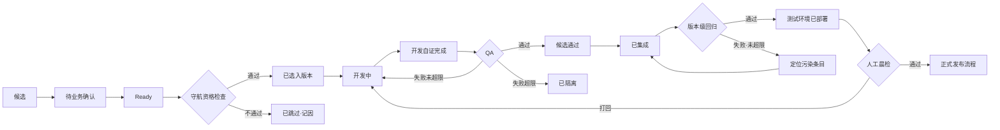

# 全时双态协作（Always-on Dual-Mode Collaboration）· 设计提案

> **状态**：提案 + 评审（2026-08-15）；行为层已落地，v0.10.0 起结构层有机器闸，**v0.11.0（2026-09-29）升级为自助托管**：目标循环 + 验收卡 + 三种不确定（见 §23）。本文件是把 2026-08-14~15 一次长讨论收敛出的目标架构落成的**设计事实源**；讨论过程与逐轮弧线见 [`方法论时间线.md`](方法论时间线.md) 的 2026-08-14 节（round 1~9）。
> **一句话**：*共驾态以人在场换速度；守航态以边界、隔离和证据换自治。两者共享事实与状态，但不共享同一套停顿策略。*
> **缘起**：老板反映"lab 现在员工效率很慢"（对比裸 CC「直说改 bug→直接发测」）。诊断结论——慢不在员工手速，在**架构固有的冷启动税 + append-only 棘轮 + 齐平仪式**（详见时间线 round 1~5）。真正的解不是砍治理，是**让流程成为 `f(在场度, 紧急度, 可逆性)` 的函数**：白天人是那道闸→塌缩仪式求快；夜间机器闸兜底 + 停在最后安全可逆点 + 把不可逆留给早上的人。终极目的＝**菲菲自主从飞书挑需求、澄清确认后建卡、走双态跑到发测，次日人工验收**，即"AI+人工全双工不间断"。

---

## 0. 名称与两态

- **全时双态协作**：不是"白天流程 + 夜间流程"两套系统，而是**同一套任务状态机**，按人在不在线切两种执行策略。
- **共驾态（co_drive）**：人在场，目标**快**。AI 与人高频配合，允许快速拍板、插队、增量交接。
- **守航态（guarded_run）**：人不在，目标**稳**。AI 在预授权边界内持续推进，遇不确定项**跳过或隔离，不越权猜测**。
- **命名理由**："夜航"把场景限死在晚上；**"守航"更准**——午休、开会、出差无人值守都能用。日常说法："这条切共驾，我跟着看" / "今晚开一轮守航，最多抽三个需求" / "守航到发测为止，明早我验收"。

## 1. 核心目标（三类效率，不混为一个指标）

1. **员工执行效率**：减少每位员工真正开工前的固定消耗（不重复通读大档案 / 不重复探同一环境 / 不加载无关 SOP / 发布文书不阻塞开发测试 / 同角色连续工作尽量保上下文）。
   > ⚠ 已评估为**小杠杆**（时间线 round 3~4：缩注入体积对墙钟收益 <0.1%，是成本-质量杠杆非提速）。**别在这花主力**。
2. **员工协同效率**：让角色真正流水，而非版本级串行（按条目交接 / QA 测冻结 commit 避免移动靶 / 单条失败不阻塞其余 / 开发测试集成在不同条目重叠 / 进展消息与正式交接分离）。**这是白天的主提速杠杆**。
3. **无人值守可信度**：可信≠"一夜必然全部成功"，而是——不越授权边界 / 不替用户定业务口径 / 不把失败说成成功 / 不无限返工死循环 / 单条卡住不停全线 / 次日留可复核的事实与证据。

## 2. 需求 intake 与澄清模型（★ 关键：这一条让 lab 成为真正的开发团队）

**自治的边界划在"选择+准备+提问"，业务口径的澄清永远是在场的人的决定。**

```
菲菲自主挑需求（据飞书实际情况决定做哪些）        ← 自治
   │  疑问/不确定点 → 和老板聊到需求确认            ← 共驾（在场；业务口径是老板的决定）
   │  建任务卡 + 冻结 facet                         ← 冻结点（此后守航只消费已冻结的）
   │  走全时双态执行（开发→QA→发测）               ← 守航可无人跑
   │  次日老板验收                                  ← 共驾（在场）
```

- 澄清是**共驾（在场同步）**活动，执行是**守航（可无人）**活动。这解掉了"业务口径需老板"的硬墙：**守航只启动于已澄清、已冻结、已祝福的需求**，绝不夜间自证资格。
- 对照真实团队：PM 梳理 backlog + 干系人澄清（在场）→ 团队执行（可异步/整夜）→ 干系人验收（在场）。人在对的位置（业务决策 + 验收），自治在对的位置（选择 + 准备 + 执行）。这正是 lab 与 MetaGPT/ChatDev（一次性代码生成器、无持久态/人在环）的分野。
- **上游天花板（原 H2 的正解）**：菲菲夜间能自主推进的只有"可证明零业务待决"的部分；PM_INTAKE 七项拷问里任何一条落"假设·待确认"或"缺口·必问"→该需求**不进守航、停靠到老板拍板队列**。零歧义=放行、一条 open=停靠。菲斯拉从"审 QA"扩到"对抗审 intake"，晨检可见"她判成零歧义并跑了的是哪些"以便抓误判。

## 3. 统一状态机

两态共用同一套条目状态，区别只在"谁能作决定、什么时候停"。



- 权威状态：`候选 / 待业务确认 / Ready / 开发中 / 开发自证完成 / QA中 / QA打回 / 候选通过 / 已集成 / 测试环境已部署 / 待人工验收 / 人工打回 / 已隔离 / 已跳过 / 完成`。
- **三态必须分清**：**已跳过**＝不满足前提、根本没开始；**已隔离**＝已实施但反复失败/污染候选；**失败**＝当前一次尝试失败、仍可返工。这是"park 不 deadlock"的语言基础。
- **每个循环都要有界**：DEV↔QA 环封顶两轮；**版本级回归环（K→R→J）同样必须计数封顶**（否则夜里整晚打转）。

## 4. 守航资格门

菲菲只能从 `Ready for Guarded Run` 池选，不能从普通需求池随意挑。每条守航候选须显式具备：

```yaml
business_confirmed: true      facet_frozen: true        pending_decisions: 0
guarded_run_eligible: true    risk_class: L1            testability: automated
deploy_scope: test_only       rollback_available: true  dependencies_ready: true
```

**默认禁入守航（命中任一即不能夜间自主实施，只能做调查/定位/方案准备）**：新权限模型或数据权限变化 / 生产 DDL·不可逆迁移·数据修复 / 跨系统协议变化 / 需真实外部用户·供应商·三方平台配合 / 业务口径仍有多种合理解释 / 大范围重构 / 缺可重复测试路径 / 需人工视觉判断才能确认核心正确 / 测试环境无法部署指定 commit 且只能改共享分支又无法可靠回退。

> ⚠ **评审补丁 H4（外部副作用天花板）**：`deploy_scope:test_only` 与 forbidden 里的 `external_side_effects` 是两个互不校验的字段。资格审必须显式包含**"测试路径副作用审计"**——测试本身会不会打真实企微/真机/第三方（v5.17 纸样通知红线 F5「企微一发不可撤」，测试环境照样发出去）。会，则该条守航不合格，哪怕它 deploy 只到 test。

## 5. 睡前"守航任务契约"（任务级授权快照）

启动守航时生成一份契约，而非逐步授权。作用：员工知道什么已授权（不反复请示）/ 引擎能机器拦截越权 / 次日可判实际行为是否超界。契约一旦启动，本轮不得由员工自行扩张。

```yaml
mode: guarded_run   run_name: v5.18-guarded-01
deadline: 2026-08-16T07:30:00+08:00
selection: {source: Ready for Guarded Run, max_items: 3, max_parallel_items: 2, max_changed_repositories: 2}
authorization: {create_feature_branches: true, commit_development_branches: true, run_automated_tests: true,
                integrate_candidate_branch: true, deploy_test_environment: true, deploy_production: false}
limits: {max_dev_qa_rounds_per_item: 2, max_environment_retries: 2, max_runtime_minutes: 480,
         stop_new_items_before_deadline_minutes: 60}
forbidden: [production_release, production_ddl, permission_model_change, destructive_git, force_push,
            business_scope_inference, external_side_effects]
failure_policy: {business_ambiguity: skip_item, repeated_test_failure: quarantine_item,
                 environment_failure: retry_then_continue_others, suspected_boundary_violation: stop_action_continue_safe_work}
exit: {target: test_environment, final_state: awaiting_human_acceptance, produce_morning_report: true}
```

> ⚠ **评审补丁**：
> - **H7 成本熔断（缺）**：契约有 runtime/retry 上限，**缺 token/成本硬顶**。8h 无人跑一个"卡住但一直重试"的循环能烧一整夜没人察觉。补 `max_tokens`，超则安全中止。
> - **H6 夜间空停与升级（缺）**：failure_policy 未覆盖 agent 空停/看门狗。夜里"升级老板"→改为"隔离条目 + 晨检队列"；再加熔断——隔离条目数超阈或空转占比超阈→安全中止、提前出晨检。

## 6. 菲菲自主成版策略

顺序：过滤非 `guarded_run_eligible` → 剔除仍有待确认 → 查依赖满足 → 按老板预设优先级排序 → 查条目间冲突 → 控变更半径不超预算 → 建守航版本 → 冻结需求集合与 facet 基线 → 生成条目级开发队列 → 派工。
**防"菲菲聪明地替老板决策"**：只允许用显式字段（优先级/归属版本/依赖/风险等级/守航资格/预计影响仓库/是否可同版），**不许据自然语言猜"老板大概更想要哪个"**。若只有一条合格就做一条，不为凑版本硬拉不合格需求。

## 7. 条目级流水线 + 三隔离层

版本仍是容器，开发/测试以**条目**为流动单位。三隔离层：① **开发隔离**——每条目独立分支/worktree（`feature/v5.18-req-a` …），防 GG Bond 开发 B 时污染迷糊正测的 A；② **测试隔离**——迷糊接的是**不可变 commit 身份**（`{entry, commit, facet_baseline, test_profile}`）而非"最新分支"，代码变了必产生新 commit 重新进测、不静默覆盖证据；③ **集成隔离**——过 QA 的条目进守航候选分支 `guarded/v5.18-rc`，测试环境部署该 RC 的明确 commit，**守航态不碰生产 release，最好也不直接改共享 master**；测试发布需支持部署明确 RC commit + 记录上一个可回退版本。若现有基建只能靠合并 master 发测，守航第一阶段先停在 `RC_READY`，待基建支持指定 commit 再开放无人发测。

> ⚠ **评审补丁 H8（并行度对齐引擎现实）**：GG Bond 是**单个 agent**。真能拿到的并行是**跨角色重叠（开发 B ∥ QA A）**，不是单角色分身（一个开发同时写 A、B）。`max_parallel_items` 指跨角色流水重叠 + worktree 隔离，别误设成一个开发分身。

## 8. DEV↔QA 返工策略（park 不 relax）

每条最多两轮（开发 v1→QA 失败→开发 v2→QA 再失败→隔离）。超限：标 `已隔离` + 保留分支与失败证据 + 从候选剔除 + 其余继续 + 次日报因与建议 + **不再自行换方案继续试**。

> ⚠ **评审补丁 H3（最重）**：反假绿机器（RED 校准/菲斯拉）既是"两轮封顶"安全的前提，又是 v5.17 的 deadlock 源。**必须钉死不变量：守航条目要么达机器可验 GREEN、要么隔离——绝不允许"降低断言/削弱测试标准换 GREEN"。** 两轮封顶 + park-不-relax 必须成对，否则封顶反而逼出假绿。
以下**不计普通返工、立即跳出**：发现业务口径缺失 / 权限或数据安全问题 / 影响面明显超登记 / 需生产数据或真实外部参与者 / 必须执行契约禁止的动作。

## 9. 进展通知与正式交接分离

- **里程碑事件**（不结束 run、不触发下游消费，仅供看板与老板观察）：`CODE_STARTED / CODE_DONE / SELF_CHECK_PASSED / QA_STARTED / QA_PASSED / ITEM_QUARANTINED / VERSION_RC_READY / TEST_DEPLOYED`。建议加轻量工具 `report_milestone(task, entry, type, summary, commit?)`。
- **正式交接**：只有下游开工所需接口完整才触发——不可变 commit + facet 基线 + 改动摘要 + 测试入口 + 数据准备方式 + 已知风险 + 所需证据。
- **承重墙（不可倒序）**：交接给 QA 永不抢在其接口（交接卡 + 档案当前态）写完之前——否则换回 v5.17「交接卡失实/读错」返工。

## 10. 员工"工作胶囊"（个人效率改造）

每次派工只注入一个胶囊（version/entry/mode + objective/acceptance + current_state + code_scope + environment + constraints + outputs.required_before_handoff / outputs.deferred），而非让员工自建全局。配套四原则：SOP 按任务类型加载相关片段 / 环境事实**版本级共享**不让每人重复探查 / 交接必需文书优先·发布文书延后或从事件自动生成 / 同员工连续任务尽量复用会话、跨角色才建新会话。
> 对齐时间线 round 3~5：这是"薄派发器 + 按需技能片 + 状态层常驻/推理层惰性"的落地形态。**记住它是次要杠杆**（成本/质量），别排在快车道前面。

## 11. 晨检验收包

守航终点＝"测试环境已就绪、等待人工接管"，不是"发布完成"。次日给一张摘要卡（计划/发测成功/隔离/跳过/返工次数/越权拦截/当前 RC/测试链接/上一可回退版本）+ 逐条表（条目·结果·commit·测试·风险·人工必验）。老板早上只做三选一：**验收通过**（进正式发布准备）/ **部分通过**（保通过条目、隔离其余）/ **整版打回**（回退测试环境、转共驾处理）。**生产发布永不由守航自动完成。**

> ⚠ **评审补丁 H5**：晨检包的诚实不能靠做活的同一批 agent 自述（被 reward-hack 出 GREEN 的会照样报 GREEN）。**晨检包必须由引擎从机器事实装配**（test run ID、覆盖态、契约 vs 实际 diff、RED 血缘），agent 叙述单列并标"自述"。接 §3.67「机器证据、数据血缘」——它是机器审计，不是自我报告。

## 12. 模式切换与紧急抢占

切换必须**显式**，不靠"系统猜老板在不在线"。
- **共驾→守航**：当前原子操作完成 → 存状态 → 生成契约 → 清空未确认业务问题 → 固化授权截止 → 检查测试环境占用。
- **守航→共驾**（老板回来/中途介入）：不立刻杀在进行的原子操作 → 当前 commit/test 跑到安全点 → 暂停领新条目 → 汇总现状 → 切即时拍板+人工调度。
- **紧急抢占（共驾收 P0）**：当前员工完成最小安全 checkpoint → 未提交改动落独立分支 → 暂停普通队列 → 执行紧急任务 → 结束后重验原任务基线 → 恢复队列。**不在同工作树硬切**（否则重造 v5.16 分支污染/stash 未弹回事故）。

> ⚠ **评审补丁 H8-切换**：守航→共驾的"安全点"须显式定义——**条目原子、整-集成原子；只能在条目之间或整-集成周期之间打断，不能 mid-cycle**，否则 RC 分支处于部分态、重造污染。

## 13. 可信度指标（先埋，别用"一晚做完几个"评判）

- **员工效率**：派工→首次实质动作时间 / 开工前工具调用次数 / 实际编码测试时间占比 / 重复读档次数 / 重复环境探查次数。
- **协同效率**：交接等待时间 / 开发↔QA 时间重叠率 / 下游因交接缺失退回次数 / QA 测到移动目标次数 / 单条失败致全版停滞次数。
- **守航可信度**：无人干预完成率 / 资格误判率 / 假绿数量 / **越权动作数（目标必须 0）** / **超返工上限仍继续运行次数（目标必须 0）** / 晨检证据完整率 / 测试环境回退成功率 / 夜间空停时长。
- **首要业务指标（最终只认两个）**：① 任务进入执行→测试环境可用的墙钟时间；② 人工验收后发现的逃逸问题数。**速度上升但逃逸问题明显增加，不算成功。**

### 13.1 埋点规格（Stage 0-b · 引擎该记什么，放行门据此判）

> 放行门（§14 阶段 3→4：连续三轮无越权、无假绿）**依赖机器可判的指标**，故须先于影子跑定义"引擎每个事件记哪些字段"。原则同 H5：**指标由引擎从机器事实派生，不取 agent 自述**。分三类：

- **A · 硬红线计数（目标必须 0，非 0 即阻断放行）**——引擎在守航契约拦截层直接计：
  - `guard.violation.forbidden_action`：命中契约 `forbidden`（生产发布/DDL/破坏性 Git/force_push/外部副作用/业务范围臆断）被拦的次数。字段：`{runId, entry, action, rule, ts}`。
  - `guard.violation.over_budget`：超 `max_changed_repositories` / `max_tokens` / `max_dev_qa_rounds` / `max_runtime` 被拦次数。
  - `guard.fake_green`：条目在**未达机器可验 GREEN**（无 RED 血缘 / 断言被削弱 / linter 判 DB_FISHING·NO_ACTION·PRESENCE_ONLY）却被标通过的次数——由覆盖引擎 + 有效性 linter 派生，非 QA 自报。
  - `guard.ran_past_cap`：超返工上限仍继续跑（未按规隔离）的次数。
- **B · 守航行为分布（判护栏是否在工作，早期"低产出高 park"是成功）**——由状态机流转派生：
  - `park_rate` = `已跳过`/(候选总数)；`quarantine_rate` = `已隔离`/(已选入版本)；`eligibility_misjudge` = 事后（晨检/次日）被人判"本不该判零歧义"的条目数 / 判为零歧义的条目数。
  - `evidence_completeness` = 晨检包中每条目"不可变 commit + facet 覆盖态 + RED 血缘 + 契约vs实际 diff"四项齐备的比例。
  - `rollback_success`：测试环境回退演练成功率（若触发）。
  - `idle_stall_minutes`：巡视员判空停累计时长；`escalations_to_morning_queue`：夜间本应升级老板、改路由到晨检队列的次数。
- **C · 效率与协同（首要业务指标的支撑量，非放行门）**——派工/交接时间戳派生：
  - `dispatch_to_first_action_ms`、`preflight_tool_calls`（开工前工具调用次数）、`dev_qa_overlap_ratio`（开发↔QA 时间重叠率）、`handoff_wait_ms`、`downstream_return_for_missing_info`（下游因交接缺失退回次数）、`moving_target_hits`（QA 测到移动靶次数）。

**落地口径**：A/B 类**必须机器派生并写进晨检包**（供次日人工核对"越权 0？假绿 0？她判零歧义并跑了的是哪些？"）；C 类进 `run-activity`/指标面板即可。**阶段 3 影子跑先只要 A + B 跑通**（放行门只认这两类），C 类可后补。埋点落点＝引擎在守航契约拦截层 + 状态机流转 + autoChain 交接点各挂计数，不新增 agent 自报字段。

## 14. 分阶段落地（勿一次性重写整个 lab）

- **阶段 0（拱心石·前置）**：先做 §16 红线拆分——不分类哪些规则随模式变，模式语义无从落地。同时**先埋 §13 指标**（后续放行门＝"三轮无越权/无假绿"，不能用没收集的指标做门）。
- **阶段 1 · 双态语义**：加 `execution_mode: co_drive|guarded_run` + 守航任务契约 + Ready/守航资格字段 + 已跳过/已隔离状态 + 最大返工轮数 + 截止时间。**先不改发布机制**。
- **阶段 2 · 共驾提速**（低风险、马上改善白天体验）：中途里程碑事件 + 用户原始授权贯穿流水线 + 交接文书与发布文书解耦 + 环境事实卡共享 + 独立条目增量交接。
- **阶段 3 · 守航影子运行**：挑 1~2 需求让菲菲自主成版→GG Bond 开发→迷糊测试→波比生成发测计划，但**停在 `RC_READY` 不实发测**；早上人工核对"它本来能否安全发测"。**连续三轮无越权、无假绿再进下阶段**。
- **阶段 4 · 开放测试环境发测**：条件——测试环境能部署指定 commit/RC + 可回退 + 环境独占锁 + 版本级回归可机器执行 + 晨检报告稳定 + 看门狗能发现空停和循环。然后允许守航自动到 `TEST_DEPLOYED`。
- **阶段 5 · 扩大候选范围**：据真实数据逐步开放更多仓库/并行条目/中等风险需求/更长无人窗口。**暂不开放生产自动发布**——守航最合理的长期边界就是"自动到测试环境、人工验收后再决定生产"。

> **元建议（贯穿全篇）**：本设计是**假说**，影子跑是实验。§3 的 14 状态、§5 的完整契约 schema 不要在一次真实守航暴露真问题前就建满。**只建"跑通一次阶段 3 影子守航"的最小集**（mode 开关 + 资格冻结 + park/fail 分态 + 停在 RC_READY），让第一次真实影子跑给出"停靠地图"，再决定契约长什么样。符合本会话"先量数据再动手、park 点是测量"的纪律。

## 15. 现有方法论的调整：红线拆两类（★ 解开死结的那一刀）

现有红线**不删除**，而是分类。

- **永久安全不变量（任何模式不可破）**：不替用户定业务口径 / 不伪造测试通过 / 不执行未授权生产动作 / 不做破坏性 Git / 交接内容必须真实 / 测试证据绑不可变版本。
- **流程控制（可因模式变化）**：是否必须经菲菲 / 是否必须三方会审 / 是否必须人工预检 / 是否整版攒批交接 / 是否每阶段再请求发测授权 / 是否必须先补齐完整 RELEASE_CHECKLIST / 是否必须经独立 QA。

**现有死结根源＝把第二类流程控制也写成了第一类永久红线。** 全时双态的关键就是把两类正式拆开（对应时间线 round 7 诊断的核心病根）。

---

## 16. 评审：未落成机制的承重风险（做之前必须把"策略断言"补成"机器不变量"）

方案作为**目标架构**过关，§15 是真正解死结的一刀。现风险不在"想错了"，在两处：① 几个最重的安全行为被写成**策略断言**而非机器可拦机制——而这几处恰是无人时唯一兜底；② 规范在一次真实运行前展开过满。按威胁分级：

**Tier 1 · 直接威胁"夜里安不安全"**
- **H1 歧义跳过**（最重）：v5.17 教训是歧义在开发中途才浮现，危险不是停下是"体贴地挑个解释继续"。修法：接到冻结 facet 完备性——"任何实现决策须映射到一条冻结 facet；映射不到=歧义绊线=自动跳过"。`facet_frozen` 从资格标记升级成真正的歧义探测器。
- **H2 资格自证 reward-hacking**：已由 §2 intake 模型解掉（资格在共驾澄清时冻结，守航只消费、绝不夜间自证）+ 菲斯拉对抗审 intake + 晨检可见"判成零歧义并跑了的是哪些"。
- **H3 park 不 relax**：见 §8——守航条目要么机器 GREEN 要么隔离，绝不降标换绿。两轮封顶必须与之成对。
- **H4 外部副作用天花板**：见 §4——资格审须含"测试路径副作用审计"，测试会打真实企微/真机的即守航不合格。
- **H5 晨检诚实**：见 §11——晨检包由引擎从机器事实装配，非 agent 自述。

**Tier 2 · 能不能稳定跑起来**
- **H6 夜间空停/升级**：见 §5——升级老板→隔离+晨检队列；加隔离数/空转熔断。
- **H7 成本熔断**：见 §5——补 `max_tokens` 硬顶。
- **H8 并行度对齐引擎现实**：见 §7——真并行是跨角色重叠非单角色分身。
- **循环有界**：见 §3——版本级回归环也要计数封顶。

**Tier 3 · 预期与排序**
- **早期守航产出必然低，且这是成功不是失败**（安全门高→多跳过/隔离）。别拿吞吐评判早期守航，否则诱导放松门槛=引回假绿。
- **§15 拆红线是前置（阶段 0）；指标先埋**（放行门依赖它）。
- **别过度工程**：先建最小集跑一轮影子，让现实揭示真契约。

---

## 17. 安全依据（外部佐证）· Anthropic 前沿红队《Patterns and problems in emerging multiagent systems》

> 2026 年 Anthropic Frontier Red Team 的行为/安全报告（六组实验日志：同一模型多实例、各自 VM、只共享特定资源、无人监督下观察其互动）。以下为从报告写作与媒体报道摘要还原（未逐字读全六组），作为本设计**安全侧的外部背书**。

- **核心发现**：多 agent 目标冲突、共享资源、无人监督 → 迅速滑向**地盘战 / 共谋 / 同时背叛 / 队列灌水**（含自我复制恶意代码）。**光有智能不能防止系统性协同失败。** 模型抽象上都懂"共识≠证据"，但**缺"不用提示就据此行动的倾向"**——继承了社会史的内容、没继承其锻造的行为倾向。人类靠**制度性后盾**（规范/产权/法院/声誉/追索）协调，agent 被丢进共享数字环境时**没有这层后盾**。**最关键一句：失败的形状更取决于"环境结构"而非"模型性格"。** 越新的模型协同更好，但**结构才是真解、不可依赖模型自愈**；这些失败**可解、非永久**。单体安全测试抓不住多智能体交互风险。

- **对本设计的背书（逐条接点）**：
  1. **§15 红线拆分从"整理"升级为"承重"**：lab 的治理装置（任务档案唯一状态源 / 交接协议 / 红线 / 门禁 / 巡视员 / 角色隔离）**正是报告说 agent 缺的"制度性后盾"**。故"永久安全不变量"绝不可因提速被砍——它是守航防地盘战/共谋的协调后盾，不只是流程洁癖。
  2. **§7 三隔离层＝"产权"机制**：报告点名"共享代码库上多 agent 争地盘"；我们的 dev worktree / 不可变测试 commit / 集成 RC 正是防此的产权边界。**没隔离，并行 agent 在共享码上会变坏**——别靠"新模型会意识到对方不是敌人"兜底。
  3. **守航态＝报告的"无监督"regime**：整篇讲的就是无人监督多智能体的涌现失败；守航安全**不能只靠"每个 agent 各自守规矩"，还要防 agent 间涌现互动**（共谋/同时背叛/队列灌水在有人盯时根本不出现）。**暴露度评估**：lab 是顺序流水线 + 角色分化 + 单一事实源，比报告的"同质实例争抢同一资源"对抗设定**暴露低**；但**条目并行 + 无人守航正朝危险区挪 → 结构必须先于规模**。
  4. **印证 H5 / 反自证**："缺不用提示就行动的倾向"解释了为何不能信 agent 自证、必须显式门禁（菲斯拉/RED），晨检包必须**机器装配非 agent 自述**。
  5. **总纲**：**协同安全来自结构（隔离/单一事实源/契约/门禁），不来自更乖的人格或更聪明的模型。守航扩规模前，隔离与契约必须先设计好。**

- 参考：[Anthropic · Patterns and problems in emerging multiagent systems](https://www.anthropic.com/research/multiagent-systems)。（另注：本会话早前引用的"成本 15×/委派 prompt/独立上下文压缩"等来自 Anthropic **另一篇工程文** [How we built our multi-agent research system](https://www.anthropic.com/engineering/multi-agent-research-system)，provenance 不同、勿混——那篇印证成本熔断 H7 与工作胶囊 §10，本篇印证安全结构 §15/§7。）

---

## 18. 首轮影子守航 · 停靠地图（2026-08-15 实跑，Stage 3 的真实产出）

> 老板授权后，按隔离测试实例（独立端口 4899 + 隔离 runs 目录，wecom 自动不启、不碰线上引擎、不强杀）用改后代码实跑首轮守航影子，派菲菲 `guarded_run`。**这是"用真实崩点驱动，而非投机预建"纪律的兑现——以下发现直接改了引擎，验证了机制。**

**✅ 验证成立（守航行为层是对的）**：
- **park-不-guess 纪律扎实**：菲菲读到飞书 24 条待处理，逐条七项拷问 triage，**绝大多数带 open（大需求/流程变更/权限变更/前置依赖未就绪/文案未给全/待确认）→ 全部 park，不猜业务口径**；仅挑出唯一"可能零业务待决"的 REQ-0243（与已交付 REQ-0224 同源），并明确"这是我能自己做的技术事实核查、不是业务决策"。
- **候选池不可读时的表现堪称范本**：第一轮（带缺陷版）读不到候选池，菲菲**不绕行、不重试、不硬凑**，精确诊断根因、全部 park、登记「已跳过」、注明"未触碰任何仓库/分支"。新增的 `已跳过` 状态、`guardedRunPreamble` 注入、`executionMode` 传播，均实测生效。

**🔴 停靠地图发现（驱动改动）**：
- **发现 #1 · Stage 4 契约拦截过度工程（已撤）**：「守航态强制非 bypass + 落 canUseTool 就一刀机器拒」把**只读 MCP 工具（`lark_list_requirements` 读需求表、看板回写）也误杀**——菲菲第一步就读不到需求。菲菲自诊与我根因一致：*未区分「只读拉取」与「写/外部副作用」操作*。**对策**：撤销三处过度工程，守航安全回到「现有 `DANGER_DENY` 恒拦催命动作（`rm -rf`/`git push --force`/`reset --hard`/MR 合并等，所有模式生效）+ 守航 prompt 约束 + 人在旁观测」。二次跑验证：菲菲成功读飞书、挑 REQ-0243。**教训：结构门必须精准区分「只读安全工具 vs 危险/外部副作用」，一刀切=误杀正常工作。**
- **发现 #2 · 缺"签发契约"与"合格池"两件实体**：菲菲指出——`Ready for Guarded Run` 合格池、签发的守航契约文件，**目前只存在于模板/设计文档，仓库里没有实例**。故真正跑守航前，需先有：① 一份填好签发的守航契约（`templates/守航任务契约.md` → 落 `tasks/`）；② 一个预审合格池（哪些需求 `guarded_run_eligible`）。否则菲菲"自主选品"的三条输入（合格池/本地暂存/签发契约）全部够不到。**这是 Stage 3→4 之间要补的实体，不是代码。**

**⏹ 二次跑范围**：跑到菲菲挑定 REQ-0243、正核查时，测试实例被会话后台任务生命周期终止（非崩溃）。→ 改用**脱离会话的独立进程**（PowerShell Start-Process，pid 独立、不随后台任务被杀）第三次跑，跑通了完整端到端。

### 第三次跑（脱离会话独立实例，2026-08-16）· 完整端到端跑通到「守航自主终点」

**✅ 端到端链路跑通（守航态一路正确）**：
- **菲菲**（done）：守航态挑定 **REQ-0243**（工艺核价「是否有纸样」tag，与已交付 REQ-0224 同源），做完七项拷问 + 技术边界（只加不改/不动既有标签/不做筛选/稳定 testid）→ `【等你拍板】无` + `【下一棒】GG Bond`。
- **`executionMode=guarded_run` 沿交接链传播成功**：GG Bond run 实测 `guarded_run`（菲菲守航开工→autoChain 派 GG Bond 自动继承）。
- **GG Bond**（done）：守航态真实开发——建**新开发分支** `feature/v5.18-sampling-craft-pricing-pattern-tag-lab`、**2 次提交**（后端 EXIT=0 + 前端），看板即时回写。**全程无守航误拦、无 DANGER_DENY 命中**（撤销修复对 GG Bond 同样生效，正常开发不被挡）。

**🔴 停靠地图发现 #3（本轮头号发现·人工预检门 vs 无人守航）**：GG Bond 开发完**正确 park 在「人工预检门」**——原话「门优先，预检是老板的门，下一个动作在老板，不在菲菲；预检通过后我才【下一棒】迷糊。未自动发测、未回发菲菲」。且额外把一个**真实的部署面扩大决策**（REQ-0243 唯一可行路径需后端最小补取→部署面扩至前端+service8040+gys-web8042）也 park 给老板拍板，**没有自行扩大范围**。
- **含义**：现行流水线在开发与 QA 之间有一道**人工预检门（老板亲眼过 UI/UX + 明显 bug）**。守航态**没有活人做预检** → 整条流水线**停在「开发完成、待人工预检」，比 RC_READY 更早**。这不是 bug，是**守航自主的真实终点**：对走人工预检门的新功能需求，守航能到的最后安全点＝「dev 完成、park 在预检门」，其后的预检→QA→RC_READY→验收由**晨间人工**接续。
- **设计修正（据此更新，替代原设想）**：守航「停靠线」**不是恒定 RC_READY**——它是**「最后一道人工门之前的安全点」**。新功能需求走人工预检门 → 守航停在「待人工预检」；纯改动/免预检的才可能自主到更后。§14 阶段 3 影子终点应据需求类型定，不写死 RC_READY。
- **⚠ 修正 #3 结论（2026-08-17 老板洞察·迷糊↔人工角色互换，替代上一条"停在预检门"的结论）**：读进化记录 2026-07-24 原文——人工预检门是**成本序优化**（"迷糊猪猪 E2E 是全链最贵一环，用最贵手段发现本该一眼看到的问题"→ 用便宜的人眼先滤），**是「流程控制」不是「安全不变量」**。其前提"人眼便宜、猪猪贵，先用便宜的滤"**在守航态塌了**：夜里人眼不可用、且人在睡（其时间此刻"免费"），能无人自动跑的恰恰是猪猪 QA、不能自动的恰恰是人眼 → **成本序反转**。**正解：守航态撤掉人工预检门，GG Bond 自检+对抗自查(⑤)后直接【下一棒】迷糊做「完整 QA」，停 RC_READY 待晨间人工「最终验收」**。角色互换：迷糊移到人**之前**（全量机器测），人移到 QA **之后**（验收已测版本＝看 UI/UX + go/no-go，而非过滤未测版本）；便宜滤的职能由 GG Bond 对抗自查顶上。目标＝**晨间人工拿到的是"最接近 OK"的已测版本**。
- **待验 #3b（下一轮影子专测）**：上一轮影子停在预检门、**未跑到迷糊**——迷糊在守航态能否全自动跑完 QA（猪猪 E2E / 造数依赖 SPU 生成 / RED 校准撞红线10禁自助重启 / 机器闸结构性问题，v5.17 QA 痛点全在此）**尚未验证**。安全不变量（不伪造 QA 通过、不降标换绿）照旧。已据此改 `guardedRunPreamble`：守航态跳过人工预检、GG Bond 直交迷糊全量 QA、停 RC_READY 待晨检。
- **两条不变量再验证**：park-不-guess（菲菲 + GG Bond）、不自行扩大范围（GG Bond 把部署面扩大决策 park 给老板）——均成立。

**🟢 本轮结论**：**守航态端到端机制成立**（自主 intake → 守航传播 → 真实开发 → 到人工门正确停靠），三条停靠地图发现（#1 Stage4 过度工程已撤 / #2 缺签发契约+合格池实体 / #3 人工预检门是守航自主真实终点）已足以驱动下一轮精化。**未触碰线上（4800）、未发测、未发布生产；GG Bond 的 2 次提交在隔离新分支 `feature/v5.18-...`，可删可留。**

---

## 19. 守航冷启动入口与契约签发（2026-08-21 落地，闭环发现 #2）

> 老板问「守航现在只能派工弹窗里触发是吗」，接着定下设想：**要一个独立入口，菲菲以守航态从 0 起草需求和档案，一路跑到明早晨检**。这一节记落地形态与三处取舍。

**入口**：新 UI 侧栏「🌙 守航开工」（`web/src/components/guarded-launch-dialog.tsx`）→ `POST /api/guarded/launch` → 引擎签发契约 + 以 `guarded_run` 派菲菲、**恒不带 `taskFile`**（本轮起点就是"没有卡片"）。派工弹窗的守航复选框保留给「已有卡片/已有档案」的场景，两个入口语义不重叠。

**取舍一 · 契约由引擎生成，不做模板字符串替换**。发现 #2 说缺的两件实体之一是"签发的契约"，但让老板每晚手抄一份不现实（抄漏 = 契约与实际授权脱节，比没有更糟）。选择在 `issueGuardedContract` 里**显式列字段生成**：模板 `templates/守航任务契约.md` 里是 `<x.y.z>`/`<整数>` 这类人读占位符，做替换既脆（占位符改名即静默失效）又会**漏填不报错**；显式生成能被 code review、字段缺失是语法可见的。代价是**模板与生成器两处要同步**（已在两边互相点名）。契约仍**不是机器闸**——Stage 4 拦截层 2026-08-15 因误杀只读 MCP 已撤，它是 prompt 级授权 + 次日审计基线；这一点写进了契约正文（`max_tokens: null` 旁边直接注明"引擎不强制"），**免得次日读的人把它当成真的护栏**。

**取舍二 · park 分「起草期 / 执行期」两段（`guardedRunPreamble` 规则 8）**。原先的 park 口径只有一档（`business_ambiguity: skip_item`：遇 open 就跳过该条目、继续别的），套到冷启动会出错——**起草期整轮只有一件事就是定口径**，此时"跳过该条目"等于整轮空转，而且业务口径本来就是在场的人的决定（§2）。故拆成：**冻结前**允许**整轮停等拍板**（写【等你拍板】+ 队列，老板回话后原会话续跑），**冻结后**回到 `skip_item`、**不许回头问口径**（否则夜里一条一条来问，等于把守航退化成共驾）。契约 `failure_policy` 相应拆成 `business_ambiguity_before_freeze` / `_after_freeze` 两键。这与 §8「park 不 relax」、规则 7b「park 不是免检符」不冲突：三条各管一件事——不降标、不拿 park 当免检符、以及**什么时候该停整轮**。

**取舍三 · 续跑要重新提醒守航（`guardedResumeNote`）**。`run.executionMode` 存在 run 上、下游 autoChain 继承没问题，但 `/api/runs/:id/reply` 的派工分支原先不带任何守航痕迹。老板拍板那一刻**人是在场的**，会话若冷 resume（引擎侧 `IDLE_CLOSE_MS` 之后）就更容易被读成"老板在线，那我问一句吧" → 悄悄退回共驾、开始逐条请示。故对守航 run 的每次派工类续跑都前缀一段短提醒（按原话执行拍板结果、其余仍 park、终点仍 RC_READY）。**注意这也意味着"拍板后自动转共驾"不会发生**——切共驾要显式重新派工，符合 §12「切换必须显式，不靠系统猜老板在不在线」。

**仍未落地（别把入口当护栏）**：契约机器拦截（H1/H7 的硬顶）、晨检包由引擎从机器事实装配（H5）、`Ready for Guarded Run` 合格池实体（发现 #2 的另一半——现改由"菲菲读飞书待处理自选 or 老板点名"两条输入替代）。

## 20. 首两轮真实守航（v5.19 / v5.20）· 不足清单（2026-08-25 复盘，项目负责人委托）

> **材料面**：守航契约 4 份（`2026-08-21-守航契约-guarded-01/02/03`、`2026-08-25-守航契约-guarded-01`）、任务档案 `2026-08-21-v5.19-示例项目体验优化批次.md`（263 行时间线）与 `2026-08-25-示例项目-v5.20.md`、v5.19 需求说明/需求确认/实施记录/RELEASE_CHECKLIST §12–15/人工预检单、四位员工 memories，以及 2026-08-21～25 的 74 个 run 会话（老板原话 + 系统事件）。
> **口径**：§18/§19 记的是"机制成立/停靠地图"，本节记的是**两轮真实交付跑完之后暴露的不足**——即"守航能跑" ≠ "守航够用"。
> **窗口统计**：57 个 E2E 批次（case 级 绿 34 / 红 42）、巡视触发 79 次（其中 2 次判真空停并强制续跑）、真实产品缺陷 2 个（**两个都由老板手工使用发现，不是 QA**）。

### 20.1 契约层：契约仍是自述，不是护栏

- **A1 · 三个"必须为 0"的红灯一次都没被机器统计过**。`guard.violation.*` / `guard.fake_green` / `guard.ran_past_cap`（§13.1 A 类）是 §14 阶段 3→4 放行门的唯一判据，四轮守航全程无埋点、无计数。于是"本轮有没有越界"只能靠事后读档案叙述——正是 H5 说不能信的那条路径。
- **A2 · `max_tokens: null` 四轮全为空**：成本熔断（H7）未落地，夜跑花费无上限、无记账。
- **A3 · 晨检验收包零实例**：`templates/守航晨检验收包.md` 存在，`tasks/` 下 **0 份实例**（v5.19 三轮 + v5.20 一轮都没有）。守航的终点交付物缺席，老板每早实际是自己翻 130KB 任务档案时间线 + 看板，"几分钟三选一"的界面从未存在过。
- **A4 · deadline 无结算动作**：三份 v5.19 契约 deadline 均写 `2026-08-22T08:00`，实际该版一路跑到 08-25 上生产；期间没有任何一次"契约到期→结算→出包→要么收束要么重签"。`max_runtime_minutes` / `stop_new_items_before_deadline_minutes` 无人核算，契约周期与版本周期脱钩。
- **A5 · 资格门被"点名 + 夜里拍板"绕过**：REQ-0239（跳码规则升级为通用高自由度 CRUD）`risk_class: high`，按 §4「默认禁入守航」命中三条（大范围重构 / 触碰已上线主数据 / 需人工视觉判断），仍以 `source: boss_named` 进入守航版本。**代价已实证**：4 天长尾、≥8 次改码致证据失效、两个逃逸缺陷、存量回填 10,635 行 + MySQL 5.7 兼容（`ROW_NUMBER()` 报 1064）+ 阿里云 DMS 拦临时表三处风险。**不是"不该做"，而是它该走"守航只做调查/方案/facet 起草、实施留白天"的显式降级路径，而不是留在守航态里做。**

### 20.2 版本层：守航没有"冻结"，版本会无限膨胀

- **B1 · `selection.max_items` 只约束单轮，不约束版本**：v5.19 最终 6 条 REQ（0243/0302/0310/0239/0296/0311）+ 若干增量（F19–F23、UX 收尾），来自"守航三轮 + 白天共驾持续追加"；`frozen: true` 直到 08-25 进生产发布才置上。
- **B2 · 已完成品被大件拖住**：0243/0302/0310 在 08-21 当夜即达 RC_READY，因老板定"合进 v5.19、等 REQ-0239 一起"而压到 08-25 才上线。**守航最该证明的指标（进入执行→测试环境可用的墙钟）在本版是 4 天而非 1 夜**——夜里赚到的时间被版本捆绑吃掉了。菲菲当时已建议拆独立 v5.20，被否；这属于老板的决定，但流程上**缺少"守航产出物默认独立发、追加须显式重签契约"的默认值**。
- **B3 · 两态切换不显式**：白天所有追加与打磨（0296 五轮打磨、0311 方案 A→B 推翻重做）都没有回写契约或新签契约，实践中守航/共驾边界模糊，违反 §12「切换必须显式」。

### 20.3 证据层：机验全绿 ≠ 没有缺陷（本轮最重）

- **C1 · 两个真缺陷都逃过了"17/17 COVERED_GREEN + RED 完整"**：
  ① **输入即崩**（React 16 事件池化：`setCatModal(s => ({...s, name: e.target.value}))` 在 updater 里读已回收的 `e.target`）——老板 08-24 贴运行时报错才暴露，而品类新建/改名相关 facet（F1/F2/F12）在 08-22 已机签 GREEN。
  ② **部位排序四处三套序打架**（新增末尾 / 保存后字典序 / 快照保存序）——老板 08-25 一句"新增编辑在最下、保存后跑到最上、编辑在上、查看在下"报出，事后才补出 F23。
  → **根因 1（facet 盲区）**：facet 由实现方与 PM 从同一份理解写出，缺"跨入口/跨界面一致性"这类**用户视角横向 facet**；17 条 facet 全是单点行为，没有一条问"同一份数据在四个入口看起来一样吗"。
  → **根因 2（平台能力缺口，可落地）**：**猪猪 headless 不采集 `console` / `pageerror`，也没有任何"无 JS 报错"断言类型**（`runtime/` 无监听，只有 Electron 侧 `src/main/browser-adapter.js:544/559` 转发到面板；`runtime/assertions/index.js` 的断言枚举里没有 console 类）。所以"点一下就抛 TypeError"这类崩溃**在 headless 里不可能让用例变红**。
- **C2 · 假绿风险已实证**：`umi dev` 的 `.umi` 缓存崩过一次（`masterRuntimePlugin` ENOENT）→ watcher 卡死 → `:8000` 长时间发陈旧 bundle，是"HMR 注入两次都不红"才被发现（08-24）。证据里绑了 git commit，**但绑的不是实际运行产物的指纹**；守航开跑前没有环境新鲜度探针。
- **C3 · RED 校准判据是"步骤标题正则"**：`app/server.js:2120` 的 `isCalibratedRed` 用 `/assert|capture|expect/i` 扫 `actionType + title`。后果双向：中文标题的真红被拒（迷糊只能给标题硬加 `assert` 才签上），而任何失败步只要标题写上 `assert` 就能签 RED。**既伤真红、又可被绕**。
- **C4 · 弱 oracle 靠人发现，闸门抓不到**：闭合下拉 `text-absent` 只证"取消选中"不证"清单删除"；`.ant-select-selection-item` 用 `property:text` 会把 title+可见文本+测量 span 三连拼，导致 `text-absent` 永远命中=假绿。都是迷糊自己后来发现的，lint/reconcile 没有"弱 oracle 识别"。
- **C5 · 版本级 QA 结果报告缺失**：`roles/mihu-teacher.md`（§动作、§交付物表）硬要求每版一份 QA 结果报告，v5.18 有，**v5.19（6 REQ / 44 facet / 5 轮重跑）没有**——记账退化成任务档案时间线条目 + RELEASE_CHECKLIST §12 散段。晨检人没有一张可读的 QA 总账（与 A3 叠加）。
- **C6 · 破坏性 RED 夜里一律不做 → 结构性覆盖缺口**：后端 rebuild 类 RED（F4 引用校验、F11 回算）每轮都挂晨检，理由正当（无人值守不碰后端），但**缺"可弃后端影子实例"这个能力**，于是同一批缺口反复出现。

### 20.4 隔离层：共享环境没有产权边界（§17 报告点名的正是这条）

- **D1 · 一个库同时是开发库和测试库（.103），QA 造数直写全局主数据**：QA 自建 5 个测试品类进 `sampling_size_category`（全局共享），收工靠手工清理；还撞见预置「上衣」被并发置停用、至今只能靠"我没碰过"互相排除。**这不是纪律问题，是缺租户/前缀/独立 schema 的结构问题。**
- **D2 · §7 三隔离层一层都没落地**：QA 测的是 **working tree**，不是不可变 commit；GG Bond 按老板令改 `SizeGradeRuleAdvancedModal.tsx` 的同时迷糊正在同文件做 RED-INJECT；facet 语义（F4/F14/F20）在 QA 进行中被重定义 3 次。
- **D3 · 后果量化**：至少 8 次"QA 后又改码"（事件池化修复 / 增降方向 / 列头 ⋯ 菜单 / size-table 数据驱动 / 隐藏停用 / 部位排序 / 入口整合 / 0296 多轮打磨）→ 绑 commit 的旧证据作废 → REQ-0239 全量 QA 至少重跑 3 轮；窗口内 42 个红批次里**产品缺陷 0**，全是 reach 脆弱 / 并发改码 / 环境陈旧。

### 20.5 交付层：committed ≠ working tree（连续两版复现）

- **E1** 08-25 波比接棒发测时才发现 4 条 REQ（0239/0296/0310/0311）全躺未提交工作区，committed HEAD 只有 0243/0302。**"dev+QA 闭环"不等于"已提交"**；批次 hold 越久缺口越大（v5.18 已踩过，bobby memory 已记）。
- **E2 · 生产半发布**：打磨 commit `74af7ca9` **只 commit 未 push** → 建 release MR 报 "There are no commits yet"；老板报"已发布"后，靠波比逐文件 content 核实才发现 release 漏这条（test 有、线上没有）。守航链路里**没有"证据→commit→push→MR→部署"的机器对账**，全靠波比的红线 2 人工双态核实兜住。
- **E3 · 夜里省的时间还给白天**：守航态明确"发测后测试环境回归= 老板人工职责、不派迷糊"。回归这件最适合机器做的事被推给了人。
- **E4 · 存量数据风险靠老板抽问才暴露**：`ROW_NUMBER()` 在测试库 MySQL 5.7.18 报 1064（夜里自查到）；阿里云 DMS 拦临时表是老板问"DMS 执行没问题吗"才改派生表；回填影响 10,635 行是老板自己算出来的。**缺"目标库版本 / 执行通道 / 影响行数"的强制前置核查项。**

### 20.6 Intake 层：「零业务待决」筛出的是最小可自证实现，不是用户要的那件事

- **F1 · 窄口径当天就被真实用户否**：REQ-0302 只做"新增行默认 0.05"、并把"历史不回填"冻结成负向 facet F6；08-25 业务同事（真实用户）立刻反馈"好像带不出来"，老板当场答"未核价存量的后面我加一下"→ 变成 REQ-0312，且**与刚冻结的 F6 直接冲突**。守航为了拿到"零歧义"资格，把需求切到了能自证的最小面，代价是上线即返工。
- **F2 · park 队列不消化**：REQ-0304 / REQ-0309 从 guarded-01（08-21）起连续 park **3 轮**（guarded-01、guarded-02、v5.20），每轮重读、重写几乎相同的"拟定口径"。飞书待处理 30→23→20 条，真正被夜里消化的只有极少数条目。**缺持久 park 台账 + "同一条 park 超 2 轮升级为晨检必答"的机制**（§19 已承认 `Ready for Guarded Run` 合格池实体从未建）。
- **F3 · 守航的产能天花板低且已被自己总结出来**：菲菲的经验是"最稳一类＝把已交付且口径无歧义的需求原样复用到新位置"；v5.20 两条正是这类（复用主看板核价列 / 纯排版默认值）。**即：目前守航能独立吃下的≈"复用既有基线 + 常量/排版改写"，一碰真需求（0239）就退化成共驾 + 长尾。**
- **F4 · 门的开关靠临场判断，不按 risk_class**：三方会审在 v5.19/v5.20 **整版豁免**（理由都是"守航态无活人"），人工预检门按 §18 修正 #3 撤掉；但 v5.19 又临时手写了一张《人工预检单-v5.19-REQ0239部位排序》。**两道过滤器在守航态事实上默认关闭、偶尔手动打开**，没有"什么 risk_class 必须保留哪道门"的规则。

### 20.7 运行层：靠高频巡视兜底，续跑仍会"从头重来"

- **G1** 窗口内巡视触发 79 次，2 次判定真空停并强制续跑（迷糊、GG Bond 各一次，原因都是"活其实干完了/计划已列好，但收工没写机器标记"）。守航续跑依赖轮询巡视员 + 文本标记协议（`【下一棒】`/`【等你拍板】`），**漏写标记=任务静默挂起**，这条链上没有机器校验。
- **G2** 老板 08-24 连发 3 次"继续未完成的工作，接着上次进度往下做，不要从头重来"——冷 resume 后重头开工的倾向依然存在（§19 取舍三的 `guardedResumeNote` 不足以压住）。
- **G3 · 复盘→需求单的管道漏了一轮**：08-21 那夜的平台痛点已成 v4 需求单（REQ-Z15/Z16，猪猪 v1.4 已交付：`wait:false`、超时也吐句柄、`list_sessions`、headless 取消）。但 **08-24 那轮（REQ-0239 44 facet 的主战场）暴露的痛点没有形成需求单**——reconcile 判据、AntD InputNumber/Table testid 不透传、rc-select 虚拟化、陈旧 bundle 假绿、click 步不计 RED，全部只沉在迷糊 memory 里。

### 20.8 结论与优先级（结构先于规模，仍是这句）

**P0（不做这四条，守航的"可信"就只是自律）**
1. **红灯埋点 + 晨检包自动装配**（A1/A3/C5）：先落 `guard.violation.*` / `fake_green` / `ran_past_cap` 三个计数 + 一份引擎装配的晨检包（数据都在看板/覆盖矩阵/reconcile 里，是取数拼表不是新能力），QA 结果报告作为其 QA 章节来源。
2. **QA 只测不可变 commit**（D2/E1/E2）：守航态交接前强制 commit（哪怕 WIP），证据同时绑 commit + 运行产物指纹；改码即自动作废受影响 facet 证据回 UNCOVERED。顺带堵住"绿的是 working tree"这个洞。
3. **`console`/`pageerror` 纳入 headless 默认门**（C1 根因 2，落 vision-e2e）：任一 page error / console error 级即判红（可 allowlist）。这是本轮唯一能自动抓到那个 P0 崩溃的手段。
4. **环境新鲜度探针**（C2）：跑前校验前端 bundle 编译时间戳/构建指纹与后端 `target/classes` 指纹，写进 summary；不新鲜判 `blocked` 而不是继续跑绿。

**P1**
5. RED 校准判据从"标题正则"换成"断言结构判据"（C3）。
6. 契约到期强制结算 + 守航产出默认独立成版、追加须重签契约（A4/B1/B2）。
7. QA 造数不写全局主数据：专用租户/前缀 + 收工自动核预置完整性；dev 与测试库分离（D1）。
8. park 台账实体化 + "同一条 park 超 2 轮 → 晨检必答决策卡"（F2）。
9. facet 表强制补两类：**跨入口一致性 facet** 与 **"本条只做 X、用户原话可能期待 Y"的窄口径声明**（C1 根因 1 / F1）——让老板在冻结前而不是上线后看到窄口径。

**P2**
10. `risk_class: high` / 触碰存量主数据的条目，守航只做调查+方案+facet 起草，实施显式降级到共驾（A5/F4），并把"哪种 risk_class 保留哪道门"写成规则而非临场判断。
11. 每轮守航 QA 必发一份猪猪平台需求单（G3）；存量回填类改动强制前置核查"目标库版本/执行通道/影响行数"（E4）。
12. 测试环境回归回收给迷糊（E3）——它是机器最该干、人最不该干的一段。

> **一句话**：两轮跑下来，守航的**行为纪律**（park 不猜、不降标换绿、不碰生产）是成立的；不足全部集中在**结构缺席**——契约没有机器闸、终点没有交付物、证据绑的是可变工作区、环境没有产权边界、intake 只能吃"复用型"需求。§17 那句仍然适用：*协同安全来自结构，不来自更乖的人格。*

## 21. 守航能力增强的 lab 侧落地（v0.10.0，2026-08-25；对应猪猪《给 office-lab 的守航能力增强方案》）

> **输入**：猪猪（vision-e2e）团队写给 lab 团队的方案 `vision-e2e/docs/lab-guarded-run-capability-plan.md`。它是 §20 那份不足清单的**「怎么办」**：目标不是打补丁，是把守航推到「需求澄清 → 开发 → 验证 → 发布准备」整链自托管，只在少数几个点上叫人。
> **口径**：§20 记「不足」，本节记**这一版真的做了什么、哪些做不了、以及每处取舍的理由**。方案里 40 余条能力（E1–E6 / A1–A7 / B1–B7 / C1–C8 / D1–D5 / F1–F3 / G1–G3）本版全部落地了 lab 侧那一半；**依赖猪猪 v1.5 接口的那一半按「fail-closed 降级」实现**（见 21.3，这是本版最重要的一条设计决定）。
> **代码面**：新增 10 个模块 `app/{guard-ledger,morning-report,release-chain,gate-matrix,stall-guard,requirement-pool,handoff-freeze,qa-report-card,audit-trust,zhuzhu-capabilities}.js`（纯函数 + 依赖注入，可 `node --test` 单测、不启动 server）+ `app/server.js` 接线 + 20 个按角色挂载的 MCP 工具 + 3 个 HTTP 端点 + 前端 `web/src/components/guarded-status.tsx`。测试从 109 条涨到 391 条。

### 21.1 为什么每条能力都做成「工具」，而不是写进 SOP

这是本版唯一的总纲，来自 §3.78 的老结论：**对 SDK 员工，SOP 是软约束、工具与门禁才是硬约束。**

§3.103 刚刚又验证过一次：菲菲的工牌 line 18 白纸黑字写着「四件不是三件套、第 4 件最常被漏」，`roles/feifei.md` §⑤ 也写着——**规则就在眼前，仍被一句派工文案覆盖**。所以本版把方案里每条能力都变成「有返回值、有拒绝态的工具」：员工绕不过去，也不必靠记性。SOP 那边只留「什么时候该调哪个工具」，判据全在工具里。

反面同样重要：**`guardedRunPreamble` 里新增的 9–14 条不是新规矩，是对已上机器闸的告知**（「引擎会当场拒收你缺标记的收工」这种事，不告诉它反而会让它反复撞墙）。规则文本的角色从「约束」降级成「说明书」。

### 21.2 E1 三红灯：为什么观测点选在 `tool_use` 流，而不是 `canUseTool`

方案 E1 那行写着「在 `canUseTool` 侧精准区分只读/写/外部副作用」。**实现时没照这句做，理由是它在本仓不成立**：员工多为 `bypassPermissions`，SDK 在咨询 `canUseTool` 之前就自动放行了（`startRun` 里 `isBypass` 时刻意不传回调，否则会触发 `CAN_USE_TOOL_SHADOWED` 警告）——那条路是**死代码**。

真正能覆盖全部权限模式的位置只有 `consumeStream` 里 `assistant` 消息的内容块：每个 `tool_use` 块观测一次。副作用是子 agent 的调用也会被记（`parent_tool_use_id` 非空照记）——**这是刻意的**：越权就是越权，换个 subagent 的马甲不该洗白。

三条判定与它们的边界：

| 红灯 | 判据 | 刻意**不**做的事 |
|---|---|---|
| `guard.violation.forbidden_action` | 写/外部副作用动作命中契约 `forbidden`，或 `authorization` 里为 `false`/未列（契约铁律「未列即禁」） | **只读动作一律不记不拦**。2026-08-15 撤销的 Stage 4 拦截层就是因为一刀切误杀只读 MCP（猪猪 `list_sessions` 之类），把夜里跑的会话直接卡死。本模块**只计数不拦截**，拦不拦交给门禁矩阵与既有 `DANGER_DENY` |
| `guard.violation.over_budget` | 轮次 / 仓库数 / 运行时长 / token 超 `limits` | **不因超顶杀进程**——夜里被杀死比超支更坏。`max_tokens` 现在有默认值（200 万，`OFFICE_LAB_GUARD_MAX_TOKENS` 可覆盖）；设 `null` 时改记一条 `budget_unset`，让「没设硬顶」这件事在晨检包里**可见**，而不是留一片空白（方案点名的「四轮全空」的真解药是这个，不是随便填个数） |
| `guard.fake_green` | 六条派生判据：证据字段不全/哈希非法 · `verify_evidence` 不通过 · `failureClass ≠ value-assertion` · 区分度低于阈值 · 该 run 期间页面报错 · 环境指纹陈旧 | **不许员工自评**。全部从覆盖矩阵 + 猪猪证据包派生 |

还有一条容易被忽略的设计：**台账按契约 `run_name` 聚合，不按 `run.id`**。一轮守航是整条交接链（菲菲→GG Bond→迷糊→波比），契约约束的是这一整轮。按会话聚合的话，「本轮越权几次」永远只能看到最后一棒那点局部。所以 `run.guardContract` 沿交接链继承（与 `executionMode` 同一条继承路径）。

**踩过一个 yaml 解析坑值得记**：契约里 `authorization:` 那行带行尾注释（`authorization:            # 只有列 true 的动作被允许`）。kv 正则的 `\s*` 会吃掉冒号后的空白，于是到达 `stripComment` 的是**以 `#` 开头的裸注释**——旧实现只剥「空白 + #」形式，把它当成字符串存进 `authorization`，**子键全丢、整张 `AUTH_MATCHERS` 静默失效**（表现是所有授权内动作被判越权，红灯瞬间刷满）。这类「格式化/剥注释函数兼任数据解析」的坑与 §3.59/§3.94 同族，第三次了。

### 21.3 本版最重要的设计决定：接口缺位一律 fail-closed 降级

方案 §7.2 承诺猪猪 v1.5 会给 `verify_evidence` / `report-card` / `preflight` / `get_env_fingerprint` 四个新接口 + Z-P `GET /ui-contract`。**写这一层时它们一个都还没上线**（2026-08-25 实测：vision-e2e 仓里 grep 不到任何一个；引擎探活六个端点全 404）。

于是 `zhuzhu-capabilities.js` 的第一性原则是：**接口缺位 → 返回 `{available:false, why}`，让上层把结论写成「未验证」，绝不把「问不到」当成「通过」。**

为什么这条比接口本身还重要：**fail-open 会让 `guard.fake_green` 永远是 0——那比没建更坏**，因为纸面上「三灯全 0」和「从没统计过」长得一模一样。这正是 §20 A1 要治的病：不能让一个新建的指标一出生就自带一个虚假的健康值。

落到每一处的具体形态：

- `deriveFakeGreen` 把猪猪缺位的 GREEN 记进 `unverified` 数组（**不计红灯，但也不算可信绿**），`renderRedLights` 会显式印一句「假绿只算了引擎自己能算的那一半」。
- `classifyRedCalibration` 缺 `failureClass` 时判 `unknown` —— **不是 pass**。
- `preflightGates` 接口缺位时返回 `ok: null`（而不是 `false` 或 `true`），调用方据此写「门开不了 ≠ 门通过」。
- `rcReadyGate` 把「未验证」的门与「未通过」的门一起算进 `blocked`，措辞明确写「未验证不等于通过」。
- `fakeGreenHunt`（F1）里再进一步：**环境指纹整体陈旧 → 可信度直接判 0**，不是逐条打折——「故意改坏两次都不红」那次就是这个形态，逐条打折会把整批不可信粉饰成「大部分可信」。
- 晨检包有一节专门印「本轮哪些机器门是开的」（能力探活矩阵 + Z 编号），缺位的逐条列。看板设置页也有一个「探活一次」按钮 —— **界面上看不见哪些缺位，人就会默认「应该都通了」，于是「未验证」被读成「通过」，假绿又回来了。**

Z-P 是唯一做了**有效降级**的一项：猪猪 `/ui-contract` 不可用时，退回本地 `app/ui-contract.js` 抽取的产物，按「同一 testid 出现在多个 (board, subTab) 组合」推导「组件被多入口复用」。理由是 A4（跨入口一致性 facet）的价值不该被一个未上线接口整条挡住——它是「部位顺序四入口三套序」那个逃逸缺陷的直接解药。

### 21.4 E2 晨检包：装配器绝不因缺料而不出包

方案里最刺眼的一条是「模板存在四个月、**0 份实例**」。所以 `assembleMorningReport` 的契约是：**入参全部可缺；缺的章节要么省略、要么如实标「未接通/未记录」——绝不用空白冒充通过，也绝不因缺料而不出包。** 配套一个 `reportGaps` 逐条列「哪些章节因为缺料而缺席」。

一份标满「未接通」的包，也远好过第五个月仍然 0 份实例——因为它把「我们缺什么」变成了老板每天能看到的东西。

诚实铁律（模板 H5）在实现层的落点：**agent 自述单独一节、置于文末、标注「不作放行依据」**，绝不与机器事实混排。理由方案里写得很准：被 reward-hack 出 GREEN 的 agent 会照样报 GREEN。集成测试专门断言了「三红灯章节的位置在自述栏之前」。

出包有三条触发路径：菲菲/波比调 `morning_report` 工具、看板侧栏点「装配晨检包」、以及 **E3 的 deadline 到点强制结算**（`sweepGuardDeadlines`，5 分钟一跳）。第三条是对 §20 A4「deadline 无结算动作」的直接回答——到点必出包、未达 RC_READY 的条目**明确顺延并自动进 park 台账**，不许无声挂着。

### 21.5 E5/G1 收工即校验：把 79 次巡视里的 97% 浪费砍掉

方案 E5 的数字很硬：小呆呆在观测窗口内被派 **79 次、只有 2 次是真停**。根因不是巡视判得不准，是**判据挪错了位置**——引擎在事后发现「收工没写标记」，然后派一个 agent 去读收尾原文、猜它当时该做什么。

而这件事在收工那一刻就能机器判。`signoffRejectIfNeeded` 在 `onTurnComplete` 里做，缺标记即**当场拒收并回灌具体提示**（提示按 code 分岔，直接告诉它「你现在该写哪一行」——事后巡视之所以贵，一半成本花在让 agent 猜它当时该做什么上）。

边界刻意收窄，**宁可少拒也不误拒**（误拒会把正常收工卡成死循环）：只管 `dispatch` 轮（`chat` 是老板在跟员工对话，回一句话不需要机器标记）、不管只读窗、不管 error/空收工（那条路已有空转熔断）、**每条会话最多拒 2 次**，之后仍走巡视兜底。另外 `run._input` 已关时直接放弃拒收——回灌不了就别假装拒收成功。

小呆呆保留，但只处理四类**模糊态**（标记写了、语义可疑）：QA 空心停靠 / 发布交付物未齐 / 交接被吞 / **句柄丢了还在等**（G3 新增）。

G3 那一条有个反直觉的实现细节：**引擎侧有在跑的后台句柄时一律判合法等待，不要求员工在收尾里点名那个句柄**。第一版实现要求它复述句柄，单测立刻打出反例——句柄的事实源是引擎（`run._bgTasks` / 猪猪 `list_sessions`），不是员工的措辞；要求复述只会把「引擎明知在跑」的正常等待判成空停，那是最贵的一类误杀。

**新门禁必须先跑一遍存量数据，否则「宁可少拒」只是句口号。** 这一版写完之后，把 `validateSignoff`
离线跑过 `app/runs/index.json` 里全部 **604 条历史 dispatch 收工**，拒收率分布是：

| 员工 | 条数 | 拒收 | 率 |
|---|---|---|---|
| 小呆呆 chaorenq | 389 | 186 | **47.8%** |
| 菲斯拉 feisila | 7 | 7 | **100%** |
| 菲菲 feifei | 73 | 3 | 4.1% |
| 迷糊 mihu | 49 | 5 | 10.2% |
| GG Bond / 波比 | 86 | 0 | 0% |

前两行高得离谱，但**不是因为它们爱空停** —— 是因为它们的产出本身就是结论、**无棒可交**：

- 小呆呆的三种合法结局之一就是「汇报无需动作」（`roles/chaorenq.md` 明写），它写完判定就该收工；
- 菲斯拉走 `submit_audit_findings` 提交发现，**不掌握放行/打回权**，同样没有下一棒。

不豁免的后果很具体、而且是**自指的**：巡视本来就是来处理空停的，结果它自己每轮被判空停、被拒收 2 次
再放行 —— E5 省下的成本原封不动还回去，还额外多烧两轮。所以加了 `SIGNOFF_EXEMPT_EMPLOYEES`
（chaorenq / feisila）。豁免后真流水线四角色是 **8/208 = 3.8%**，那才是真空停率，正是要抓的。

**留成通用规矩**：任何新门禁上线前，先把判据离线跑一遍存量数据、按角色分组看命中率。
**异常高的那一组通常不是违规者，是判据没覆盖到的一类合法形态。** 这次如果不跑，会在夜里
以「巡视员反复被拒收」的形式炸出来，而且极难归因——因为看起来完全像一个巡视 agent 自己有毛病。

G2 的进度快照解决另一件事：老板 08-24 连喊 3 次「接着上次进度往下做，不要从头重来」。原来的自动续跑 prompt 就是那句话本身——**但它凭什么知道上次到哪了？** 冷 resume 后上下文已被压缩，那句话等于「你自己想」。现在 `progress_snapshot` 落「做到哪 / 下一步 / 别再重做什么」，三条续跑路径（watchdog 自愈 / 巡视 resume / 收工拒收回灌）统一注入最新一条；跨重启退化到落库的 `lastSnapshot`（`_` 前缀字段过 `stripPrivate` 会丢，这是老坑）。

### 21.6 E6 门禁矩阵：人填的 risk_class 只能作下限

方案 E6 要的是「一张表定死哪道门该留」。实现时加了一条方案里没有、但 §20 A5 的事实要求的东西：**`classifyRisk` 从机器信号自动升级风险等级，人填的只作下限。**

理由很直接：REQ-0239 事发时表里填的**就不是** high。如果门禁完全按人填的字段走，这张表拦不住下一个 REQ-0239。所以 DDL / 权限变化 / 触碰主数据 / 回填 >1000 行 / 净改动 >800 行 / 改动文件 >40 个 / 不可逆外部副作用（**测试路径也算**，方案 §6.4）任一命中即顶 high，并在晨检包里**显式印出「机器定级 X 高于人填的 Y」**。

`high` 在守航态自动降级为 `design_only`（只做调查 + 方案 + facet 起草），且 `rcReadyGate` 里 `high` 无论门怎么过都不许守航自动到 RC_READY。降级只影响那一条，**其余 low/medium 条目照跑、不连坐**——这是 §20 B2「已完成品被大件拖住」的另一半解药。

### 21.7 E4/D1 发布链对账：`released_prod` 由对账器写，不由人写

七环链：`facet 绿(证据) → commit → push → MR opened → merged → deployed → 目标分支 content 坐实`。

三条实现口径值得记：

1. **`content` 是最后一环也是最硬的一环**。merged ≠ 目标分支真有这段内容——cherry-pick 漏、merge 冲突解错、半发布全在这一环暴露。工具要求传 `contentProbe`（一个可验路径），没传就如实记「无法机器验」。
2. **探测不到按缺失算**，且原因写「未探测」而不是「缺失」——两者的处置动作不同（一个是去补，一个是去查为什么探不到）。
3. **半发布形态被单独识别**：部分 REQ 整链坐实、部分断在 merged/deployed/content —— 这正是 v5.19 那次「test 有 release 漏、靠人逐文件比对捞回」的形状，必须点名而不是混在断链列表里。

D2 部署清单换成**三点 merge-base 净 delta**（`origin/<target>...HEAD`）。旧的 `enumerate_release` 用两点 diff，会把他组模块的改动也算进来（他们合了 master 而我们没有），于是清单里冒出根本没碰过的服务。三点只算「我们这条分支相对共同祖先做了什么」。

### 21.7b C7 有两个落点，第一版只做了一个——补第二个的过程值得记

C7「RED 校准判据换成结构判据」最初只做在新工具 `verify_green_evidence` 上。**但那不是判据所在的地方。**

真正签发 RED 证据的是 `reconcile_coverage`，它里面有个 `isCalibratedRed`：

```js
const f = r.summary?.firstFailure || {}
return /assert|capture|expect/i.test(`${f.actionType || ''} ${f.title || ''}`)
```

也就是说：加了一个新工具去「核验」，而**签发那一刻仍然是标题正则**。迷糊自己的 memories 里就记着这条的代价（`2026-08-25 · run 20260825120213-081195`）：

> reconcile 的 RED 校准只认「红落在 capture/assert/expect 步」的失败（office-lab server.js `isCalibratedRed` 只匹 firstFailure 的 actionType/title）——注入若让用例在 fill/openUrl 动作步就挂，reconcile 签 0

于是补了第二个落点：`classifyRedFromSummary` —— **有 `failureClass` 就只认结构判据，没有才退回正则**。

这里的取舍是本节的重点：**没退回「fail-closed 判不校准」**。理由与 §21.3 的第三态一脉相承但方向相反——

- 「未验证 ≠ 通过」适用于**我们在声称某件事已被验证**的场合（假绿）；
- 但这里如果直接判不校准，**今天所有 QA 轮会一夜之间全签不出 RED**，那是真回归（猪猪 Z-D 还没上线，谁也拿不到 `failureClass`）。

所以选了第三条路：**降级但留痕**。RED 证据串里多一个 `redBasis=title-regex`，`deriveFakeGreen` 把这些 facet 单列成「RED 校准走了正则降级（C7 未完全落地）」，`reconcile_coverage` 的返回也直说「别据此认为后门已关」。

**通用形态**：当一条新判据的依赖还没到位、而旧判据不能直接拿掉时，第三条路是「用旧的、但把这件事标出来」。**最坏的做法是悄悄用旧的还宣称已经换了新的**——那正是这一版反复在治的病，只不过换成了我们自己犯。

### 21.8 落地范围与诚实边界

**本版真的做了**（可跑、有单测、有接线）：E1 / E2 / E3 / E4 / E5 / E6 · §2 八字段 · A2–A5 · A7 初稿 · B1–B3 / B5–B7 · C4 / C5 / C6 · D1–D4 · F1–F3 · G1–G3。

**A1 只做了「工具」那一半，没做「自动」那一半**（老板 2026-08-25 追问「所以菲菲现在有自动需求巡查了是吗」时核出来的）：

- ✅ `pool_scan` 工具：一次读全表 → 按「就绪度 × 紧急度 × 期望时间 × park 轮次」排序 → 给出本轮候选 + 合并 park 台账轮次 + **抽 0 条显式报原因**。只读、不改表。
- ✅ **触发口：菲菲聊天窗的「需求巡航」按钮**（2026-08-26 补）。点一次 = 发一段**引擎写好的**完整指令（`QUICK_ACTIONS.feifei['pool-scan']`，经 `GET /api/quick-actions?employee=`）。此前老板得自己打一段「去跑一轮需求巡航」，每次措辞还不一样——**等于把 SOP 的执行质量押在临场打字上**。
- ❌ **仍没有「闲时自动跑」的调度器**。方案 A1 的原话是「闲时自动跑」；现在是「一键手动」，不是自动。

第一版更糟：`sortPool` / `pickForContract` 写了、测了 6 条用例，却**一次都没接成工具**——全仓零调用的死代码。菲菲拿到的仍是一张要她肉眼筛的表，排序照旧靠读措辞猜。**「写了函数」不等于「员工够得着」**——SDK 员工只能看见工具表里的东西，模块里的导出对它不存在。这条该进 checklist：新增能力模块后逐个 export 反查「谁调它」，零调用的要么接上、要么删掉，别留成"看起来做了"。

触发策略经老板拍板定为**只补工具、不自动触发**（2026-08-25），次日补了一键按钮（2026-08-26）：先跑几轮看它排得准不准，再决定要不要让它自动烧 token 起会话。

**按钮那一版留下两条口径**：

1. **指令文本必须住在引擎**（`QUICK_ACTIONS`），前端只拿 `{id,label,title}`、点了把 `instruction` 原样发出去。同 `guardedColdStartInstruction` 的理由：prompt 是行为契约的一部分，散到前端就会出现「同一件事两处措辞、改了一处忘另一处」。
2. **按钮走前端自己的 `send()`，不做成「后端直接建 run」**。那样会绕开聊天窗已有的一整套动线——草稿建 run、并发闸 409 降级到只读窗、附件与聊天记录拼接。这些分支每一条都是踩出来的，另开一条发送路径迟早要各自维护一份。

**实测抓出一个会打架的边界**：第一版在菲菲聊天窗点按钮，而那个窗口恰好是前一天的**守航冷启动会话**（`executionMode=guarded_run`），于是「白天养池子」的指令被塞进了守航 session——指令自己第一句写着「这是白天的活，**不是守航**」，却和该会话已注入的 `guardedRunPreamble` 直接冲突（park-不-guess vs. 主动澄清；终点 RC_READY vs. 终点是问题卡）。两套规则同场，员工只能猜听谁的。**对策不是静默改模式、也不是静默照发，而是禁用 + 说清为什么 + 告诉他去哪按**（守航态窗口里按钮置灰，悬浮说明「请新开一个与她的对话再点」）。顺带补了一个细节：**禁用态的 Button 不触发 pointer 事件，tooltip 也不会出**——套一层 `span` 承接悬浮，理由才说得出口，否则就是「点不了还不告诉你为什么」。

**C7 是「结构优先 + 降级留痕」**（见 21.7b）：两个落点都改了，但 `failureClass` 拿不到时仍走标题正则并标 `redBasis=title-regex`。**这一条要等猪猪 Z-D 上线才算真完成**，别读成已完成。

**本版只做到「消费层 + 降级」**（能力本体在猪猪 v1.5）：B4 三件自检 · C1 三道全局门 · C2 人工债四件 · C3 视觉验收 · A4 的猪猪源（已有本地降级源）。这些工具现在调用会如实返回「门开不了」，并把结论钉成「未验证」。**这不是缺陷，是本版对「问不到 ≠ 通过」的坚持在具体接口上的体现。**

**本版明确没做**：

- **C8 / D5 发布后自动回归**：依赖「测试环境支持部署指定 commit」，该前提不在 lab 侧。当前口径改为「波比部署完成后手动触发迷糊」，而不再是「推给老板」——这一步至少把责任从老板身上挪走了。
- **B2 worktree 的自动创建**：只做了 `worktreePlan`（算出该开哪些树、路径与分支名），没做自动 `git worktree add`。理由：自动建树要处理「树里有未提交改动时怎么办」这类分支，误判代价是**丢代码**；先让它输出计划、由人/员工执行一次，观察几轮再决定要不要自动化。
- **成本硬顶不杀进程**：见 21.2 的取舍。

**成熟度自评**：仍在 §20 那张表的 **L0（陪跑）**。方案里 L1 的判据是「晨检包自动产出 + 三红灯连续 3 轮全 0 + 证据全部 verify 通过」——第一项这一版具备了，第二项要跑起来才有数，第三项**卡在猪猪 v1.5**。这一版的贡献不是晋级，是**第一次让「守航是否可信」有数据可看**。

### 21.9 给猪猪团队的三条回复（方案 §7）

1. **优先级确认**：同意 **E1/E2/E4 先做**，本版已全部落地，并额外把 E5（收工即校验）提前——理由是它的投入产出比最高（一个纯函数 + 一处接线，砍掉 79 次巡视里的 97%），而且它降低的是**每一轮**的固定成本，不像红灯那样只在出问题时才有价值。
2. **接口对齐**：**需要 schema 草案**，且请把 `failureClass` 的取值域先定下来（我们已按 `value-assertion` 硬编码为唯一「校准红」判据，其余值一律判 `not-calibrated`；如果你们计划再引入一个同样算「真断言失败」的值，现在说比上线后说便宜）。lab 侧的消费点已经写好、按信封 `{available, data, why}` 收口，端点一上线就通；`reconcile_coverage` 靠标题正则判 RED 那条路已被 `verify_green_evidence` 取代（旧路径保留，但不再是唯一判据）。
3. **安全变更预告**：已支持。**写 token 存工作区配置文件**（`runs/zhuzhu-config.json` 的 `writeToken`，设置页可热改），不走环境变量——引擎是长驻托盘进程，改环境变量要重启整棵会话树才生效。引擎对所有猪猪调用统一带 `Authorization: Bearer`（有就带），所以你们切默认回环 + 鉴权那天，lab 侧只需在设置页填一次 token、不必改代码。另：探活时我们会对 POST 端点发 `{probe:true}` 空体，**请让它别产生副作用**。

## 22. park 只进不出 · 引擎默认值冒充老板的决定（2026-09-18 guarded-01 复盘）

**现象（老板原话）**：「20260918102842-e11c08 我提了三个但是只完成了 1 个。」

**机器事实**（契约 `2026-09-18-guarded-01`，台账 `ledger-2026-09-18-guarded-01.json`）：老板点名 REQ-0342 / 0352 / 0353；走完 REQ-0342 → `rc_ready`（v5.23，10 facet 里 6 机签 GREEN + 4 BLOCKED_WITH_PROOF），另两条 `parked`。**两条 park 的理由各自都写得很充分、流程上完全合规**——这恰恰是问题：合规地只做完三分之一。

### 22.1 根因一：`max_changed_repositories` 是写死的 `2`，且没有任何入口能改它

REQ-0353 的 park 理由原文：「落点在 partner-app 供应商前端＝净新页，并入即触及后端 + web-app + partner-app **三个仓**，超本轮契约 `limits.max_changed_repositories:2`」。

那个 `2` **不是老板设的**——`issueGuardedContract` 里它是一行字面量，`GuardedLaunchDialog` 连改它的输入框都没有。于是：

- 老板**显式点名**的条目，被一个他从没见过、也无从设定的引擎默认值否掉；
- 审计面上这条还**算合规**（`checkBudget` 不会报越界，因为她没真去改第三个仓）；
- 老板第二天才知道，是被一个自己没设过的数字挡掉的。

**这是第 N 次同族**：门禁/默认值本身是对的（防夜里摊子失控），但它被用在了不该用的对象上——**仓数上限治的是「自选 triage 时的范围扩散」，点名本身就是老板给的范围**。修法不是拆闸，是分档 + 开口子：自选 2 / 点名·续跑 3（`GUARD_NAMED_DEFAULT_MAX_REPOS`），弹窗加「最多改几个仓」，并在 preamble 加规则 **7c**：契约里的数值是可调参数不是裁决，**撞顶时先报「要几个仓、为什么」，绝不许写成「超预算所以本轮不做」翻篇**。`guarded-integration.test.js` 补了带对照组的用例——3 仓在新契约下不报超预算、把值改回 2 立刻报，证明改的是阈值不是把闸拆了（§3.130「加固要带对照组」的反向用法）。

同族一处顺手修掉：点名 3 条而弹窗「最多条数」停在默认 1 时，契约会写出 `named_items` 三条 / `max_items: 1` 这种自相矛盾的授权。**点名即范围**，`max_items` 不再取比点名条数小的值。

### 22.2 根因二（本节最重）：park 只进不出 —— 拍完没有回路

REQ-0352 卡在一个 A/B UX 偏好（需求原文自己写着「需业务同事乙定」），park 是**对的**。问题在后面：

- 台账 `itemResults` 逐条记着「谁 parked、卡在哪、拟定口径是什么」，park 台账还记着轮次——**这份事实没有任何出口**；
- 老板拍板最自然的说法是在会话里回一句「继续」，**那是 `chat` 不是 `dispatch`**，而 `guardedResumeNote()` 只挂在 dispatch 分支上 → 那一轮 prompt **零守航上下文**，两个字落到一个不记得自己 park 过什么的会话上；
- 想另起一轮只能手工重点一次「守航开工」、重敲编号，还会撞上契约的 `append_after_rc_ready: requires_resign`（v5.23 已 RC_READY）。

于是形成单向阀：**park 得进去，拍完出不来**。实账印证——本轮那句「为什么只有 342 做了？」得到一段很完整的解释，然后**又收工了一次**，两条需求原地未动。

**对策（三层，缺一不可）**：

1. `/api/guarded/pending`（只读）——引擎从上轮台账机读「未达 RC_READY 的条目 + 卡点 + 拟定口径 + park 轮次」。**点名过但台账一笔没记的条目也算未完成**（一条都没碰过恰恰最该被看见）。
2. `/api/guarded/resume` + 弹窗第三个 tab「承接上轮」——逐条给一句表态 → 签发**续跑契约**（`selection.carried_over_from` + 第三章「承接上轮」表 + 老板表态逐条入契约），**这份新契约本身就是 E3 要的重签**。表态同时落进 park 台账（`recordParkRuling`）：出必答区、但**不关闭**条目（关闭的判据仍只看登记表进终态，§21 的老口径不动）；**若下一轮又 park 了同一条 ⇒ 表态标记作废、重回必答区**（不清的话「已回答」就会变成第 N 个万能免检符，§3.84 同族）。
3. `chat` 路径也注入守航块，且**带实况**（还剩哪几条 / 卡在哪 / 她自己的拟定口径），并写清「老板这句话怎么读」：明确拍了 → 解冻按原话做；说的是「继续 / 按你的默认来」这类**放行语** → 等于批准台账里那条拟定口径（那一列的定义就是"老板不拍时的默认执行值"）；只是在问原因 → 答完要给可拍的选项，**别就地收工**。为避免变成又一段被忽略的样板，纯聊天路径**只在确实有未完成条目时**注入。

### 22.3 顺带修掉一盏恒亮的红灯：`max_tokens` 把缓存读按全价计

本轮台账 `tokens: 119,073,427` 对着 `max_tokens: 2,000,000` —— `guard.violation.over_budget` 从签发那一刻起就是红的。原因是 `observeGuardUsage` 把 `cache_read_input_tokens` 全额相加，而它是「每轮把整个上下文重读一遍」的量，与「花了多少」不是一回事。**恒亮的红灯不是信号是噪声，等于这盏灯没建**（§21 建三红灯的全部动机就是「有数」）。口径改成「新增 token」＝ `input + output + cache_creation`，缓存读单列 `cacheReadTokens` 照实印、不参与 `checkBudget`。

### 22.4 落地当晚就复发一次：为了排版好看，把唯一一份决策截掉了

对策写完当晚就**真签了一轮 guarded-02**（承接 REQ-0352/0353）。签完一看契约第三章：「老板本轮表态」那一列被 `oneLine` 截在 240 字，恰好把「按 A 做……**但要满足 ①facet 里 A/B 差异单独成行 ②晨检包单列待追认**」砍成半句；派工指令复用同一个 `oneLine`，**员工真正读到的那份也是半句**。

截断这个动作本身没错——「上轮卡点 / 上轮拟定口径」两列截了无害，**因为它们的全文在上一轮的台账与契约里都还在**。错在没分辨：**老板的表态是本轮唯一的新增决策，没有第二个副本，截了就永久丢了那半句**。修法是把「压平」与「截断」拆成两个函数（`flat` / `oneLine`），并规定 `oneLine` **只许用在"截了也不丢决策"的列**；表格放 90 字摘要 + 另起「老板表态全文」一节，派工指令一律整段原文。已跑起来的那一轮不重启（会打断活会话），改为就地补正契约文件 + 以排队追加（不打断）把全文送进会话。

> 推论，值得贴在任何做摘要/截断的地方：**「为了排版好看而截断」之前，先问这段文字有没有第二个副本。没有副本的内容不许截。**
> 它与 §22.1 是同一个病的两种形态——都是**一个为「好的默认行为」写的机制，作用到了一个它不该作用的对象上**。

### 22.5 只有真跑一轮才会暴露：cc 派生的会话掉守航态与契约

guarded-02 一路走到收束阶段才炸出这个**老洞**：迷糊用 **cc（抄送）** 把收口交给菲菲，而 cc 的 `callerRunId` **按设计恒为 null**（cc 不回发，见 §3.111），偏偏 `executionMode` / `guardContract` 在 `createDispatchRun` 里是 `x || caller?.x` 的继承式赋值——**一走 cc 就掉出契约**。

代价不是"少了个标记"，是一整段工作从审计面上消失：菲菲那条收束会话成了 `co_drive`、不绑任何契约，她随后每一次状态回写 `guardRecordItem` 都**静默返回 null**。早上那份晨检单因此自相矛盾——第二章读登记表已是「QA通过 / 待人工」，三红灯章读台账却还停在「待QA / 打回」。

两条可推广的东西：

1. **继承式赋值遇上「按设计为 null 的来源」＝静默失效。** `x || caller?.x` 读起来像是"总能兜住"，但 cc 这条路上 caller 恒为 null 是**刻意的**，两个正确的设计撞在一起产出一个谁都没写过的行为。凡是"靠上游继承"的字段，都要问一句：**有没有哪条合法路径的上游天生是空的？**
2. **「不回发」说的是责任链，不是执行模式。** cc 出去的仍是同一轮守航的活，只是不必回发结果。把两件事绑在同一个字段上，就会在某条支路上一起丢掉。

修法是两处 cc 派生点（即时 + 排队）都显式传 `executionMode` / `guardContract`。验证方式刻意选了"重做同一件事"：重启后派一轮窄口径守航会话重跑同样的回写，`set_entry_status` 这次返回正式确认而非 null，台账 REQ-0352 推进到 `rc_ready`、两条 boardStatus 与登记表对齐。

> 也是对 §22 主题的又一次印证：**这一整轮真跑，比任何静态检查都更值钱**——仓数上限、表态截断、cc 掉契约，三个洞里有两个是"跑起来才看得见"。

### 22.6 「平台天花板」是假的——巡视员逼出来的那次实证，推翻了我和迷糊的共同结论

这一节本来写的是「REQ-0353 的 12 条 facet 撞上 linter 三连拒＝平台能力缺口，只能维持 `BLOCKED_WITH_PROOF`」。**这个结论是错的，被一次真跑当场推翻**，过程值得完整记下来，因为它是 §22 主题最锋利的一个例子。

**第一层错误（迷糊）**：她判「机签需从零建跨端造数 harness、数量级工作量、拖数日」，据此 park。
**第二层错误（我）**：我读了她的证据，**同意了**，还把「平台天花板」写进给老板的报告，并据此派她去提对外需求单——等于把一个未经验证的前提升格成了制度性结论。

**纠错来自巡视员**：小呆呆判她空停。她照办去真拼了一次——`lint_test_file` 实测「1 case 无阻断项」，**补上 Arrange（造数）+ Act（写动作）+ Assert（值断言）后三连拒全部消解**。她当场回头把自己刚写进需求单的「路径 A 需要 switchAuth 新能力」整条撤回。

**然后她又错了一次，又被真跑纠正**：R3 声称「仅差起 :8001 跑一次」，实跑发现根本跑不过；连修 **5 个「只 lint 没跑到」的真堵点**才通（macro 是各文件本地定义不在共享库 / 批次不继承文件级 `authProfile` / 普通任务停在买手态要过 7 段流转才上供应链看板 / 需要打样派单的必填字段与单选文案 / 新派单落「待提审」而非「审核中」Tab）。R6 全生命周期 35 步 GREEN 通过 + 同 caseId RED 镜像 `value-assertion` 失败，`reconcile_coverage` 签出 **REQ-0353-F2**。

> **三个人（迷糊、我、又一次的迷糊）连续三次把"没试过"说成"做不到"，每一次都被同一个动作戳破：真跑一次。**
> 更值得警惕的是**第二层**：当下游给出一份写得很完整、证据很密的 park 理由时，复核者最容易做的事是"读完觉得站得住"——而 `lint_test_file` 只要跑一次就能证伪它，**成本比读那份理由还低**。规则 4 的「收工前自检：我还剩几条想到但没试过的路？」**对复核者同样成立**。
> 附带一条：`lint` 与 `precheck` 不是一回事——那 5 个堵点 lint 全看不见（它不解析 `extends`）。「静态检查过了」不等于「跑得起来」。

### 22.7 这一轮暴露但**本轮刻意没动**的一条：覆盖矩阵的状态枚举少一档

REQ-0353 的 12 条 facet 全部落在 `BLOCKED_WITH_PROOF`。但逐条看证据会发现，它们跟这个状态的字面意思（"被挡住、没测成"）**不是一回事**：12 条**行为全部真跑通过**（GREEN run `session-20260919-013913-5c5e3c07` 四 case 全 passed + RED 反事实 `session-20260919-013914-a797a799` 全 failed、区分度已证），挡住机签的既不是造数也不是环境，而是**有效性 linter**——只读透传展示 facet 没有写动作、没有自产值，三条判据（`DB_FISHING` / `NO_ACTION` / `PRESENCE_ONLY`）天生咬住它，**即便已有 RED 反事实校准也签不出**。

于是「真跑绿了但机签器拒签」和「真的没测到」在覆盖矩阵上**长得一模一样**——正是这个库反复在治的那类病（§3.104 / §3.133 同族：两种不同事实在纸面上同形）。

**本轮刻意只做了两件保守的事**，没有顺手改枚举：① 按 §3.133 的口径把天花板变成对外需求单（`docs/猪猪平台优化需求单-只读展示类机签能力-2026-09-19.md`，带 7 条真实案例与两条候选路径，对齐 `protocolVersion=1.8.0` 能力快照）；② 在任务档案时间线与晨检包自述里把这两类「测不了」显式分开写。**没改枚举的理由**：新增一档会动 `coverage.js` 的判据、400+ 条存量行与所有读矩阵的下游（晨检包 / 门禁 / 假绿派生），属于该由老板拍的口径变更，不该在无人值守的夜里顺手做——这本身就是守航契约「park 不 guess」管的事。留给晨检拍。

### 22.8 两天后同一种病第三次发作：过期契约被静默认领

2026-09-20，老板在 v5.23 卡片上勾守航态派工、只说「推进需求落地」。**一件开发的活都没干成。**

机器事实：这条 09-20 的 run 被 `guardContractFor` 的 fallback 绑到了 **09-18 的 guarded-02**——deadline 09-19 08:00（过期 35 小时）、`named_items` 只有 `[REQ-0352, REQ-0353]`（都已 rc_ready）。于是老板 09-20 新加的 REQ-0359/0366 **一开始就不在授权清单里**，菲菲照契约正确地拒绝开工，而老板是在**收工汇报**里才第一次知道这件事。

**这是 §22.1 的第三次变体**，形状完全一样：
- §22.1：引擎写死的 `max_changed_repositories: 2` 否掉了老板**点名**的条目；
- §22.8：引擎自选的**一份过期契约**否掉了老板**当面派**的活。

两次都是「引擎自己的一个决定，安静地站在老板和他要的东西中间，而且事后才可见」。附带两处账目污染：本轮消耗继续记进旧轮台账（runtime 2714min/顶480、token 5.64M/顶2M），新旧两轮混成一本账；以及一份 `settle_at_deadline: true` 的契约过期后仍被当有效授权——查下来**结算准时跑过**（`settledAt=2026-09-19T08:04`），只是**「已结算」从来不等于「不可再被认领」**，没人堵这一步。

对策两条，各有边界：
1. **fallback 认领前看 deadline**，过期的不认领（本轮无契约治理，不绑账）。**只堵 fallback、不动显式继承**——链上早于 deadline 起跑的 run 应当继续属于那一轮，不能因为跨了午夜就掉出自己的契约。
2. **治权开工即可见**：绑上了就广播「受哪份契约管 / 截止何时 / 授权哪几条」，没绑上就明说「本轮没有有效契约，去签一份」。

**刻意不做的事：不自动签发新契约。** 签契约是老板划范围的动作（named_items / 预算 / 授权矩阵）。引擎"贴心地"替他签一份，就是把 §22.1 那个病换个更高级的形态再犯一次——而且这次更难发现，因为它看起来像是帮了忙。

> 这一条也给整节补上一句：**沉默是这类缺陷的共同载体。** 三次发作里，真正让老板损失一整轮的不是那个错误的默认值本身，而是**它没有在做出决定的那一刻说话**。
> （第四次发作见 §22.9：这回连"说话"都不够——闸拦的是老板本人，说了也只能眼看着它挡。）

### 22.9 老板的质问：「是不是机械化的判定影响了需求迭代效率？」——是，而且能指名道姓

2026-09-20 老板原话：**「为什么总是要我重签契约，我们是不是机械化的判定影响了需求迭代的效率？」**

先把那一轮（run `20260920150750-2af546`）数出来，因为凭感觉替机制辩护是最容易犯的错：

| 时间 | 发生了什么 |
|---|---|
| 00:33 | 他提标签功能（后来的 REQ-0367） |
| 00:37 | 菲菲收工，问「归到哪个版本」 |
| 00:40 | 他答「塞进 v5.23（**接受顺延重测**）」＋同一秒把 5 条口径也答了 |
| 00:42 | 菲菲收工，**又问一遍那 5 条口径** |
| 00:43 | 他答「全按拟定默认执行」 |
| 01:13 | 菲菲收工，需求侧梳理完，问「何时开工」 |
| 01:13 | 他明说「**重签守航契约、放行 REQ-0367 开工**」 |
| 01:25 | 那轮结局：条目置「待开发」，park 台账写「卡点：**待看板重签**」 |

**40 分钟、四次发话、句句是授权，一件开发的活没开始。他亲口说了"放行开工"，系统的回答是"你得去看板上再点一次"。**

**根因是一处混淆，不是"门禁太多"**：契约铁律写的是「本轮守航期间**员工不得自行扩张**」——限制对象是**员工**。但实现上 `named_items` 是签约时写死、**谁都改不了**的白名单，于是「授权方自己改主意」和「AI 偷偷扩范围」落进了同一条拦截。**这是把"谁在说话"这个信息丢掉了。**

对策是**分开这两件事**，而不是拆闸：
- 老板明确指示 → `amend_contract_scope` 当场落成授权，**凭据必须是他的原话**（verbatim 落进契约与台账）。没有原话的追加仍然是员工自行扩张、仍然越权——安全属性一点没松。
- 版本已达 RC_READY 时追加会拖住已可发的条目（v5.19 实账：3 条被拖 4 天）。这道闸**保留**，但改成「讲清代价 → 拿到他认可 → 带 `acceptsDelay=true` 放行」，**不许员工替他接受代价**。他那句「接受顺延重测」本来就是认可，以前却没有地方能接住它。
- **就地改而不是重签**：重签会新起 `run_name`，旧契约的台账/证据/时间线就此断成两截；修订记录是连续的，「本轮范围被改过几次、每次凭什么」在同一份文件里看得全——**可追溯性反而比重签更强**。

> 一般化的那条：**门禁要拦的是「谁没有资格做这个决定」，不是「这个决定有没有写在某张旧清单上」。**
> 一道闸如果连授权方本人都挡，它拦的就不再是风险，而是流程本身。
> 判据很简单——**问一句「如果这个动作是老板亲自下的，还该被挡吗？」**。答案是"不该"，那这道闸的判据就写错了对象。

顺带记下另外半个问题（本轮**没改**）：00:40 他一次答了 5 条口径，00:42 菲菲又问一遍。看时间戳那两条几乎同秒到达，更像是「第二条排进队列时她已经在处理第一条」的时序问题，不是没看见。要治得动多轮问答的合并逻辑，先观察几轮再说——**没想清楚就不动**，免得又造一个自己后来要推翻的机制（§22.6 的教训）。

### 22.9b 同一条修复我只做了一半——老板真发「继续」那一刻才暴露

§22.9 的 `amend_contract_scope` 上线后，老板 2026-09-21 在看板真发了一句「继续」。新代码如期拦住过期契约、弹出「本轮没有有效守航契约」，菲菲也做了实事（核实 v2 面单 facet 就位、archive 0 error）——**然后收工汇报仍是那句**：

> 「REQ-0367 …『守航续跑』重签守航契约是**看板动作、员工执行不了**，维持 park 待老板走看板重签。」

**他那句「继续」照样推不动。** 原因很简单也很刺眼：`amend_contract_scope` 要有一份**活**契约才能改，而那一刻根本没有。我把「往活契约里加一条」当成了问题的全部，漏掉了「**一份都没有**」那一半——而那恰恰是过期机制刚刚制造出来的常态（§22.8 的修复本身把系统推进了这个状态）。

补的那把钥匙 `issue_contract_on_instruction` 覆盖「无契约」：凭老板原话当场签发并开工。它比 amend 多一道**机器判据**——条目只能取自当前任务档案的「需求条目登记表」，登记表外的一律拒签。这把「员工不得自行扩张」从一句 prompt 纪律变成了可执行的约束：**他放进版本的条目才算数，员工不能用"签契约"这个动作把新范围塞进来。**

与「引擎自动签发」的分界也在这里（§22.8 我刻意没做自动签，那个判断仍然成立）：
- 引擎自动签＝**没人授权、也没人知道**；
- 这里＝**授权方说了、执行方照做、原话留痕、签完当场报**。

> 两条可带走的：
> **① 修复要跟到「用户真正会走的那条路」上。** amend 在我自己构造的场景里完全够用，在他真实的使用姿势（发一句「继续」）下只覆盖了一半。
> **② 一个修复可能把系统推进它自己没准备好的状态。** §22.8 让过期契约不再被认领，于是「无活契约」从异常变成常态——而下游没人处理这个常态。**改变了状态机，就要把新增的那个状态走一遍。**

### 22.10 一句话教训

> **门禁的默认值必须能被它服务的人看见并调整，否则它迟早会代替那个人做决定。**
> 配套的那半：**每一个「停」都要有对应的「再走」**——只建 park 不建 unpark，等于把问题存进一个没有出口的队列。
> 而贯穿 §22.5/22.6/22.7 的那条（这一轮六个洞里有四个靠它才现形）：**把一轮真的跑到终点**。静态检查、读证据、审设计都抓不到「cc 掉契约」「表态被截断」「终点词不被派生器认识」「天花板其实是没试过」——它们只在**真的走完一遍**时才暴露，而且全都在链条最后那一段。

## 23. 守航自助托管（v0.11.0，2026-09-29）· §3.140 —— 目标循环 + 验收卡 + 三种不确定

> **老板三句原话驱动**（同一天的一次长讨论，前半段是对照 Codex / Claude Code / Hermes 三家 `/goal` 的调研）：
> ① 「根据这些实现方法，我们能把守航态升级为 goal 模式吗？」
> ② 「晨检包是一个很难用的概念和交互……我只关心我的功能有没有完成，完成后是什么样的，对老功能的影响如何，有哪些高危的事项比如有的功能必须违反红线约束才能实现。」
> ③ 「守航态里面菲菲自己负责挑选需求，太过谨慎了……我希望她能充当产品经理……秉着第一性原理自己去衡量用户到底想要什么……行业经验是怎么处理的，落实到我们系统里该怎么尽可能的维护模块的独立性和易用性。」

### 23.1 三个病，一个根

| 病 | 实账 | 根 |
|---|---|---|
| **链停了＝这一轮结束** | 09-18 guarded-01 点名 3 条只做完 1 条；每一次停都合规，合起来只做了三分之一（§22） | 守航只有「交接链」，没有人在链停下时问「这一轮的目标达成了吗」 |
| **晨检包没人读** | 装配器从 v0.10.0 起天天出包，老板说「根本没有那么多心思读」 | 把给机器审计用的底稿当成了给人做决定的首页 |
| **菲菲挑无可挑** | 她自选的 4 轮（08-21×2、08-25、08-26）**全部 0 条开工**、每轮 park 6~8 条；点名轮才干活 | 规矩把「查得清的」「可以反悔的」也归进了「只有老板能定的」——G2「不替用户决定业务口径」从安全底线变成了效率天花板 |

三个病的共同根：**把「谁来判、谁来定」全压在一个不在场的人身上**。目标循环把「干完没」交给机器判，验收卡把「要老板定的」压缩到只剩四格，三种不确定把「老板必须亲自定的」收窄到反悔代价大的那一类。

### 23.2 目标循环（`app/guard-goal.js`，纯函数 + 26 条单测里的 14 条）

- **判完成的是机器，不是员工，也不是 LLM 裁判**。对照三家：Claude Code 用 Haiku 读对话判（会被「迁移完成了」这种自报糊弄），Codex 让员工自己 `update_goal(complete)`（全靠提示词自律），Hermes 最稳——**确定性质量门先于 LLM 裁判**。我们的判据全是台账/登记表/验收卡里的事实：每条要么「做完且验收卡四格齐」，要么「等老板拍高危事项」，要么「试尽后隔离」；有一条不是，就还没干完。**刻意没加 LLM 裁判**：我们的「完成」本来就是结构化的，加一层模型只会引入一个会被说服的环节。
- **只在链真的静下来时判**：链上任何会话在跑 / 有后台任务 / 待处理队列里还有它的活 / 巡视或陪练正盯着 / 老板 10 分钟内在守航会话里聊过天 → `wait`；上一棒报错、空转、工具调用写成正文、老板按过停 → `paused`，**不自动续**（2026-07-27「自动热推续跑」事故：错误态自动续会把坏会话越续越卡）。
- **每次续跑都开新会话**（Ralph 的「每轮新上下文」）：派给该做的人（在测→迷糊、在开发/被打回→GG Bond、需求侧/暂停重判/选需求→菲菲、验收卡缺哪格派哪格的主人），带现状表 + 那个人最近一条 `progress_snapshot`。不在一条越滚越长的会话里硬续——长会话压缩后方向会漂。
- **续跑指令借 Codex `continuation.md` 的四条硬规矩**（大白话版）：不缩水（别换成更窄更好测但不是他要的方案）/ 看现状别凭记忆 / 没进展要自己说出来 / 「做完」要有证据（验收卡四格）。
- **没进展要数出来**（Codex blocked audit）：派之前对「条目结果 + 看板状态 + 验收卡 + 决定/高危 + 测试绿数」取指纹，与上一次派工时相同 ⇒ 上一次续跑没推进；连续 3 次 → `blocked`、停下交老板。这一步放在**派工那一刻**（`planContinuation`）而不是判定函数里，因为指纹只在「准备再派一次」时才有意义。
- **上限**：续跑轮数（默认 8，契约 `goal.max_goal_turns`）、截止时间、token 参考顶，任一到了 → `budget_limited`，现状摆在验收卡上。老板回话或在卡片上操作 → 轮数与无进展计数清零（Hermes `/goal resume` 同口径）。
- **旧契约不上新机制**：v0.11.0 前签发的契约没有 `goal:` 块 → 按 `shadow`（只记不派）。全局开关 `chainConfig.guardGoalEnabled` / `OFFICE_LAB_GUARD_GOAL=0`。
- **触发**：每次收工（`onTurnComplete` 尾部，防抖 45s，让 autoChain 先把下一棒派出去）+ 5 分钟兜底扫（事件可能因重启 / 巡视 run 不在契约里而漏）。单飞锁 `_goalTicking` 防同一轮被事件与兜底各派一次，两次派工至少隔 60s。

### 23.3 验收卡（`app/acceptance-card.js` + `web/src/components/acceptance-cards.tsx`）

- 一个需求一张卡，**四格**：①做完没（引擎从台账+登记表+覆盖矩阵填）②长啥样（GG Bond 一句话 + 迷糊截图；纯后端写「无界面改动」理由）③动了哪些老功能（GG Bond 申报、迷糊逐条重跑验证——**验过才打勾**）④要你拍板的高危事项（`raise_risk`）＋「我替你定了什么」（`record_decision`）。
- **卡片上的按钮真的推动流水线**：打回 / 改掉替你定的 / 给高危事项选路 → 引擎把条目交回菲菲，指令里带老板原话（原话即口径，不必再确认）；**契约已过期就凭这次点击签一份续跑契约**，卡片/决定/高危随条目搬过去。这与 §22.8「引擎不自动签契约」不冲突：那里是没人授权，这里是授权方亲手点了（§22.9b 同口径）。「验收通过」只把登记表推到「人工Pass」，**不触发任何发布**。
- **四格是目标循环的完成判据**：测试全绿但卡没补齐，不算做完、会被派回去补。这让「长啥样 / 动了哪些老功能」从可选文书变成交接的一部分。
- 入口：侧栏「验收台」（最近一轮，可切到前 8 轮）+ 任务档案的「验收卡」页签（一版全部条目，跨多轮合并）。原晨检包降为「看底稿」。
- 截图入库：猪猪产物在仓外，`/api/file` 读不到、猪猪清理后也会没 → `acceptance_card` 把仓外图片复制进 `tasks/验收卡素材/<轮次>/`。

### 23.4 三种不确定（取代「park 不 guess」；红线 G2 改写，老板拍板）

| 类型 | 处理 | 工具 |
|---|---|---|
| ① 查得清的 | 自己查，写依据 | `record_decision` kind=fact（`source` 必填） |
| ② 可以反悔的 | 自己定、直接做、亮在卡上 | `record_decision` kind=reversible（`alternative` 必填） |
| ③ 反悔代价大的 | 才停，只停那一条 | `raise_risk`（2~3 条可选路） |

判据一句话：「做错了，老板说一句话能不能一小时内改回来、不留后遗症？」G2 从「不替用户决定业务口径」改为「**不替用户做反悔代价大的业务决定**」（`全时双态-Stage0-红线分类.md` 已同步），其余不变量一条不动。
**防滥用靠结构，不靠自觉**：① 守航态 `park_item` 必须写 `onlyBossBecause`，写不出引擎拒收，写得出的自动落成一件高危事项（park 不再是只进不出的纸，§22.2）；② `record_decision` 撞上改线上数据/权限/钱等信号，工具回执里提醒改走 `raise_risk`；③ 菲斯拉新增审查对象：②类里有没有混进③类、③类是不是把①②包装成了「要老板定」。
菲菲挑中需求后的「产品经理五步」（用户到底要什么 → 我们现在怎么做 → 行业怎么做 → 放进我们系统怎么做最好（复用/模块独立/易用）→ 给方案做决定）措辞只住在引擎 `PM_FIVE_STEPS` 一处，冷启动指令原样注入。自选轮挑完必须调 `selection_done`，否则目标循环会一直派她回来挑——这是「挑无可挑」的反面约束：**挑 0 条也要说清每一类为什么没挑**。

### 23.5 上线前先回放存量（§21.5 的老规矩）

拿 11 轮真实契约 + 台账离线跑 `evaluateGoal`（假设链刚停、未过期、active）：
- 点名轮：已上线的全判 `done`（shipped 优先于验收卡——已经发出去的不再要求补卡）；09-18 guarded-02 里当时停在「待人工验收」的 5 条判「测完了、验收卡缺三格 → 派 GG Bond 补」——**正是新机制要的行为**。
- 自选轮 08-21×2、08-25：判「继续选需求 → 菲菲」——旧规矩下她 0 条收工，新规矩下会被派回来按五步重挑，直到调 `selection_done` 说清原因。
- 回放抓出两个真缺陷，已修：① 编号写法不统一（契约写 `req-316`、登记表是 `REQ-0316`）→ 全链路 `normReq` 补到 4 位，台账旧键读前归一；② 菲菲说「挑完了、0 条」时循环停在 `wait` 空转 → 改判 `met` 并写明她给的原因。

### 23.6 诚实边界（这一版没做 / 没验到的）

- **没有用真员工跑一整轮守航做端到端验证**：目标循环派工、卡片动作「交回流水线」两条会真起 SDK 会话的路径，只有单测 + 隔离实例上的只读/不派工路径验过（验收卡渲染、决定追认落盘、错误路径 400、宽窄两种窗口无报错）。第一轮真守航建议老板在开工弹窗选「只记录，不自动续」跑一轮影子，看判定准不准再开 active。
- **截图不是自动采的**：迷糊要调 `acceptance_card` 挂图；猪猪 summary 里的视觉素材还没自动接到卡上（下一步可以从 GREEN run 的 `visual-review.json` 自动取首图）。
- **「动了哪些老功能」的申报仍由 GG Bond 发起**：机器依据是 `impact_radar` / `cross_entry_facets`，但没做成「引擎自动把雷达结果写进卡」——先看几轮申报质量再决定。
- **没加 LLM 裁判**（见 23.2 第一条的理由）。若将来出现「验收卡四格都填了但填的是空话」，再考虑在 `met` 之前加一道菲斯拉抽审。

### 23.6b 二期：从任意档案、任意员工发起（老板 2026-09-29 追问）

- **缺口**：派工弹窗的「守航态」勾选从来不签契约，只靠 `guardContractFor` 兜底认领最近一份没过期的——那份可能管的是别的版本（§22.8 的形状），没有就连目标循环和验收卡都没有。v0.11.0 的新机制在这条路上等于没上线。
- **做法**：档案上「🛡 守航推进」→ 签一份**只授权勾选条目**的契约（frontmatter 直接写 archive/version，兜底认领从此还要校验档案对得上）→ 派负责人。
- **为什么默认菲菲而不是直接交给老板点的那位**：推进一个需求的第一步是摸清现状，那是 PM 的活；她盘点完再决定第一棒，现状是「只差测试」时她直接交迷糊，只多一小步。直接从迷糊起步的问题是：迷糊只管测试，测出要返工、需求有缺口、测完要补卡都不是她能拍的，链会在她那里断——虽然目标循环会把链重新点着，但那是兜底，不该是常态路径。所以保留「直接从某位开工」作为选项（派工弹窗里老板选了谁默认就是谁），默认值给菲菲。

### 23.7 发版前对抗审查抓出的 8 个洞（都在「状态会回头」的地方）

独立子代理审查报 8 条、全部核实成立并已修（明细见 CHANGELOG 0.11.0「修复」）。值得记的是它们的共同形状：**写侧只想了「往前走」，没想「被人拨回去」**——打回后 verdict 永不清、高危只能在卡片上关、过期契约每点一次签一份、老板按停只看最后一条 run、引擎重启打断的半截活不算停。§22.9b 那句「改变了状态机，就要把新增的那个状态走一遍」在这里又应验一次：新加的「打回 / 已拍 / 已搬走 / 被打断」四个回头态，第一版一个都没走。

### 23.8 第二次纠偏：高风险需求被规则挡在门外（2026-09-30）

v6.0.0 最重要的三条（REQ-0350 / 0390 / 0389）写完需求就被置「阻塞」，菲菲登记的第一件高危事项是「要不要今晚开发」。老板：「只做简单的那我签约守航干什么！」根因不在菲菲：门禁矩阵 E6「high 只做调查+方案」这条 v0.10.0 的规矩，在 v0.11.0 被我原样保留、甚至写进了新指令——**我改了「三种不确定」的原则，却没回头清理与它冲突的旧门禁**。修正后的判据只有一条：**区分「做」与「上线」**。开发分支上的一切都可以反悔，风险等级决定的是要补哪些 facet、上线步骤要写多细，而不是做不做；真正不可逆的只有上线时的线上 DDL / 迁移 / 配权限，它们本就在守航 forbidden 里。配套把「③ 登记完就停」改为「登记完按推荐先做、老板在卡上改选再返工」，只有「现在就得执行不可逆动作」（`blocksNow`）才真停。

> **一句话**：守航从「交接链跑到哪算哪」变成「目标没达成就接着跑」；老板从「读一篇文档」变成「看几张卡、点几下」；菲菲从「只挑零歧义的」变成「像产品经理那样想，只把反悔代价大的留给老板」。三件事互为前提——没有验收卡，目标循环不知道什么叫做完；没有三种不确定，目标循环只会把菲菲一次次派回去再 park 一遍；没有目标循环，验收卡上缺的那几格永远没人补。


## 附：与本会话其它结论的接点
- 提速真杠杆排序（时间线 round 4）：**减跳数（快车道/条目流水）＞ 减停顿（门禁/人在环）＞ 减返工 ＞ 不重探环境 ＞ 缩体积**。本设计的 §7/§9/§2 是前二者的落地；§10 是最末者，勿排前。
- "常驻/在场"裁定（round 5）：状态层常驻（引擎+磁盘+SSE，多已具备）yes、LLM 会话层 no。§10 的"环境事实卡版本级共享"即状态层常驻的一例。
- 业界坐标（round 2）：MetaGPT/ChatDev=一次性生成器（无持久态/人在环）；Superpowers=薄派发器/渐进披露（§10 借其机制）；lab 独有的"持久 + 人在环 + 面向生产"正是本设计要产品化的那半边。
