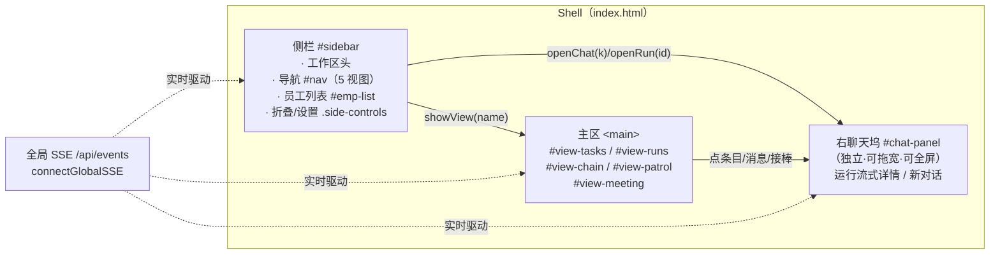
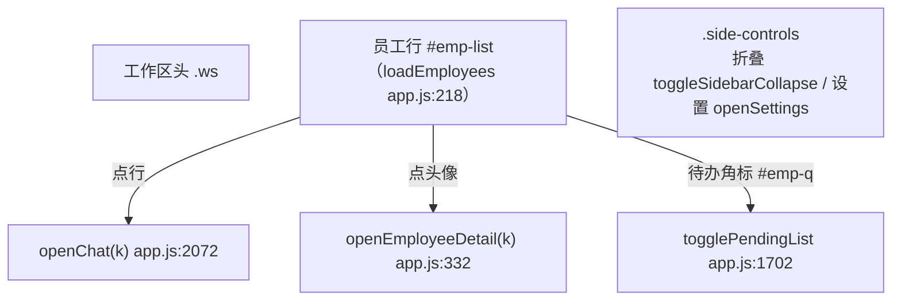
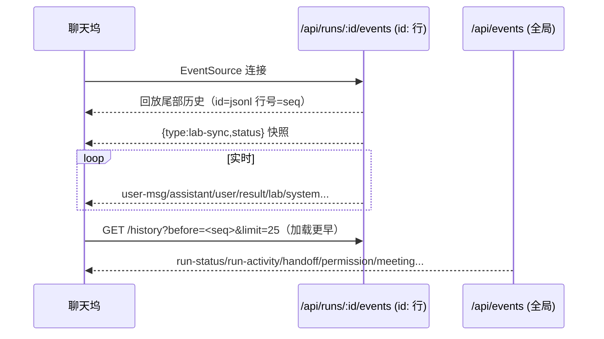
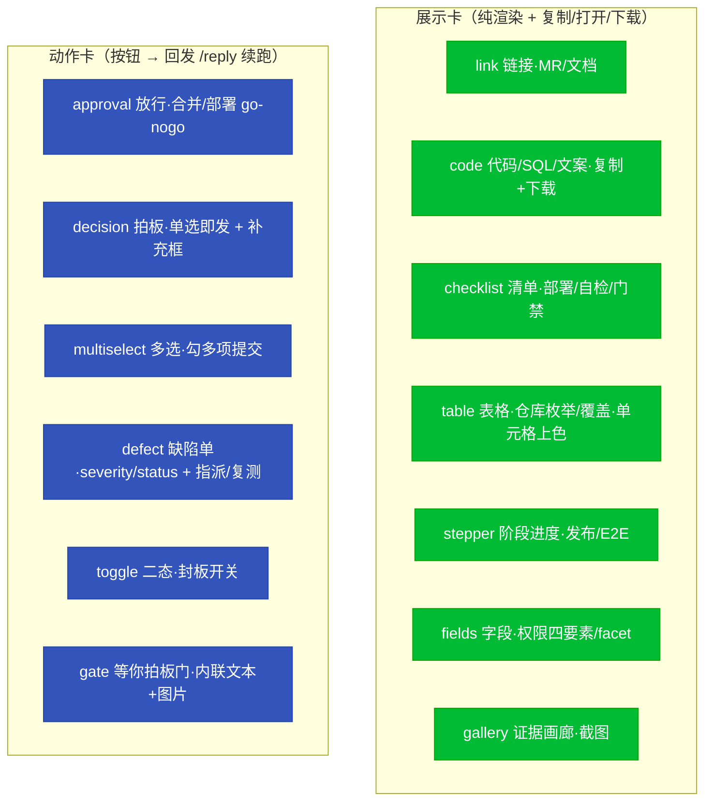
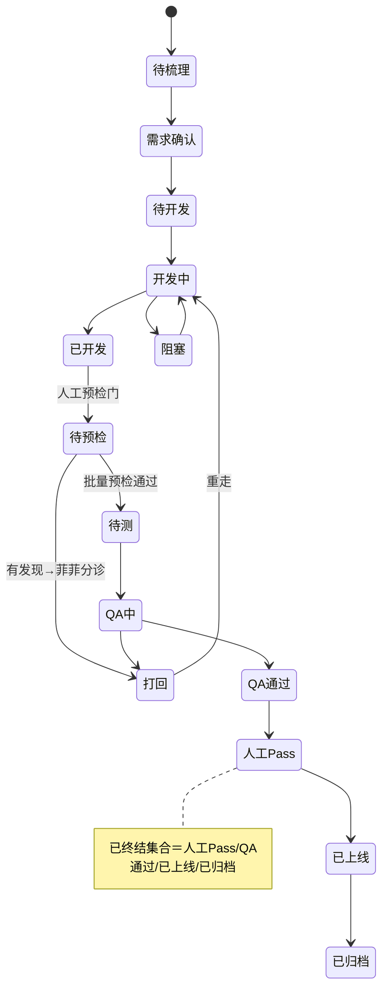

# 旧 UI（`app/public`）功能与 UX 拓扑 · 迁移基准

> **用途**：这是对**旧版人机界面**（`app/public/{index.html, app.js, cards.js, style.css}`，纯 JS 无构建）的**功能 + 交互 + 数据**全量梳理，作为新 UI（`web/`，React/shadcn）**对齐的事实基准**与回归清单。
> **来源**：逐文件通读 `app/public/**` + 交叉核对 `app/server.js` 的每个 `/api` 处理器与 SSE 广播；行号（`file:line`）为近似锚点，改动后以实际代码为准。
> **读法**：先看 §1 顶层拓扑建立全局，再按视图深入；§9 运行流式详情、§10 OLCards、§14 接口/事件、§15 状态机 是四个「重头」。

---

## 目录

1. [顶层拓扑（Shell 架构）](#1-顶层拓扑shell-架构)
2. [导航与视图地图](#2-导航与视图地图)
3. [侧栏 Sidebar](#3-侧栏-sidebar)
4. [任务视图（版本档案台账）](#4-任务视图版本档案台账)
5. [运行列表](#5-运行列表)
6. [会话看板 Chain](#6-会话看板-chain)
7. [巡检 Patrol](#7-巡检-patrol)
8. [会议室 Meeting](#8-会议室-meeting)
9. [运行流式详情 / 聊天坞](#9-运行流式详情--聊天坞)
10. [OLCards 富卡片体系](#10-olcards-富卡片体系)
11. [设置中心（7 面板）](#11-设置中心7-面板)
12. [弹窗 / 抽屉清单](#12-弹窗--抽屉清单)
13. [全局 / 环境系统](#13-全局--环境系统)
14. [数据与接口拓扑](#14-数据与接口拓扑)
15. [状态机](#15-状态机)
16. [前后端契约：标记哨兵与交接链](#16-前后端契约标记哨兵与交接链)
17. [localStorage / 快捷键 / 时序常量](#17-localstorage--快捷键--时序常量)

---

## 1. 顶层拓扑（Shell 架构）

三栏布局：**左侧栏**（导航 + 员工）｜**中主区**（5 个视图 section 切换）｜**右聊天坞**（独立于主区，切视图不关闭）。移动端左栏收成抽屉。



- 视图切换 `showView(name)`（`app.js:40`）+ 点击委托（`app.js:212`）；标题 `VIEW_TITLES`（`app.js:39`）；每视图**懒加载**。
- 聊天坞与主区**并存**：切 tab 不关闭聊天；聊天坞可拖宽（`#chat-resizer`，宽度存 `ol-chat-width`）、可全屏（`toggleChatExpand` `app.js:75`）。
- 首屏深链（`app.js:3796`）：`?theme=` / `?file=`（开文件弹窗）/ `?run=`（开某运行）。
- 顶部**网络进度条** `#net-bar`：包裹 `window.fetch`，任意请求在飞就显示（`app.js:26`）。
- 移动端顶栏 `#topbar` + 汉堡 `#menu-toggle` → `toggleSidebar`；桌面端无常驻顶栏。

---

## 2. 导航与视图地图

`#nav`（`index.html:39`）由 `data-view` 驱动，5 个主视图：

| 视图 | id | 展示什么 | 加载器 |
|---|---|---|---|
| **任务** Tasks | `#view-tasks` | 版本档案卡（版本→需求条目台账 + 健康条 + facet 覆盖 + 门禁点） | `loadTasks()` `app.js:744` |
| **运行** Runs | `#view-runs` | 所有 run 列表 + 状态药丸；`#nav-running` 在跑计数角标 | `loadRuns()` `app.js:1836` |
| **会话看板** Chain | `#view-chain` | 员工↔员工 / 用户 交接消息，按 `threadRootId` 归组 + 自动接棒开关 | `loadConversations()` `app.js:3456` → `renderChain()` `app.js:3485` |
| **巡检** Patrol | `#view-patrol` | 小呆呆(chaorenq) 巡查日志：谁被巡、续跑/升级、时间 | `loadPatrolLog()` `app.js:3462` |
| **会议室** Meeting | `#view-meeting` | 会议列表 + 直播多人会议室 | `loadMeetings()` `app.js:3572` |

---

## 3. 侧栏 Sidebar

始终存在。承载员工在线态、待办角标、巡查雷达、折叠与设置入口。



- **员工行**（`app.js:220`）：头像 + 名 + **在线状态徽标** `#emp-st-<k>`（`renderEmpStatus` `app.js:1645`）+ **活动行** `#emp-act-<k>`（实时「思考中… ~Nk」）+ **待处理队列角标** `#emp-q-<k>`。
- 点**行** → `openChat`（开该员工会话）；点**头像** → `openEmployeeDetail`（详情弹窗）。
- **巡查雷达**：仅 chaorenq 渲染光环/涟漪/圆点动画（`patrolRoam` `app.js:1755`，`renderPatrolRadar` `app.js:1747`）。
- **折叠侧栏** `toggleSidebarCollapse()`（`app.js:165`）：232px⇄64px 图标轨，存 `ol-sidebar-collapsed`。
- **设置齿轮** `openSettings()`（`app.js:176`）。
- **移动端抽屉**：汉堡 `#menu-toggle` → `toggleSidebar`；遮罩 `#sidebar-scrim`；滚动锁 `openSidebar/closeSidebar`（`app.js:132`）。

---

## 4. 任务视图（版本档案台账）

`loadTasks()`（`app.js:744`）。**一个版本档案 = 一张可折叠卡**，卡内是需求条目台账。这是新 UI 之前做偏（曾做成状态分列看板）、后已改回的形态。

### 卡头（版本级）
- **可折叠**，折叠态存 `olab.collapsedTasks`（`toggleTaskCollapse` `app.js:645`）。
- **健康条**：各状态计数（`app.js:872`，按 `ENTRY_ORDER` 排、带色点）。
- **facet 覆盖 chip** `covChipHtml`（`app.js:847`）：覆盖条 + `绿/总`。
- **三方会审 chip** `reviewChip`（`app.js:770`）、**stale chip** `staleChip`（`app.js:778`）、**里程碑/封板药丸**（`app.js:898`）。
- **门禁点**（12 gate）带富 hover popover（`app.js:760`，`GATE_LABEL` `app.js:531`，popover 引擎 `ensureOlpop/showOlpop/hideOlpop` `app.js:558`）。
- **版本下一棒** `versionNextHop()`（`app.js:940`）+「接棒·<员工>」按钮 → `dispatchStep(ti)`（`app.js:970`）。
- **快速派工头像行**（`app.js:868`）→ `openDispatch(k, file)`；**查看档案** `viewFile`（`app.js:1099`）；review-doc 按钮。

### 条目行（每条需求）
状态点（`entryState` `app.js:504`，注意 `normState` 会 `.replace(/\*\*/g,'').trim().toUpperCase()`）· `#REQ/BUG` 号 · 名称 · **优先级 chip**（P0–P3，从名称尾 `｜Pn` 拆）· **状态 chip** · **per-条 facet 覆盖条**（点开 facet 抽屉）· **球在谁手里** owner 头像 · 动作单元格。

- **facet 覆盖侧抽屉** `openFacetDrawer/closeFacetDrawer`（`app.js:723`）：逐 facet 行 `facetRowHtml`（`app.js:662`），证据链接开文件；`FACET_REG` 注册。
- **人工通过** `manualPassEntry`（`app.js:990`）→ `manualPass`（`app.js:978`，POST `/api/task/manual-pass`）；带 confirm。
- **批量预检**：`待预检/待复验` 条目出复选框（`manualActionButtons` `app.js:1006`）；浮条 `renderPrecheckBar`（`app.js:1025`）：
  - **预检通过·批量交 QA** `batchPrecheckPass()`（`app.js:1040`）：POST `/api/task/precheck {status:'待测', stage:'预检通过 → 待迷糊：QA'}` → **派 GG Bond 出一张交接卡交迷糊**。
  - **有发现·交菲菲** `batchPrecheckFinding()`（`app.js:1058`）：**不改状态**，`openDispatch('feifei'…)` 分诊。
  - 选择 `selEntries`/`toggleSel`/`clearSel`（`app.js:1015`），**批量限定同一档案**。
- **等你拍板/待办**：卡内 `pendingDecisions`（待确认事项）区（`app.js:832`）。

---

## 5. 运行列表

`loadRuns()`（`app.js:1836`）。行列表，点行 → `openRun(id)`。状态药丸 `runPill`/`RUN_PILL`（`app.js:1830`），**含「后台运行中·N」态**（`bgTasks`）。同时轮询巡检状态。`#nav-running` 在跑计数。

---

## 6. 会话看板 Chain

`renderChain()`（`app.js:3485`）。

- **自动接棒开关** `#cv-chain-enabled` → `toggleChain()`（`app.js:3420`，`/api/chain-config`）。
- **刷新**按钮 → `loadConversations()`；SSE 去抖刷新 `refreshChainSoon`（`app.js:3546`）。
- 按 `threadRootId` 归组、按最近排序、前 2 线程默认展开；消息行点击 → `openRun(toRunId)`；kind 徽标 `KIND_BADGE`（`app.js:3451`，含 派工/对话/**接棒/交回/受阅**/拦截/会议）。

---

## 7. 巡检 Patrol

`loadPatrolLog()`（`app.js:3462`）。倒序列出巡查 detect/resume 事件（从 `/api/conversations` 过滤），每行点击开最近的 chaorenq run。配 `/api/patrol-status`（enabled/sweepMin/graceSec/active/checking）+ 下次扫描倒计时/雷达。

---

## 8. 会议室 Meeting

列表 `renderMeetingsList`（`app.js:3582`）+ 房间 `openMeeting`（`app.js:3633`）。

- **列表**：卡片（编号/头像/状态药丸/议题/元信息/纪要链接）+「＋发起会议」。
- **发起** `openMeetingModal`（`app.js:3601`）→ `submitMeeting`（`app.js:3612`，POST `/api/meetings`）：议题/聚焦版本/参会人/主持/轮数（409 若已有进行中会议）。
- **房间**：返回、直播发言流 `mtAppendSpeech`（`app.js:3695`）、**轮次分割线**、纪要链接、打字指示、状态药丸、**结束** `stopMeeting`（`app.js:3742`）、**删除** `deleteMeeting`（`app.js:3753`）、老板**插话** `replyMeeting`（`app.js:3746`）。
- 事件源（关键·易踩）：`speaking` 指示来自**全局** `/api/events` 的 `meeting-speaking`；发言内容/轮次来自**本会议流** `/api/meetings/:id/events` 的 `speech`/`round`（详见 §14）。

---

## 9. 运行流式详情 / 聊天坞

`#chat-panel`（`index.html:101`）。**全 UI 最复杂处**。由 `openRun(id)`（`app.js:2105`）或 `openBlankChat(empKey)`（`app.js:2079`，空白新线程、首次发送才懒建 run）打开。

### 9.1 传输

- per-run seq = **`m.lastEventId`**（jsonl 行号），作翻页游标 `chatOldestSeq`（`app.js:2130`）。
- **加载更早**：`loadEarlier`（`app.js:2692`）沙盒化重渲染 `renderHistoryBatch`（`app.js:2666`）→ 前插 + 锚定滚动；按钮 `ensureLoadEarlierBtn`（`app.js:2718`）。回放阶段 `replaying` 抑制逐行自动滚动直到 `lab-sync`。

### 9.2 中央分发 `renderEvent(ev)`（`app.js:2732`）
| 事件 | 渲染 | 锚点 |
|---|---|---|
| `queued-accepted` | 清「排队中」标 | `app.js:2734` |
| `user-msg` | 用户气泡；**派工/抄送折叠成 chip**；沉浸式内联截图 `renderInlineShots`、聊天记录块 `chatlogBlockHtml`、附件图/文件解析 | `app.js:2735` |
| `lab` | 系统 chip；识别 收工/error 标记 → 置药丸 | `app.js:2780` |
| `lab-sync` | 回放结束标记 → 置药丸/停 spinner/重渲染待办权限卡/滚底 | `app.js:2789` |
| `system`/`init` | 会话开始 chip | `app.js:2800` |
| `assistant` | 遍历 `message.content`：`text`→`renderEmpText`（**markdown + OLCards 拆分 + `【等你拍板】` 合成 gate**）；`tool_use`→工具行 `addToolRow`（分组进可折叠 `.tool-group`；Task/Agent 记为子代理 `subAgentMeta`） | `app.js:2802` |
| `user`（tool_result） | 回填工具结果 + 耗时 `fillToolResult` | `app.js:2821` |
| `result` | 错误文本去重、置 done/error 药丸；**成功结果不单独出框**；刷 runs+tasks | `app.js:2834` |
- **子代理嵌套**（`app.js:1896`）：`parent_tool_use_id` 路由进可折叠 `.subagent-group`；`switchContext` 存/恢复工具组。
- **消息渲染件**：`msgRow`（`app.js:2237`，iMessage 分组 `applyGrouping`、逐气泡复制、日期分隔 `maybeDateSep`）；OLCards 内嵌 `cardRow`（`app.js:2446`，`cardCtx()` `app.js:2412`）；仓库 `.md` 路径自动链接 → `viewFile`（`linkifyRepoPaths` `app.js:2506`）；打字指示 `setTyping`（`app.js:2327`）。

### 9.3 聊天头 `renderRunHead`（`app.js:1962`）
头像+状态徽标 · 名 · **线程选择下拉** `toggleThreadMenu`（`app.js:2014`，`renderThreadMenu`）带 **置顶** `togglePin`（POST `/pin`）· **停止** `stopRun`（POST `/stop`）· **新线程** `openBlankChat` · **复制 runId** · **全屏** `toggleChatExpand` · **关闭** `closeChat`。（删除 `deleteRun` `app.js:2140` 存在但不在头部）

### 9.4 组合器 / 回复 `#reply-form`（`index.html:108`）
- 自增高 `autoGrowReply`；Enter 发送 / Shift+Enter 换行，**IME 三重防误发**（`app.js:3262`）。
- 提交 `sendComposed`（`app.js:3225`）：有 `currentRun`→POST `/reply`；否则 POST `/dispatch`（建 run）。处理 queued/takeover/409-busy。
- **附件**：`#attach-input` + 粘贴/拖拽上传（`uploadMany/uploadOne` `app.js:2915`，POST `/upload`）；附件 chip `renderAttach`。
- **＋聊天记录** `openChatlogPaste`（`app.js:1276`）；**＋预检单** `openImmersiveEditor`（`app.js:2985`，**仅菲菲** `syncPrecheckBtn`）。
- **派工 toggle** `toggleDispatchMode`（`app.js:3195`）+ 任务选择 `#r-task`。
- **⚡接管** `takeoverRun`（`app.js:2151`，POST reply `takeover:true`）；中断态 `enterInterrupting/exitInterrupting`。
- **置顶进度卡** `#pinned-card`（最新 stepper 镜像到顶，`pinProgressCard`）；**攒批条** `#card-batch-bar`（多卡一起发 `renderBatchBar`/`sendCardBatch`）。
- **巡视接管横幅** `#patrol-banner`（倒计时 + 取消接管 `cancelPatrolTakeover`，POST `/patrol-cancel`）。
- **内联权限审批卡** `permCard`（`app.js:2851`，`showPermCard`/`resolvePerm`，POST `/permission`）。
- 聊天坞拖宽 `#chat-resizer`（存 `ol-chat-width`）；loading spinner `#chat-loading`。

---

## 10. OLCards 富卡片体系

员工消息里嵌 ` ```olcard ` 围栏 JSON → 渲染成富卡片（`cards.js`；协议见仓库根 `消息卡片协议.md`）。

- **解析**：`FENCE` 正则（`cards.js:68`）；`parse()` 拆 md/card 段（`cards.js:102`）；`repairLenientJson` 宽松修复未转义引号/裸换行（`cards.js:76`）。多卡 + 卡文混排。`hasCard`（`cards.js:69`）。「已处理」态存 `ol-card-acted`。公共 API `window.OLCards`（`cards.js:645`）。



- **动作卡纪律**：点击把预设 `reply` 回发给当前员工续跑（`postCardReply` → `/reply`）；点后置「已处理」并保留选择。**`onReply` 返回布尔——失败（如员工忙 409）不锁卡、可重试**（`cards.js:295`，2026-07-29 教训）。
- **动作规格归一** `normAction`（`cards.js:265`）：字符串简写 = `{label,reply}`；缺 `reply` 回落 `label`。
- **攒批** `ctx.act`/`ctx.onSend`（`cards.js:281`）：一轮多卡暂存、一起发。
- `gate`：多由 `【等你拍板】<事项>` marker **自动合成**（空/「无」不合成）；自带文本 + 图片/附件内联输入。

---

## 11. 设置中心（7 面板）

统一弹窗 `#settings-modal`（`index.html:238`），左导航 `switchSettingsSection`（`app.js:182`），每次打开重取配置。

| 面板 | 字段（真键名，核对自 server） | 读/存/测 端点 |
|---|---|---|
| **通用** | 主题切换 `toggleTheme`；自动接棒开关 | `/api/chain-config` |
| **手机推送** | `enabled/barkUrl/iconBase/group/sound/on{done,error,interrupted}/scope(all\|dispatch)/aiSummary/approvalPush/labBaseUrl` | GET/POST `/api/push-config`；测 `/api/push-test` |
| **猪猪** | `enabled/baseUrl/docPath/injectFor[]/note`（**workspace 已移除**，由对接文档返回） | GET/POST `/api/zhuzhu-config`；测 `/api/zhuzhu-test`；开文档 `openZhuzhuDoc` |
| **企微渠道** | `enabled/botId/botSecret(写)/ragApiUrl/wsUrl/welcome/kbDailyQuotaDefault/kbWhitelistOnly/users{}` | GET/POST `/api/wecom-config`；测 `/api/wecom-test`、连通 `/api/wecom-connect-test`；状态 `/api/wecom-status`；已知用户 `/api/wecom/known-users` |
| **飞书需求表** | `appId/appSecret(写)/appToken/tableId/fields{}` | GET/POST `/api/lark-config`；字段 `/api/lark/fields` |
| **企微镜像** | `enabled/webhookUrl(写)/syncMin` | GET/POST `/api/wecom-mirror-config`；`/api/wecom-mirror/sync`、`/reset` |
| **消息卡片** | 全 OLCards 类型只读画廊 | `renderCardGallery`（`OLCards.DEMO`） |

- **写入密钥**用 `*Set` 布尔标识（`botSecretSet/appSecretSet/webhookUrlSet`）——「已设置·留空不改」。
- **连通测试**常返回 `200 + {ok:false, message, snippet}`，**失败也是 200**——UI 必须看 `ok` 字段、别一律报成功。
- **员工配置**（在员工详情弹窗，非设置）：`permissionMode` 选择（`PERM_MODE_OPTS` `app.js:247`）+ `iconUrl`，POST `/api/employees/:k/config`。**巡检配置**（仅 chaorenq）：`savePatrolConfig`（`app.js:3432`）POST `/api/chain-config`（patrolEnabled/patrolSweepMin/patrolGraceSec/patrolMax）。

---

## 12. 弹窗 / 抽屉清单

| 弹窗 | 元素 / 函数 | 端点 |
|---|---|---|
| 聊天记录粘贴 | `#chatlog-modal`；`confirmChatlog` `app.js:1295`（contenteditable，图片粘贴/拖入，`〘聊天记录〙` 哨兵） | — |
| 沉浸式预检单 | `#immersive-modal`；`sendImmersiveEditor` `app.js:3092`（图文穿插 `〖截图〗` + 引导行；仅菲菲） | `/upload` + `/reply` |
| 派工 | `#dispatch-modal`；`openDispatch`/`submitDispatch` `app.js:1579` | `/api/dispatch`（409 busy） |
| 发起会议 | `#meeting-modal`；`submitMeeting` `app.js:3612` | `/api/meetings` |
| 文件查看 | `#file-modal`；`viewFile` `app.js:1099`（md 渲染 + frontmatter） | `/api/file` |
| 员工详情 | `#emp-modal`；`openEmployeeDetail` `app.js:332` | `/api/employees/:k/detail`；`/config` |
| 设置 | `#settings-modal`（见 §11） | 各配置端点 |
| facet 抽屉 | `ensureFacetDrawer` `app.js:716`（右滑入） | — |
| 待办队列 popover / 富 popover | `app.js:1706` / `#olpop` | — |
| confirm 确认 | 人工通过 / 删 run / 镜像重置 / 停删会议 | — |

员工详情弹窗内含：概览+统计、巡检设置、通知头像、职责/红线、教训库、**在办事项**、**交接链**、**最近运行**、产出模板、Agent 定义（滚动 spy 导航 `edSetupObserver`）。

---

## 13. 全局 / 环境系统

- **通知/toast** `toast()`（`app.js:3392`，`#toast-host`），6s 自消。
- **SSE 实时驱动**：`connectGlobalSSE`（`app.js:3316`，错误 3s 重连）消费全部全局事件（见 §14）。
- **自动刷新**：`setInterval(loadRuns,15000)`、`setInterval(loadTasks,60000)`（`app.js:3794`）；去抖 `refreshSoon`（`app.js:3312`）。
- **主题**：`initTheme/applyTheme/toggleTheme`（`app.js:3291`）+ `<head>` 内联首绘防闪 + 状态栏色 meta。
- **移动端**：抽屉+滚动锁、软键盘避让（visualViewport `--kb` `app.js:3763`）、聊天全屏、宽度 clamp。
- **未读/角标**：`#nav-running` 在跑数、员工待办角标、员工状态徽标。
- **DOM 上限**：聊天裁到 `MAX_CHAT_ROWS=1500`（`app.js:2183`）从顶剪。

---

## 14. 数据与接口拓扑

### 14.1 HTTP 端点（`server.js`）

```
员工   GET /api/employees · GET /api/employees/:k/detail · POST /api/employees/:k/config
任务   GET /api/tasks · POST /api/task/manual-pass{file,kind:'entry',no} · POST /api/task/precheck{file,nos[],status,stage?}
运行   GET /api/runs · GET /api/runs/:id/events(SSE) · GET /api/runs/:id/history?before&limit
       POST /api/runs/:id/reply{message,kind,taskFile,takeover} · /stop · /pin{pinned} · /permission{reqId,behavior} · /patrol-cancel · DELETE /api/runs/:id
派工   POST /api/dispatch{employee,instruction,taskFile?,model?,kind?,callerRunId?}（409 employee busy）
会话   GET /api/conversations?limit · GET /api/pending · GET /api/patrol-status
会议   GET /api/meetings · POST /api/meetings · GET /api/meetings/:id/events(SSE) · POST /:id/reply · /:id/stop · DELETE /:id
文件   GET /api/file?path（text/plain） · POST /api/upload{data(dataURL),name}→{path,url,name,kind,mime}
通知   GET /api/notifications?since → {seq,pending[{reqId,runId,employee,employeeName,toolName,brief,ageMs}],events}
配置   /api/chain-config · /api/push-config(+/push-test) · /api/zhuzhu-config(+/zhuzhu-test) · /api/wecom-config(+/wecom-test,/wecom-connect-test,/wecom-status,/wecom/known-users) · /api/lark-config(+/lark/fields) · /api/wecom-mirror-config(+/wecom-mirror/sync,/reset)
健康   GET /api/health · /healthz
```

### 14.2 三条 SSE 流

| 流 | 格式 | 说明 |
|---|---|---|
| **全局** `/api/events` | `data:` only（type 在 JSON 里）；`: ping` 25s；载荷带 `_ts` | 首帧 `{type:'hello'}` |
| **单 run** `/api/runs/:id/events` | **`id:` 行**（=seq，`event.lastEventId`）+ `data:`；连时回放尾部 → `{type:'lab-sync',status}` → ping | 翻页游标来自 `id:` |
| **单会议** `/api/meetings/:id/events` | 同用 `id:` 行；连时回放 → `meeting-sync` | — |

**全局事件字典**（按 `type` 区分）：
```
hello · tasks-changed · conversation{ts,threadRootId,fromKind,from,to,toRunId?,kind,text,depth}
run-status{runId,employee,status,resultTail?,retriesExhausted?} · run-activity{runId,employee,activity}
run-queued{runId,queued} · run-bg{runId,tasks[]} · run-bg-settled{runId,taskId,status,summary}
run-stalled{runId,idleMs,thinkingBudget} · run-retry{runId,attempt,maxRetries,reason}
run-interrupting{runId} · run-pinned{runId,pinned} · run-deleted{runId}
permission-request{runId,employee,reqId,toolName,brief,title} · permission-resolved{runId,reqId}
pending-changed{employee,count,items} · handoff{from,to,kind?,fromRunId,runId,selfContinue?,queued?}
handoff-blocked{from,reason,text} · patrol-detected/escalate{from,runId,source,text} · patrol-resume{from,to,runId}
patrol-pending{runId,employee,deadline,graceSec} · patrol-cancelled{runId,employee,reason}
audit-shadow{from,runId,text} · audit-findings{from,runId,severity,text} · board-stale{runId,taskFile}
wecom-intake{item} · wecom-mirror-synced{count}
meeting-speaking{meetingId,speaker} · meeting-msg{meetingId,speaker} · meeting-status{meetingId,status} · meeting-deleted{meetingId}
```
**单 run 事件**：`user-msg{kind,text,queued?}` · `assistant{message,parent_tool_use_id,session_id}` · `user{message(tool_result),...}` · `result{subtype,is_error,result}` · `system{subtype:'init',model,session_id,permissionMode}` · `lab{text}` · `queued-accepted` · `lab-sync{status}`（`_seq` 仅 `/history` 带）。
**单会议事件**：`speech{speaker,displayName,role,text}` · `round{round,total}` · `meeting-start{...}` · `lab{text}` · `minutes{file,code}` · `meeting-end{status}`。

---

## 15. 状态机

### 15.1 需求条目生命周期（`ENTRY_STATUS_ENUM` server.js:947）

> 全部枚举：待梳理·需求确认·待开发·开发中·已定稿·待审·已开发·QA中·待QA·待测·待人工·待预检·待复验·人工Pass·阻塞·打回·QA通过·已上线·已归档。比对前必须 `**` 去噪 + trim。

### 15.2 版本门禁 gates（12，frontmatter.gates 布尔）
`tripartite_review · pm_confirmed · dev_confirmed · dev_selfcheck · dev_adversarial_swept · human_precheck_passed · qa_coverage_complete · qa_red_calibrated · qa_passed · released_test · released_prod · post_release_done`

### 15.3 facet 覆盖状态（`coverage.js`）
行级：`COVERED_GREEN · SOURCE_ATTESTED · BLOCKED_WITH_PROOF · HUMAN_INHERENT · UNCOVERED`；REQ 汇总 `reqRollup{counts{GREEN,SOURCE,HUMAN,BLOCKED,UNCOVERED},total,redPending,status,dot,flight,next}`。

### 15.4 run 状态
`starting → running → done|error`（+ 中断/停止过渡）；`/health` 把 `running+starting` 记为 live。run 还有 `bgTasks`（后台任务）独立于主状态。

---

## 16. 前后端契约：标记哨兵与交接链

**机器可读标记**（引擎唯一事实源，卡片不算数）：
- `【下一棒】<目标·结果>` → 看板接棒 / 自动接棒解析。
- `【交回】<给委托者的结果>` → 回发委托会话（call/return）。
- `【等你拍板】<事项>` → 前端合成 gate；空/「无」不合成。
- `【抄送】…` → 并行知会（cc/受阅）。
- `【派工】…` → 派工注入前言（UI 折叠成 chip）。

**正文哨兵**（供渲染识别、对员工无害）：
- `〘聊天记录〙…〘/聊天记录〙` → 折叠聊天记录块（内可含截图）。
- `〖截图〗<path｜name>〖/截图〗` → 内联出图（path `office-lab/app/uploads/x` ↔ url `/uploads/x`）。
- `[附件]` 行 → 附件。

**交接链**：`threadRootId` 贯穿一条交接链；`callerRunId`/`depth` 记委托与深度；`handoff`/`handoff-blocked` 广播接棒与被拦（depth/unresolved/target-busy/self-chain-cap/cc-fanout-cap/coverage-incomplete…）。

---

## 17. localStorage / 快捷键 / 时序常量

- **localStorage**：`ol-theme` · `ol-sidebar-collapsed` · `ol-chat-width` · `olab.collapsedTasks` · `ol-card-acted`。
- **快捷键**：Enter 发送 / Shift+Enter 换行（IME 三重防误发）；Esc 关线程菜单 / facet 抽屉；decision/gate/multiselect 输入框 Enter 提交；会议回复 Enter。
- **时序**：runs 轮询 15s · tasks 60s · 去抖 150/200/250ms · 巡查动画 5s · toast 6s · SSE 重连 3s · SSE ping 25s · 聊天 DOM 上限 1500 行 · 卡死接管阈值 `STALL_TAKEOVER_MS=180s`。

---

### 关键源码指针
- 旧前端：`app/public/app.js`（行为）· `app/public/cards.js`（OLCards）· `app/public/index.html`（骨架）· `app/public/style.css`（`.ol-card*`）。
- 后端契约：`app/server.js`（路由 `http.createServer` @ `:4150` 起，`json()` @ 4141，全局广播 `broadcast` @ 2300，单 run `appendEvent` @ 2761）· `app/coverage.js`（facet 覆盖）。
- 协议：仓库根 `消息卡片协议.md`（OLCards）· `文档格式规范.md`（frontmatter/条目表契约）· `消息卡片协议.md`。
- 新 UI 对齐现状与差异：见本目录同级 `../README.md` 与仓库根 `CHANGELOG.md`「新 UI」条目。
